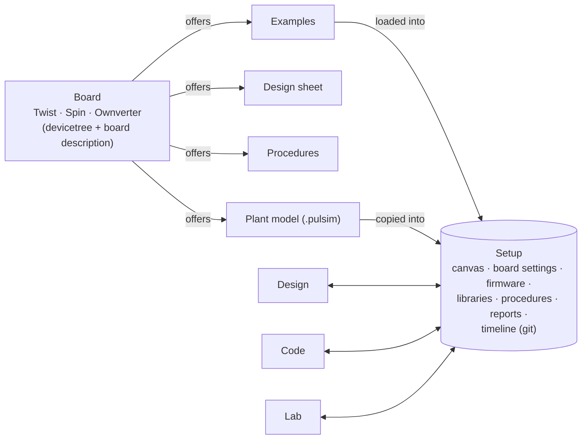
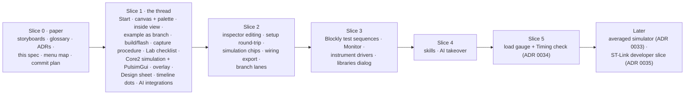

# OwnStudio: specification

*Version 2.0, 2026-11-10. LGPL-2.1. Author: Luiz Villa (LAAS-CNRS / IUT A GEII), with Claude.*

OwnStudio is a desktop application for power electronics, built on Eclipse Theia (the framework behind Arduino IDE 2 and TI's Code Composer Studio 20) and on the OwnTech open hardware and software stack. A user picks a board, wires it into a setup with a source and a load, loads an example, builds and flashes it, measures, simulates the same thing and sees both together, changes the design or the code, and runs again, without leaving the tool.

Version 2.0 follows Luiz's trial of 2026-11-10 ([notes](docs/design/trial-2026-11-10-notes.md)), which found version 1.0 cumbersome, and ten more rounds of decisions (rounds 11–20 of the [decision log](docs/decision-log.md)). Each decision links to its record ([ADRs](docs/adr/)). Terms in **bold** are defined in the [glossary](GLOSSARY.md). The [storyboards](docs/design/storyboards.html) show every screen described here.

**What changed from 1.0:** the board, not a mission, is where everything starts; a setup canvas at the bottom replaces Home; the Lab gets drawn test sequences; simulation follows Core2's pattern with PulsimGui as the circuit editor; setups are git repositories shown as a timeline; the AI is the user's own coding agent.

---

## 1. The problem

Taking a power converter from idea to tested prototype today means crossing several tools that don't share anything:

- a simulator (PLECS, Simscape, PSIM) for the power stage;
- a control-design tool (MATLAB, TI Compensation Designer) for the loop;
- an IDE (VS Code + PlatformIO, Code Composer Studio) for the firmware;
- scripts, notebooks and instrument GUIs for the lab.

The requirement lives in a document, the simulation result in one tool, the measurement in another. Comparing them is manual work done at the end, if at all. For students this fragmentation is the main obstacle. For researchers it's a source of untraceable results.

## 2. Who it is for, and what it must do first

The first users are colleagues and PhD students at LAAS, then students. The objective of the next steps is Luiz's (Q70):

> A colleague or PhD student, with a Twist on the bench, simply finds out how to:
> 1. drag and drop the three elements: source, Twist and load;
> 2. click on the inside of the Twist to set it up;
> 3. load an example;
> 4. build and flash it;
> 5. set up a simple procedure: switch on and retrieve a firmware scope capture, such as a step response;
> 6. load the simulator with the same parameters, and see its circuit;
> 7. simulate, with the results drawn over the measurement;
> 8. change a parameter in Design;
> 9. run the procedure again, change the code if needed, and so on;
>
> all in the same tool.

**Good enough** is the bar: Luiz uses OwnStudio end to end, in one or two hours of testing, without hitting problems he could have caught himself. Only then do PhD students try it (Q114).

## 3. The core idea: a board, a setup, three workbenches



- The **board** is the root ([ADR 0025](docs/adr/0025-the-board-is-the-root.md)). Choosing it, on the Start page, offers its examples, its design sheet, its procedures and its plant model.
- The user's work lives in a **setup**: one folder, one git repository, holding the canvas (source, board, load), the board's settings, the firmware, the libraries, the procedures, the reports and the history.
- Three **workbenches** are views of the setup: **Design** (sizing and control law, no firmware runs), **Code** (the firmware), **Lab** (procedures on a target).
- **Simulation is a target, not a workbench** ([ADR 0003](docs/adr/0003-simulation-is-a-target-not-a-workbench.md)): the same procedure runs on the simulator or on the board.
- A **tutorial** is an optional guided walk over a setup. The buck example's guided steps from 1.0 become the first tutorial, rewritten after slice 1.

## 4. Describing a converter: five blocks, ports and the environment

Every board is described with the same five **converter blocks**, OwnStudio's main teaching device. On the setup canvas they are the inside of the board node.

- **Power**: switches, filters, protection devices, power connectors, thermal interfaces, and the hot side of the sensors.
- **Measurement**: receives the sensor signals, conditions and amplifies them, and delivers them to the controller's pins.
- **Controller**: the microcontroller with its ADCs, communication, PWM generation, and relay and trip commands. ("Control law" is the mathematics it runs.)
- **Driver**: turns PWM into switch commands.
- **Auxiliary power supply (APS)**: supplies the other blocks.

Measurement, driver and APS are the **bridge blocks**; an **isolation barrier** can only cross them.

The converter exchanges energy with the **environment** through **power ports**, named for what is connected to them (HIGH, LOW1, LOW2 on the Twist), not "input" and "output". On the canvas the environment is made of parts: a **source**, a **load**, and later **instruments**.

## 5. The window

```
┌──────────────────────────── title bar (OwnTech green) ────────────────────────────┐
│ File  Edit  Setup  Board  Lab  History  View  Help          [board: Twist ✓]     │
├──┬─────────────┬──────────────────────────────────────────┬───────────────────┬──┤
│De│ LEFT PANEL  │                CENTRE                    │   RIGHT PANEL     │Pa│
│Co│ per bench   │  the work itself                         │ Parts · Inspector │In│
│La│             │                                          │ · AI (one shown)  │AI│
│  │             ├──────────────────────────────────────────┴───────────────────┤  │
│  │             │ BOTTOM: [Canvas | Terminal]  setup canvas, tinted per bench    │  │
│⚙ │             │ ● ─ ● ─ ● ─ ◆ ─ ●   timeline                         [>_]      │  │
├──┴─────────────┴────────────────────────────────────────────────────────────────┴──┤
│ status: Twist 1.4.2 · firmware 584efeb ✓ · Lab checklist 6/6 · progress           │
└────────────────────────────────────────────────────────────────────────────────────┘
```

- **Left icon bar:** the workbenches, Design, Code and Lab (Q74). Settings at the bottom.
- **Left panel:** changes with the workbench: Design's sheets; Code's files (the student's files first, the libraries read-only below); the Lab's procedures and its checklist.
- **Centre:** the work itself: Design's live forms and plots; the code editor; the Lab's test sequence editor, results and overlay.
- **Right icon bar and panel:** **Parts** (the palette to drag from), **Inspector** (opens on its own when something is selected), **AI** (the agent's chat). It works the same in every workbench: opening Parts from Code swaps the right panel and nothing else moves; a part dropped on the canvas is a timeline dot (Q142).
- **Bottom:** the **setup canvas**, always present, with its background tinted by workbench (Design, Code, Lab, Simulate); beside it a **Terminal** tab, opened from View → Terminal or the button at the bottom, in the setup folder with OwnStudio's Python and toolchain on the path (Q136), and a **Build output** tab with PlatformIO's own log; under them, the **timeline** strip.
- **Status bar:** Build, Upload and Serial monitor buttons (as PlatformIO's), the board and its identity, the firmware match, the Lab checklist, progress of builds, flashes and simulations.
- **Icons, not letters,** on both icon bars.
- **Title bar** in OwnTech green, not Theia's grey.

**Start page** (replaces Home): shown when no setup is open. A grid of boards with the connected one highlighted (as Arduino IDE 2 detects boards), recent setups, the chosen board's examples, and tutorials. Picking a board installs or updates its board definition and opens a new setup with the board on the canvas.

**Menus** (Q130). Theia's own Selection, Go and Terminal menus are removed; every menu item has an owner in the code, so nothing appears by accident.

| Menu | Items |
|---|---|
| File | New setup…, Open setup…, Open recent ▸, Examples ▸ (the board's examples), Save, Save all, Export ▸ (report, wiring diagram), Preferences, Quit |
| Edit | Undo, Redo, Cut, Copy, Paste, Find, Replace |
| Setup | Add part ▸, Libraries…, Check setup, Wiring diagram, Simulation sheet, Open in PulsimGui |
| Board | Select board…, Boards manager…, Build, Flash, Build and flash, Board info |
| Lab | Run procedure, Stop, Run on the simulator, New procedure, AI takeover (only when enabled), Reports |
| History | Milestone…, Restore…, New branch…, Pull, Push, Remotes…, Propose upstream… |
| View | Design, Code, Lab, Parts, Inspector, AI, Canvas, Timeline, Terminal, Zoom ▸ |
| Help | Tutorials, Documentation, Board datasheet, Report a problem, About |

## 6. The setup canvas and the inspector

([ADR 0026](docs/adr/0026-setup-canvas.md); [style board](docs/design/canvas-styles.html))

- **Nodes with typed ports.** Parts are dragged from the Parts palette: a DC source, the Twist, a resistor. Each node shows its values and live state (the source: 30 V set, 29.9 V measured). Power ports accept only power wires.
- **Topology rules, first version:** exactly one source on HIGH, one Twist, one load on LOW1 (LOW2 may share it). A wire that breaks a rule doesn't snap, and the canvas says why (Q82).
- **Two levels.** Double-click the Twist (or "open") to see its inside: the five blocks on Luiz's reference layout ([drawing](docs/images/five-blocks-reference.png)): power side and control side, the feeder in the centre, signals looping clockwise (power → measurement → controller → driver → power), the isolation barrier between the grounds, the power ports on the power block. The blocks carry their names only, to keep the view light; clicking one shows its details in the inspector, from the devicetree (legs, mode, frequency, dead time, calibration) (Q143). The inside view and a read-only inspector come in slice 1; editing in slice 2.
- **Inspector.** Any node or inner block, when selected, shows its settings, its requirements and their test states, and three buttons: **Design**, **Code**, **Tests** (Q73).
- **Requirement layers** (Specification, Verification), for setups that carry requirements, become **badges** on the blocks of the inside view (a count of requirements, coloured by their worst test state) and a **list in the inspector** for the selected block (Q144).
- **The canvas follows the workbench.** Design shows values; Code shows which file and function each block maps to; the Lab shows **probes** and live readings; Simulate shows fidelity chips.
- **Probes** are placed on a node, a block or (later) a Spin pin. Each probe is either **Monitor** (slow, blue) or **Capture** (fast, amber).
- **Round-trip with the code** ([ADR 0027](docs/adr/0027-setup-round-trip.md)): the board's settings live in one marked setup function in `main.cpp`. On save, recognised SDK calls flow both ways; anything else in the function is shown as custom code and left alone.
- **Instruments** (an oscilloscope probing a Spin pin) are in the data model from the start, in the interface after slice 1.

## 7. Design workbench

Design covers hardware sizing as well as control ([ADR 0006](docs/adr/0006-design-workbench-includes-hardware-sizing.md)). It is a set of **sheets** offered by the board, each a live form, not code (Q75):

- **Output filter**: sliders and fields for L, C, switching frequency and load step; ripple and undershoot update live against the requirement lines; the Twist's own values are marked.
- **Control loop**: Kp and Ti on a Bode plot with margins; "Apply" writes the gains into the code.

Python still computes every number (the sheet's script runs on each change, about 0.1 s), and a "Show the formulas" link opens the script. A changed value that the canvas or the plant model also holds (for example L) updates them too.

## 8. Code workbench

- **Language support** for C++ and Python: colouring, completion, go to definition (Ctrl+click), snippets. It comes from VS Code extensions run through Theia's plugin system (clangd, a Python language server), which OwnStudio did not have in 1.0.
- **The student's files first** (Q76): `main.cpp` (its setup function is shared with the canvas) and `control.cpp` (the control law, hardware-free, simulated as written, [ADR 0018](docs/adr/0018-skeleton-simulates-a-hardware-free-control-function.md)). "Show all files" reveals the rest. The libraries are listed below, read-only by default, so the user and the AI can read Core.
- **Data objects** are declared in `data_objects.yaml`, from which the C is generated ([ADR 0021](docs/adr/0021-data-objects-yaml-generates-c.md)); ThingSet replaces the communication task ([ADR 0019](docs/adr/0019-thingset-replaces-the-communication-task.md)).
- **Build identity** (commit, dirty flag, binary hash) is compiled in and reported by the board.
- **Build and upload** from a toolbar above the editor (Build, Upload, Build and upload, Clean, Serial monitor), from the status bar or from the Board menu. PlatformIO's log goes to the Build output tab; progress shows compile steps, then bytes uploaded out of the total.
- **Timing on the Spin** (slice 5, after slice 4, [ADR 0034](docs/adr/0034-timing-check-and-load-gauge.md); [storyboard T-1…T-9](docs/design/timing-storyboard.html), local). There are two levels:
  - **The load gauge** in the status bar, also a badge on the Controller in the inside view. It shows the critical task's worst run as a % of the control period, from built-in ThingSet data objects: green under 60 %, amber up to the budget (80 % of the period), red above it, never colour alone.
  - **The Timing check** (build toolbar, Board menu, Lab procedures). It flashes a TIMING image of the same code over USB with PWM outputs inhibited and no power, walks the firmware's states, reads the report over ThingSet, files a record and puts the user's firmware back.

  Its results show in a Timing bottom tab: one stacked bar per state (task API, sensor reads, the user's code and its `OWN_TIMING` sections, PWM writes, unprobed rest), the budget and the period as dashed lines, the worst tick marked, the previous run paired above, a detailed view and a table. A CodeLens gives each `OWN_TIMING` section's cost. Agents may run it. ST-Link (SWD) support for developers comes later ([ADR 0035](docs/adr/0035-st-link-probe-support.md)).

## 9. Lab workbench

- **Procedures.** A procedure is the setup check, a **test sequence**, and the handling of the data afterwards (a test record and a light report). The default procedure offered by the board is a **capture**: arm the firmware scope on the chosen probes, switch on, step the reference, read the capture into the setup's records folder, switch off (Q83).
- **Test sequences** are drawn in Blockly ([ADR 0029](docs/adr/0029-test-sequences-in-blockly.md); [mock-up](docs/design/test-sequence-blockly.html)): nested blocks, user-defined blocks used as one line, collapse, variables dragged from the setup. The editor generates readable Python; hand edits become custom steps.
- **Monitor and Capture** (Q90, Q99). Capture uses the firmware scope (fast, triggered: step responses, later Bode by injection). Monitor reads data objects periodically over ThingSet and shows them on widgets and rolling plots in the style of modular's panels ([ADR 0024](docs/adr/0024-panels-rebuilt-natively-modular-format-subset.md)), for state machines and slow algorithms. Amber and blue everywhere: probes, plot frames, blocks. They never share a plot.
- **The Lab checklist** runs continuously when the Lab is open and stays visible (Q86, Q93):
  1. the board is connected and is the board on the canvas (a Twist, not a bare Spin);
  2. it runs the setup's firmware;
  3. HIGH is within 10 % of the canvas source;
  4. the outputs are inside the limits;
  5. a load is set;
  6. the procedure is valid.

  Run is green only while every line holds; a line that fails turns the button red again and explains itself in one sentence.
- **Results** are interactive plots (zoom, pan, cursors, channels on and off), opened zoomed on the event with the whole run one click away (Q77). The simulation is drawn over the measurement.
- **Instrument drivers.** Source and load nodes can carry a driver (Python, for example SCPI through pyvisa) that a sequence calls. Without one, the sequence asks the person ("Load on LOW1?"). The hook comes now; real drivers later, from existing projects (Q98).
- **Testing vocabulary** stays Core2's ([ADR 0020](docs/adr/0020-core2-testing-vocabulary-with-l2.md)): test case, campaign, record, findings, levels L0–L2. Requirements and pass/fail are available for setups that carry them.

## 10. Simulation

([ADR 0028](docs/adr/0028-simulation-follows-core2.md))

- **One plant file.** The board ships a `.pulsim` plant (the Twist buck on leg 1), copied into the setup. The student's control code is compiled into a Pulsim **C-Block** in it, as Core2 does with `controlStep`.
- **One runner.** OwnStudio's runner loads the file, applies the setup's values to named components (source voltage, load, L, C), the setup function's recognised values (frequency, dead time, control period), runs the procedure and files the record.
- **PulsimGui is the circuit window.** Setup → Open in PulsimGui launches it (installed with pip in OwnStudio's environment) with an OwnStudio backend, so its Run button calls the same runner and gives identical results. Saving in PulsimGui writes the setup's `.pulsim`; OwnStudio syncs the named values back to the canvas; a structural change shows as "custom circuit".
- **The simulation sheet** is the canvas in its Simulate tint: one sentence says what the control receives ("V_LOW1, I_LOW1, V_HIGH every 100 µs, ideal"), and each block carries a fidelity chip: green (as on the board), yellow (simplified, such as ideal sensors), hatched (not simulated, such as the APS). A click on a chip gives the detail in the inspector. Code in `main.cpp` outside the setup function is listed as board-only.
- **Other simulators** (PLECS, MATLAB) can be added behind an external-simulator interface later.
- **Later: an averaged simulator** ([ADR 0033](docs/adr/0033-averaged-simulator-for-fast-evaluation.md), deferred until after slice 4), as Core2 proposes: a third target where each leg is replaced by its duty-weighted average, running the same procedure and the same control code in seconds instead of minutes. It is for trying ideas only: never a verdict on a requirement, used only when the user asks (never on the AI's initiative), filed at test level D as INFO, and labelled "averaged" everywhere.

## 11. Wiring diagrams

Each board ships its draw.io wiring and circuit diagrams as templates, one per topology (the Twist documentation already has buck, buck single leg, buck independent, boost, inverter and PFC). OwnStudio picks the template matching the canvas, fills its placeholders (supply setting, load value), turns layers on or off (a load on LOW2, a probe), shows it in Setup → Wiring diagram, and exports it with the circuit diagram as SVG or PDF. Nothing is routed automatically; a canvas with no matching template says so. Adding a topology means drawing one more template (Q109).

## 12. Boards, examples and libraries

- **A board definition** is the board's devicetree overlay in Core plus a small **board description** ([ADR 0032](docs/adr/0032-boards-from-the-devicetree.md), refining [ADR 0017](docs/adr/0017-board-descriptions-in-hardware-repos.md)). The overlay gives legs, pins, defaults and sensors (read with Zephyr's Python devicetree library); the board description gives the drawing, the ports and ratings, the `.pulsim` plant, the wiring templates, the recognised setup calls, the default capture procedure and the AI skills. A custom board is an overlay plus a board description. The Spin's header map makes pins addressable by name.
- **Boards manager** (Board menu), as in Arduino IDE 2: install and update boards; the Twist ships with the installer.
- **Examples** are read from the OwnTech examples repository's index (38 today), filtered by the board on the canvas. The board is inferred from the group name and `app.ini` until a `board` field is added upstream through Luiz's fork (Q128). Loading an example puts its files into the setup on a new branch named after it (§13).
- **Examples need nothing for OwnStudio.** The board's defaults make any example usable at once (plant, capture procedure). An example may ship extras in an `ownstudio/` folder: only the buck example, for now.
- **Libraries** are chosen in Setup → Libraries…, a checkbox list of every OwnTech library with the board's recommended set checked. Each is a git submodule in the setup's `libs/` (§13), and `lib_deps` in `app.ini` is kept in step so the VS Code build still works.

**A setup is a clone of OwnTech Core** (confirmed by Luiz after slice 0): OwnTech projects already are Core checkouts with the application in `src/`, and "pulling updates from other cores" is git with several remotes (Core4 has OwnTech's, Luiz's and Jean's). OwnStudio adds its files beside Core's, so the devicetree is read from the setup's own Core and the VS Code flow keeps working in the same folder. A setup on disk:

```
~/OwnStudio/twist-buck/            one git repository: a clone of Core
├── platformio.ini  zephyr/  owntech/   Core itself (zephyr/boards/... holds the devicetree)
├── src/                           firmware: main.cpp (setup function), control.cpp,
│                                  data_objects.yaml, app.ini, app.conf, app.overlay
├── libs/                          submodules: control_library, scopemimicry, …
└── ownstudio/
    ├── setup.yaml                 canvas: parts, wires, values, probes; board and version
    ├── plant/twist_buck.pulsim    the plant, from the board
    ├── procedures/                *.py (generated) + *.blockly (layout)
    ├── reports/                   light HTML reports, committed
    ├── records/                   raw captures, ignored by git
    └── origin.yaml                the example's origin (repository, commit)
```

Remotes: `owntech` (OwnTech's Core), the user's fork, colleagues' cores, added from History → Remotes.

## 13. Setups and git

([ADR 0030](docs/adr/0030-setups-are-git-repos.md))

- **Timeline.** A strip under the canvas shows the setup's commits as dots, with icons for what happened: example loaded, build, flash, run (pass or fail), simulation, setup change, design change (a value or gains chosen on a Design sheet), and named **milestones**. OwnStudio commits automatically at those moments. A click previews that state (canvas, code diff, records); "Restore here" returns to it; editing from an old dot starts a branch. Branches are supported from the start; lanes in the interface come in slice 2.
- **Libraries as submodules**, managed by OwnStudio, so each dot pins the library commits too. A library can have several remotes (upstream, your fork, colleagues' forks): fetch them, see their branches, cherry-pick, import a clone already on disk as a remote, propose upstream as a fork and pull request (the AI can prepare it), create a local library from a template.
- **Examples load as branches;** the previous work stays one click away. No `old/` folder.
- **Records stay out of git;** reports go in. Reproduce from the commit, share the report (Q123).
- **Merge rules:** the tree is always clean; pull only fast-forwards and diverged work lands on its own branch; merges are tried in a separate worktree and open a three-way merge editor on conflict, with Abort always available; library conflicts are a choice between two commits, and `setup.yaml` is merged key by key.
- **Sign-in:** GitHub or GitLab in the browser; HTTPS with the token; "Use SSH instead" generates a key and uploads it through the API; existing keys and settings are used as they are. Push checks that every pinned library commit is on a remote and offers to push it to the user's fork.
- The full git view (diffs, branches, merge editor, pull requests) comes from VS Code's git extension and GitHub's pull-request extension, through the plugin system.

## 14. Safety

Safety covers three concepts: the **safety envelope** (operating limits per power port), **protection chains** (what detects and acts), and the **isolation barrier** (built into the structure). One safety envelope feeds firmware trips, instrument limits, simulator assertions and component ratings ([ADR 0009](docs/adr/0009-one-safety-envelope.md)); it sits at or below the **board ratings**. The teaching profile caps the Twist's HIGH at 60 V, marked "indicative, not certification".

What 2.0 adds:

- The run's **operating profile** comes from the canvas (source voltage and current limit, load), with the details (envelope limits, stop thresholds, scope rate) in the Lab.
- The **Lab checklist** (§9) refuses a run on the wrong board, the wrong firmware or a dead or mismatched HIGH. The trial showed why: a run started on a bare Spin with HIGH at 0.24 V.
- **Power only through OwnStudio** ([ADR 0031](docs/adr/0031-ai-agents-and-takeover.md)): the runner refuses to switch the converter on without a one-time token from OwnStudio's confirmation dialog, whoever started it.

## 15. The AI agent

([ADR 0031](docs/adr/0031-ai-agents-and-takeover.md))

- **The user's own agent.** Claude Code and OpenAI Codex through Theia AI's integrations, signed in with the user's own Claude or ChatGPT account, as in VS Code.
- **Skills** ship with the board definition (an `AGENTS.md` and a skills folder). Core, as checked out in the setup, is the source of truth for the API; skills keep what Core doesn't say. First three: OwnTech SDK setup calls; the Twist (ports, ratings, wiring, safety); tuning a buck controller.
- **Autonomy** ([ADR 0010](docs/adr/0010-ai-agent-autonomy-levels.md), amended): the agent may edit files, run Design sheets, run the simulator and read records freely. It cannot switch power on its own: only the token can.
- **AI takeover.** A button, shown only when enabled in the settings and a test sequence exists, apart from Run and in its own colour, hands the agent a power token for that one sequence for 30 minutes. Any red checklist line, any setup change, or Stop revokes it. The dialog states that someone must stay at the bench.
- **A light local model** specialised in power electronics is a separate research track: skills and retrieval on a small local model (through Theia AI's Ollama support), measured on an OwnTech question bank, fine-tuned only if needed.

## 16. Platform and delivery

- **A custom Theia application** ([ADR 0005](docs/adr/0005-custom-theia-application.md)) with Theia's **plugin system** added, which brings VS Code extensions: C/C++ and Python language support, git, pull requests.
- **Desktop only**, Windows first, Linux second ([ADR 0007](docs/adr/0007-desktop-only-v1.md), [ADR 0011](docs/adr/0011-windows-first-linux-second.md)).
- **An installer** bundling Python with Pulsim, PulsimGui and OwnStudio's Python packages, a portable C/C++ compiler ([ADR 0015](docs/adr/0015-bundled-host-compiler.md)), the firmware toolchain, git, and the Twist board definition.
- **The interface is in English.**

### Out of scope for now

- Hardware other than OwnTech ([ADR 0001](docs/adr/0001-owntech-only-scope.md)).
- Topologies other than the buck on the Twist (they come as canvas rules, plant files and wiring templates).
- A schematic editor inside OwnStudio (PulsimGui is the editor).
- A browser version, macOS.
- Running the full OwnTech API in simulation ([ADR 0016](docs/adr/0016-simulation-backend-inside-the-core-api.md), deferred).

## 17. How OwnStudio compares

| | Typhoon HIL | PLECS | imperix | TI | Arduino IDE 2 | **OwnStudio** |
|---|---|---|---|---|---|---|
| Starts from | A schematic | A model | A model | A reference design | A board | **A board, wired into a setup on a canvas** |
| Firmware | Outside the tool | Generated | Generated | Hand-written | Hand-written | **Hand-written or AI-written, simulated as written** |
| Sim ↔ bench | HIL hardware | RT Box | Execution-purpose switch | No | No | **Same procedure on both targets, overlaid** |
| Test sequences | Python (TyphoonTest) | Scripts | Scripts | No | No | **Drawn blocks that generate Python** |
| History | Files | Files | Files | Files | Files | **A git timeline with branches, libraries pinned** |
| Hardware sizing | No | Sweeps | No | Adapts designs | No | **Live sheets, compared with the real board** |
| Safety | Separate settings | No | No | No | No | **One envelope; power only through a confirmed token** |

The decision-by-decision comparison of 1.0 is in [docs/benchmark.md](docs/benchmark.md).

## 18. Open items

- **Exact PWM edges on the C-Block path:** the Pulsim fix (#12) was written for `switch_fn`; to check before slice 1's simulation is trusted. The Pulsim issue draft still waits for Luiz.
- **PulsimGui's backend hook:** Core2 replaces a private method (`BackendLoader._discover_candidates`) to register its backend. A public entry point should be asked of PulsimGui's author.
- **Browser sign-in** needs an OAuth application registered with GitHub and GitLab: under which account (OwnTech's)?
- **The examples repository's `board` field:** a pull request through Luiz's fork.
- **The Twist board description** starts in this repository and moves to the TWIST repository.
- **Twist documentation:** the high-side range is given as 100 V and 110 V, the minimum as 10 V and 12 V.
- **Bench findings from step 4:** sensor calibration (#14), the clamp current readings (#15).
- **The Windows installer** (#5).
- **Timing check, firmware side:** the PWM output inhibit, the `OWN_TIMING` scope semantics and the load objects are built and measured in Luiz's Spin API fork first; upstreaming waits for that trial and Jean's review (ADR 0034).

## 19. Plan

Slices, each finished before the next starts. Details and the commit plan are in [docs/plan.md](docs/plan.md).



The 1.0 interface gets no more fixes (Q112); what it lacked (progress, language support, interactive plots, the checklist) is built into the new work.

## Decision index

| ADR | Decision |
|---|---|
| [0001](docs/adr/0001-owntech-only-scope.md) | Only OwnTech hardware |
| [0002](docs/adr/0002-one-shared-converter-project.md) | One shared converter project (superseded by 0025) |
| [0003](docs/adr/0003-simulation-is-a-target-not-a-workbench.md) | Simulation is a target, not a workbench |
| [0004](docs/adr/0004-text-plus-ai-no-visual-programming-in-v1.md) | No visual programming (superseded for the Lab by 0029) |
| [0005](docs/adr/0005-custom-theia-application.md) | Custom Theia application |
| [0006](docs/adr/0006-design-workbench-includes-hardware-sizing.md) | Design includes hardware sizing |
| [0007](docs/adr/0007-desktop-only-v1.md) | Desktop only |
| [0008](docs/adr/0008-twist-first.md) | Twist first, Ownverter next |
| [0009](docs/adr/0009-one-safety-envelope.md) | One safety envelope, enforced in four places |
| [0010](docs/adr/0010-ai-agent-autonomy-levels.md) | AI autonomy levels (amended by 0031) |
| [0011](docs/adr/0011-windows-first-linux-second.md) | Windows first, Linux second |
| [0012](docs/adr/0012-mock-up-grows-into-skeleton.md) | The mock-up grows into the skeleton (date superseded by 0025) |
| [0013](docs/adr/0013-one-app-retires-modular.md) | One app; modular is retired |
| [0014](docs/adr/0014-lab-panels-and-procedures-over-one-data-object-table.md) | Lab: panels and procedures over one data object table |
| [0015](docs/adr/0015-bundled-host-compiler.md) | Bundled host compiler |
| [0016](docs/adr/0016-simulation-backend-inside-the-core-api.md) | Simulation backend inside Core (deferred) |
| [0017](docs/adr/0017-board-descriptions-in-hardware-repos.md) | Board descriptions in hardware repos (refined by 0032) |
| [0018](docs/adr/0018-skeleton-simulates-a-hardware-free-control-function.md) | Simulate a hardware-free control law |
| [0019](docs/adr/0019-thingset-replaces-the-communication-task.md) | ThingSet replaces the communication task |
| [0020](docs/adr/0020-core2-testing-vocabulary-with-l2.md) | Core2 testing vocabulary, plus L2 |
| [0021](docs/adr/0021-data-objects-yaml-generates-c.md) | Data objects in YAML generate the C |
| [0022](docs/adr/0022-name-and-licence.md) | OwnStudio, LGPL-2.1 |
| [0023](docs/adr/0023-ai-endpoint-order.md) | AI endpoint order (amended by 0031) |
| [0024](docs/adr/0024-panels-rebuilt-natively-modular-format-subset.md) | Panels rebuilt natively |
| [0025](docs/adr/0025-the-board-is-the-root.md) | The board is the root; setups; tutorials |
| [0026](docs/adr/0026-setup-canvas.md) | Setup canvas of typed-port nodes, with an inspector |
| [0027](docs/adr/0027-setup-round-trip.md) | Canvas and code round-trip on save |
| [0028](docs/adr/0028-simulation-follows-core2.md) | Simulation follows Core2; PulsimGui as editor |
| [0029](docs/adr/0029-test-sequences-in-blockly.md) | Test sequences in Blockly, generating Python |
| [0030](docs/adr/0030-setups-are-git-repos.md) | Setups are git repos; timeline; libraries as submodules |
| [0031](docs/adr/0031-ai-agents-and-takeover.md) | The user's own AI agent; AI takeover token |
| [0032](docs/adr/0032-boards-from-the-devicetree.md) | Boards from the devicetree; custom boards |
| [0033](docs/adr/0033-averaged-simulator-for-fast-evaluation.md) | Averaged simulator for fast evaluation (deferred) |
| [0034](docs/adr/0034-timing-check-and-load-gauge.md) | Load gauge and Timing check over USB and ThingSet (slice 5) |
| [0035](docs/adr/0035-st-link-probe-support.md) | ST-Link probe support for developers (deferred) |
