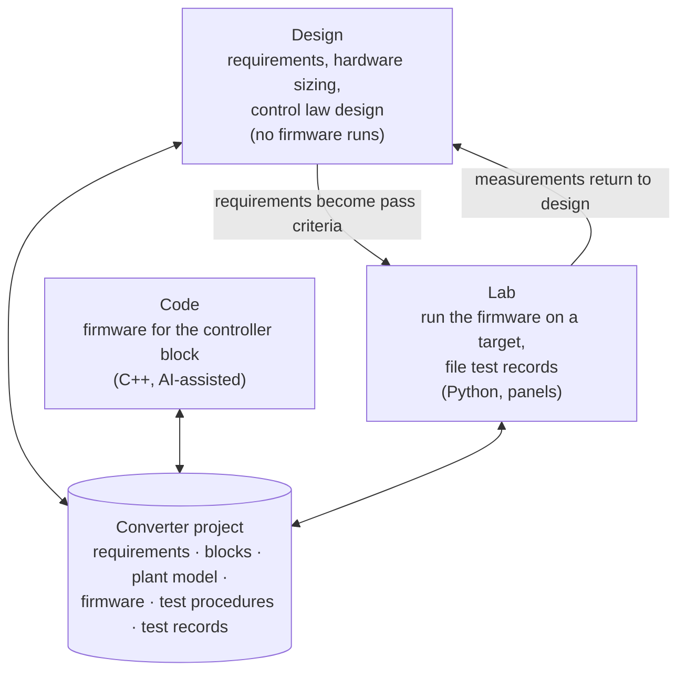
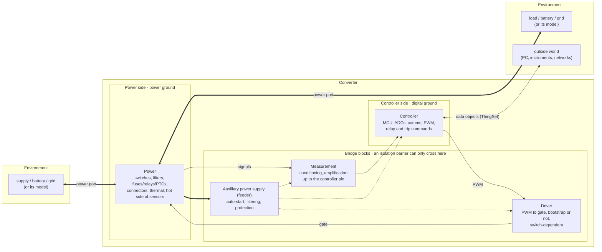
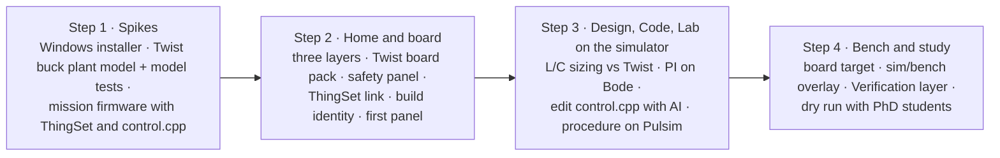

# OwnStudio: specification

*Version 1.0, 2026-11-07. Working name, LGPL-2.1. Author: Luiz Villa (LAAS-CNRS / IUT A GEII), with Claude.*

OwnStudio is a desktop application for power electronics. It takes one converter from requirements to a validated prototype, in one place. It is built on Eclipse Theia, the open framework behind TI's Code Composer Studio 20 and Arduino IDE 2, and on the OwnTech open hardware and software stack.

This document gathers decisions made over ten specification rounds. Each decision links to its record ([ADRs](docs/adr/)). Terms in **bold** are defined in the [glossary](GLOSSARY.md). The full question-and-answer history is in the [decision log](docs/decision-log.md).

---

## 1. The problem

Taking a power converter from idea to tested prototype today means crossing several tools that don't share anything:

- a simulator (PLECS, Simscape, PSIM) for the power stage;
- a control-design tool (MATLAB, TI Compensation Designer) for the loop;
- an IDE (VS Code + PlatformIO, Code Composer Studio) for the firmware;
- scripts, notebooks and instrument GUIs for the lab.

The requirement ("overshoot below 5 %") lives in a document, the simulation result in one tool, the measurement in another. Comparing them is manual work done at the end, if at all. For students this fragmentation is the main obstacle. For researchers it's a source of untraceable results.

Commercial suites solve parts of this:

- **imperix** makes one model run in simulation or on its controller;
- **Typhoon HIL** bundles a schematic editor, a SCADA and a Python test framework under one launcher;
- **TI powerSUITE** feeds measured loop responses back into compensator design;
- **MATLAB** traces requirements to tests.

None does all of it. None does it with hand-written firmware. None helps the user size the hardware. See [§14](#14-how-ownstudio-compares).

## 2. Who v1 is for

The first prototype is tested with:

- **students**, who don't know OwnTech;
- **teaching colleagues** and **research colleagues**, who don't know OwnTech either;
- **PhD students**, who already work with OwnTech.

Industrial users are out of scope for v1.

## 3. The core idea: one converter project, three workbenches

Video editors such as DaVinci Resolve split work into pages (Edit, Color, Audio) that all edit **one shared timeline**. OwnStudio does the same for a converter. One **converter project** holds everything:

- requirements;
- hardware description;
- plant model;
- firmware;
- test procedures;
- test records.

Three **workbenches** are views of that one project ([ADR 0002](docs/adr/0002-one-shared-converter-project.md)).



- **Design** turns an idea into numbered requirements, sizes the hardware, and designs the control law with models that don't run the firmware. Examples: averaged models, small-signal models, Bode plots.
- **Code** is where the firmware for the controller block is written.
- **Lab** runs the real firmware on a **target** and files **test records**.

**Simulation is not a workbench, it is a target** ([ADR 0003](docs/adr/0003-simulation-is-a-target-not-a-workbench.md)). The same test procedure runs either:

- on the **simulator**: the student's control code inside the Pulsim circuit simulator, against a plant model; or
- on the **board**: the real Twist on the bench.

This is imperix's "execution purpose" switch, applied to hand-written code.

A fixed bar along the bottom of the window switches between **Home · Design · Code · Lab** (Ctrl+1…4). Each workbench keeps its own layout. The bar also always shows the current target (Simulator or Board) and the board connection status.

## 4. Describing a converter: five blocks, ports and the environment

Every converter is described with the same five **converter blocks**. This structure is OwnStudio's main teaching device. No competitor imposes one.



- **Power**: switches, filters, protection devices (fuses, relays, PTCs), power connectors, thermal interfaces, and the hot side of the sensors.
- **Measurement**: receives the sensor signals, conditions and amplifies them, and delivers them to the controller's pins.
- **Controller**: the microcontroller with its ADCs, communication with the outside world, PWM generation, and relay and trip commands. It may also be an analog controller IC. ("Control law" is the name for the mathematics the controller runs.)
- **Driver**: turns PWM into switch commands, bootstrapped or not. It depends on the switches.
- **Auxiliary power supply (APS)**: takes a little energy and supplies the other blocks. It handles auto-start and filtering so the digital ground stays quiet.

Measurement, driver and APS are the **bridge blocks**. They connect the power side to the controller side, and an **isolation barrier**, if there is one, can only cross them.

The converter exchanges energy with the **environment** through **power ports** ([glossary](GLOSSARY.md#environment)). Ports are named for what is connected to them, not "input" and "output", because power may flow either way. Whether a port is on the high- or low-voltage side, DC or AC, and which direction power may flow are properties of the port. On the Twist the ports are HIGH, LOW1 and LOW2, matching the OwnTech API's `V_HIGH`, `V1_LOW`, `V2_LOW`.

## 5. Home and its three layers

**Home** is the landing view of a converter project: the five-block diagram. Clicking a block opens what belongs to it. For example, the controller block opens the control law. Home has three layers, borrowed from the V-model (*cycle en V*):

| Layer | Shows | Answers |
|---|---|---|
| **Specification** | Requirements on ports and blocks; safety drawn in red on top | What must it do? |
| **Build** | The blocks, ports and firmware | What is it? |
| **Verification** | Each requirement coloured by its latest test record | What has been shown? |

On the Verification layer each requirement is coloured:

- **grey**: untested;
- **grey with a dashed border**: no test case exists for it;
- **blue**: passed in simulation;
- **green**: passed on the bench;
- **red**: failed;
- **hatched**: simulation and bench disagree.

The hatched state is where most of the learning happens.

## 6. Design workbench

In v1, Design covers hardware sizing as well as control ([ADR 0006](docs/adr/0006-design-workbench-includes-hardware-sizing.md)). One of the study's goals is to collect feedback on how broad and deep Design should be. No competitor guides hardware sizing.

For the first mission (a buck converter on the Twist):

- **Requirements**: output voltage, ripple, overshoot and settling time on a load step, each with a value, a tolerance and conditions.
- **Sizing**: the student sizes L and C from the requirements, then compares the result with what was chosen for the real Twist (33 µH and 33 µF per leg, 200 kHz).
- **Control law**: small-signal plant G(s), PI tuning on a Bode plot, phase and gain margins.

All of this is **analytic models in Python files that students can read**, cross-checked against an AC sweep of the Pulsim plant model, so the difference between analytic and switched models is itself something students learn from.

## 7. Code workbench

Text is the source of truth. The AI agent is the "vibe coding" layer that writes the text. There is no visual programming in v1 ([ADR 0004](docs/adr/0004-text-plus-ai-no-visual-programming-in-v1.md)): no Node-RED-style flows and no separate notebook format.

A mission's firmware is OwnTech example code with two changes:

1. **ThingSet replaces the communication task** ([ADR 0019](docs/adr/0019-thingset-replaces-the-communication-task.md)). Each OwnTech example currently has its own single-character serial menu. Instead, every mission firmware exchanges named **data objects** with the computer through the open ThingSet protocol. Data objects are declared in a `data_objects.yaml` file, from which the C declarations are generated ([ADR 0021](docs/adr/0021-data-objects-yaml-generates-c.md)). OwnStudio shows that file as an editable **data object table**, and adding a row adds a data object.
2. **The control law is in its own file, `control.cpp`**, as plain C++ with no hardware calls. `main.cpp` keeps setup, tasks, sensor reading and PWM writing. Keeping the control law hardware-free is what lets it run inside the simulator ([ADR 0018](docs/adr/0018-skeleton-simulates-a-hardware-free-control-function.md)). This approach is already proven in the Core2 microinverter work, where `controlStep()` runs in Pulsim every 100 µs.

Every firmware build carries a **build identity**: git commit, dirty flag and binary hash. The board reports it over ThingSet. Home warns when the board runs different code than the project, and every test record stamps it.

## 8. Lab workbench

The Lab has two kinds of artifacts ([ADR 0014](docs/adr/0014-lab-panels-and-procedures-over-one-data-object-table.md)):

- **Procedures**: Python scripts that run a fixed sequence and file a test record, like Typhoon's TyphoonTest.
- **Panels**: hands-on views that show data objects and let the user set them or launch a procedure, like imperix Cockpit or Typhoon HIL SCADA. Panels hold no logic. Once something needs a condition or a sequence, it becomes a procedure.

Panels, procedures, test records and the AI agent all use the same data objects. The simulator target exposes the same data objects as the board, so a panel or a procedure works unchanged on both.

Testing reuses Core2's vocabulary and tooling ([ADR 0020](docs/adr/0020-core2-testing-vocabulary-with-l2.md)): test procedure, test case, test campaign, test record, findings register. There are three **test levels**:

| Level | What runs | Where |
|---|---|---|
| L0 | One object with synthetic inputs | On the PC |
| L1 | The control law, closed loop against the plant model | Simulator target (Pulsim) |
| L2 | The whole firmware, closed loop | Board target (bench) |

Every requirement must be verified by at least one test case with a numeric pass criterion. OwnStudio checks that link. In v1, bench waveforms come from the **firmware scope**, a triggered capture buffer inside the firmware. External instruments come after the study.

Panels are rebuilt natively in OwnStudio (plot, gauge, number, button, setpoint) and read the matching subset of modular's dashboard format ([ADR 0024](docs/adr/0024-panels-rebuilt-natively-modular-format-subset.md)). OwnStudio replaces modular, which will be retired ([ADR 0013](docs/adr/0013-one-app-retires-modular.md)).

## 9. Missions and the landing page

Before any project is open, the landing page offers **missions** first, recent projects second, and a blank project last. A mission is a guided path that ends in a real result, for example "Make the Twist hold 12 V under a load step".

- When a Twist is plugged in, the landing page detects it (as CCS 20 does) and offers the missions that need hardware. Without a board, it offers the simulator-only ones.
- Each mission ships a pre-built, hashed firmware binary, so the Lab works before anyone has compiled anything.
- Opening a mission copies its folder into a new converter project. The project is a git repository that students never have to see: OwnStudio commits a checkpoint at each finished step, which gives saved progress and "reset to step 3".

A mission folder lives next to its example in the OwnTech examples repository:

```
buck_voltage_mode/mission/
├── mission.yaml          # title, steps, board pack and version, envelope, starting state
├── requirements.yaml     # requirements, each linked to test cases
├── data_objects.yaml     # → generates the ThingSet declarations
├── firmware/
│   ├── main.cpp          # setup, tasks, sensors → control() → PWM (from the example)
│   ├── control.cpp       # the control law: plain C++, no hardware calls
│   └── app.ini  app.conf  app.overlay
├── design/
│   ├── sizing.py         # L, C, ripple; compared with the Twist's values
│   └── loop.py           # G(s), PI, Bode, margins
├── plant/
│   ├── twist_buck.pulsim
│   └── model_tests/      # the plant model's own test procedure
├── tests/
│   └── step_response.py  # L1 and L2 test cases
└── panels/
    └── buck.panel.json
```

Basing missions on the existing examples (57 example folders today) means more missions can be added without an OwnStudio release.

## 10. Safety

Safety is a red overlay on the Specification layer, not a sixth block. It covers three separate concepts, handled in a single panel:

| | Safety envelope | Protection chain | Isolation barrier |
|---|---|---|---|
| Nature | Numbers: operating limits per power port | Active: detects and acts | Passive, built into the structure |
| Example | V ≤ 60 V at port HIGH | Overcurrent → comparator → PWM off | Isolated gate driver |
| The user | Edits one table | Reviews a generated checklist | Sets one switch per bridge block |
| Verified | Design, simulator, bench | Simulator and bench (trip tests) | Design only |

**One safety envelope feeds four places** ([ADR 0009](docs/adr/0009-one-safety-envelope.md)):

- firmware trip thresholds;
- lab instrument limits;
- simulator assertions;
- component ratings checked during sizing.

No compared tool links these. In all of them they're four separate numbers in four tools.

The envelope sits at or below the **board ratings**, which can't be edited. The Twist is rated 100 V on its high side and 72 V on its low side, which is above the 60 V DC safe-to-touch limit. So the student mission envelope caps the high side at 60 V, matching what the buck example already asks for. A built-in teaching profile pre-fills the envelope. It is marked **"indicative, not certification"**. Teaching colleagues don't usually work to specific standards, so this is a plus.

Every limit in the envelope must be enforced by at least one protection chain. The panel shows any gaps. The Twist comes with its chains already filled in.

## 11. Boards

A board's facts are split by who owns them ([ADR 0017](docs/adr/0017-board-descriptions-in-hardware-repos.md)):

- the **devicetree in OwnTech Core** keeps what the firmware needs: sensors, ADC channels, default gains and offsets;
- a **board description** file in the board's hardware repository keeps the rest: port ratings, component values, operating modes, isolation of the bridge blocks.

Boards install as **board packs** fetched with git from an index, the way Arduino's Boards Manager works. The Twist pack ships inside the installer, and any board that follows the standard description can be added. v1 supports only OwnTech hardware, starting with the Twist ([ADR 0001](docs/adr/0001-owntech-only-scope.md), [ADR 0008](docs/adr/0008-twist-first.md)). The Ownverter is the first extension.

## 12. The AI agent

The agent works at three autonomy levels ([ADR 0010](docs/adr/0010-ai-agent-autonomy-levels.md)):

| Level | Actions |
|---|---|
| Free | Edit files, run Design calculations, run the simulator target |
| Confirm each time | Flash the board, start a bench run |
| Never | Change the safety envelope, bypass a trip |

A human may authorize unattended bench runs for one test campaign. Before it starts, OwnStudio reads the instrument limits back and refuses to start if they exceed the envelope. Any trip ends the authorization. Physical limits, not the agent, guarantee safety.

OwnStudio accepts any OpenAI-compatible endpoint, and Anthropic's API directly (so Claude can be connected). The order of preference is ([ADR 0023](docs/adr/0023-ai-endpoint-order.md)):

1. a University of Toulouse or CNRS sovereign service, if one offers an API;
2. the user's own key;
3. a local model, shown as limited.

The AI is optional: every mission can be completed without it.

## 13. Platform and delivery

- **A custom Theia application**, not a VS Code extension pack ([ADR 0005](docs/adr/0005-custom-theia-application.md)). It is started fresh from the Theia IDE template at the current Theia release, and still runs VS Code extensions (PlatformIO, C/C++, Python).
- **Desktop only in v1**, Windows first, Linux second, macOS later ([ADR 0007](docs/adr/0007-desktop-only-v1.md), [ADR 0011](docs/adr/0011-windows-first-linux-second.md)).
- **A frictionless installer, around 1 GB.** It bundles Python, Pulsim, a portable C/C++ compiler (needed to run student code in the simulator on Windows, [ADR 0015](docs/adr/0015-bundled-host-compiler.md)) and PlatformIO's packages, so the first firmware build works offline.
- **For a first-time user, Home is the main screen and the IDE is hidden.** An expert mode shows the full IDE (file tree, git, terminal), as Arduino IDE 2 does.
- **Updates**: the app by a new installer; missions and board packs through git from the index.
- **The interface is in English.**

### Out of scope for v1

- Hardware other than OwnTech.
- Inverter operation and AC control.
- External instruments.
- Visual programming.
- A browser version.
- macOS.
- The operations layer: fleet monitoring, fault diagnosis, remaining-useful-life estimation.
- Running the full OwnTech API in simulation. That needs a simulation backend inside Core; it's proposed and deferred ([ADR 0016](docs/adr/0016-simulation-backend-inside-the-core-api.md)).

## 14. How OwnStudio compares

| | Typhoon HIL | PLECS | imperix | TI | MATLAB | PSIM | **OwnStudio** |
|---|---|---|---|---|---|---|---|
| One shared project | Separate tools | One model | One model | Separate tools, CSV | Project of files | One schematic | **Requirements, hardware, firmware, tests in one project** |
| Firmware | On the device under test, outside the tool | Generated from model | Generated from model | Hand-written | Generated from model | Generated from model | **Hand-written or AI-written, and simulated as written** |
| Sim ↔ lab switch | HIL hardware | RT Box | Execution-purpose switch | No | SIL/PIL/HIL modes | PIL | **Target switch, L1 ↔ L2** |
| Hardware sizing | No | Sweeps | No | Adapts reference designs | Scripts | No | **Guided, compared with the real board** |
| Single safety envelope | No | No | No | No | No | No | **Yes, enforced in four places** |
| Guided start | Example Explorer, online academy | Demos | Online docs | Board detection, examples | Onramp course | Examples | **Missions ending on real hardware** |

The full decision-by-decision comparison is in [docs/benchmark.md](docs/benchmark.md).

## 15. Open items

- **University AI API**: ask the university's IT services whether isdm-chat (CROCC) or another sovereign service offers API access. LAAS is classified ZRR, which will matter before PhD students use the agent on restricted work.
- **Twist documentation**: the high-side range is given as 100 V and as 110 V, and the minimum as 10 V and as 12 V. The board description must settle it.
- **Core4's ThingSet branch**: it is an app on top of Core, but it touches three Core files. The bootloader-script fix (correct USB interface, no fallback to another board) deserves its own upstream pull request.
- **Pulsim**: its inline C-Block compile assumes GCC-style flags and `.so` names. This is harmless with a precompiled library but worth reporting upstream.

## 16. Plan to the first student study

Four steps, in order. A step may take longer than planned. Luiz builds; PhD students, colleagues and Jean test. Details are in [docs/plan.md](docs/plan.md).



The study measures:

- completion and duration of each mission step, logged locally with consent;
- the System Usability Scale questionnaire;
- three open questions on the breadth and depth of Design;
- think-aloud notes from one observer.

## Decision index

| ADR | Decision |
|---|---|
| [0001](docs/adr/0001-owntech-only-scope.md) | v1 supports only OwnTech hardware |
| [0002](docs/adr/0002-one-shared-converter-project.md) | One shared converter project, plain files in git |
| [0003](docs/adr/0003-simulation-is-a-target-not-a-workbench.md) | Simulation is a target, not a workbench |
| [0004](docs/adr/0004-text-plus-ai-no-visual-programming-in-v1.md) | Text plus AI; no visual programming in v1 |
| [0005](docs/adr/0005-custom-theia-application.md) | Custom Theia application |
| [0006](docs/adr/0006-design-workbench-includes-hardware-sizing.md) | Design includes hardware sizing |
| [0007](docs/adr/0007-desktop-only-v1.md) | Desktop only in v1 |
| [0008](docs/adr/0008-twist-first.md) | Twist first, Ownverter next |
| [0009](docs/adr/0009-one-safety-envelope.md) | One safety envelope, enforced in four places |
| [0010](docs/adr/0010-ai-agent-autonomy-levels.md) | AI agent autonomy levels |
| [0011](docs/adr/0011-windows-first-linux-second.md) | Windows first, Linux second |
| [0012](docs/adr/0012-mock-up-grows-into-skeleton.md) | The mock-up grows into the skeleton |
| [0013](docs/adr/0013-one-app-retires-modular.md) | One app; modular is retired |
| [0014](docs/adr/0014-lab-panels-and-procedures-over-one-data-object-table.md) | Lab: panels and procedures over one data object table |
| [0015](docs/adr/0015-bundled-host-compiler.md) | Bundled host compiler |
| [0016](docs/adr/0016-simulation-backend-inside-the-core-api.md) | Simulation backend inside Core (deferred) |
| [0017](docs/adr/0017-board-descriptions-in-hardware-repos.md) | Board descriptions and board packs |
| [0018](docs/adr/0018-skeleton-simulates-a-hardware-free-control-function.md) | Simulate a hardware-free control law |
| [0019](docs/adr/0019-thingset-replaces-the-communication-task.md) | ThingSet replaces the communication task |
| [0020](docs/adr/0020-core2-testing-vocabulary-with-l2.md) | Core2 testing vocabulary, plus L2 |
| [0021](docs/adr/0021-data-objects-yaml-generates-c.md) | Data objects in YAML generate the C |
| [0022](docs/adr/0022-name-and-licence.md) | OwnStudio, LGPL-2.1 |
| [0023](docs/adr/0023-ai-endpoint-order.md) | AI endpoint order |
| [0024](docs/adr/0024-panels-rebuilt-natively-modular-format-subset.md) | Panels rebuilt natively |
