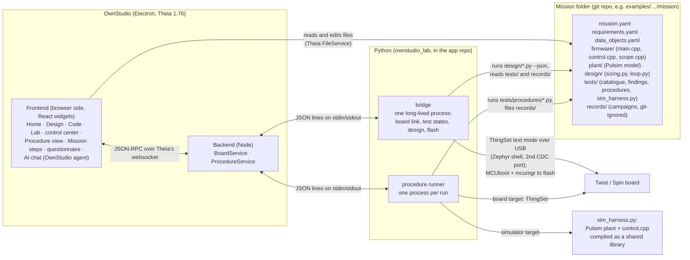
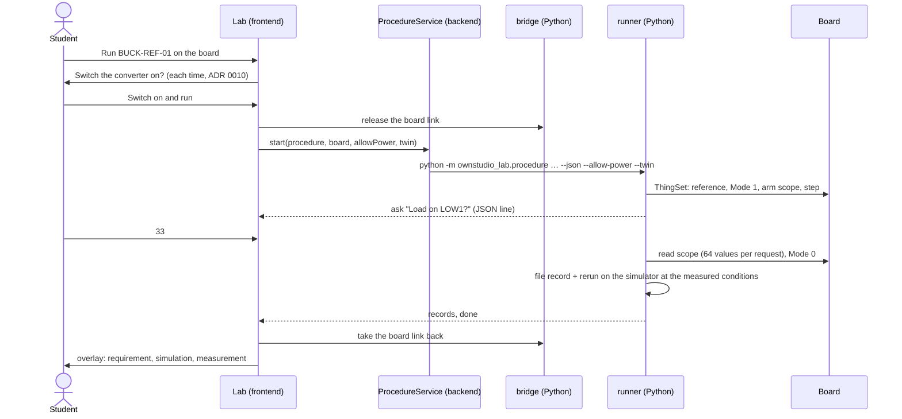

# OwnStudio architecture, as built (steps 1–4)

What exists after step 4, how the parts talk, and every engineering choice behind it. A choice is either **agreed** (an ADR or your explicit decision) or **mine**, taken during the steps without asking you. The "mine" rows are the ones to review. Each says what it would cost to change.

> **Status after the step 5 grilling (2026-11-10).** This file describes 1.0 as built. Of the choices in §5: **A11** is replaced by Core2's pattern ([ADR 0028](adr/0028-simulation-follows-core2.md)); **A10** stays (procedures are Python against a target) but their sequences are drawn in Blockly ([ADR 0029](adr/0029-test-sequences-in-blockly.md)); **A16** (study log) and **A17** (workbench switching) go with the old window ([SPEC 2.0 §5](../SPEC.md#5-the-window)); **A18** is replaced by the user's own agent and the power token ([ADR 0031](adr/0031-ai-agents-and-takeover.md)); **A7** is refined (records out of git, reports in, [ADR 0030](adr/0030-setups-are-git-repos.md)). The others stand.

## 1. The pieces

The rule behind the split: **Python computes, the app draws.** Every number a student sees comes from Python they can read: mission files (sizing, Bode, procedures) or `ownstudio_lab` (test states, records). The TypeScript side reads files, shows results and asks the user. One exception: the overlay's bands and the comparison table are computed in TypeScript from the records (`common/overlay.ts`).

## 2. A board run, end to end

## 3. Where things live

| Repository | Branch | What |
| --- | --- | --- |
| `luizvilla/Theia` | `step-4/bench-and-study` | The app (`app/`), `ownstudio_lab` (`app/python/`), the specification and ADRs (`docs/`), this file |
| `luizvilla/examples` | `mission/buck-voltage-mode` | The first mission: firmware, plant model, design scripts, tests, pre-built firmware (`bin/`) |
| `luizvilla/Pulsim` (fork of lgili/Pulsim) | `fix/exact-pwm-edges` | Exact PWM edges (#12); not proposed upstream yet |

Locally, everything is built on `/data/ownstudio` (Theia worktree, venvs, Pulsim clone).

## 4. Choices: agreed

| Choice | Where it was agreed |
| --- | --- |
| A custom Theia application, desktop only, Windows first | ADR 0005, 0007, 0011 |
| Workbenches Home, Design, Code, Lab over one converter project | ADR 0002, 0006 |
| The simulator is a target, not a workbench | ADR 0003 |
| The control law in a hardware-free function (`control.cpp`), simulated as is | ADR 0018 |
| ThingSet replaces the serial menu; data objects declared in YAML, C generated | ADR 0019, 0021 |
| One safety envelope; power switched on only after the user confirms, each time | ADR 0009, 0010 |
| AI: Theia AI, the student's own key or a local model, no board tools | ADR 0010, 0023 |
| Panels rebuilt natively from a subset of modular's format | ADR 0024 |
| Tests registered as in Core2 (catalogue, campaigns, findings, control center) | Your request, step 3 |
| The load step halved (#11); the exercise starts from a slow PI with REQ-TRACKING; exact edges in Pulsim (#12) | Your decisions, step 4 |

## 5. Choices: mine, to review

| # | Choice | Alternatives I set aside | Why I chose it | Cost to change |
| --- | --- | --- | --- | --- |
| A1 | **Backend talks to Python through child processes and JSON lines** (one long-lived bridge, one process per procedure run) | A Python HTTP/REST server; running Python in the browser (Pyodide); rewriting the board link in TypeScript | Students' tools stay in Python, which they read; no port or server to manage; a crashed run can't take the app down | Medium: one protocol module on each side |
| A2 | **The bridge owns the board link and hands it to a procedure while it runs** | Several processes sharing the serial port; a broker | A serial port has one owner; the handover is explicit | Low |
| A3 | **ThingSet in text mode through the Zephyr shell** on the second USB port (requests sent in 32-byte chunks) | Binary ThingSet; a dedicated serial protocol | It's what Core4's ThingSet example ships; readable when debugging | Medium: the link is one module (`thingset.py`) |
| A4 | **Build identity as data objects** (commit, dirty flag, source hash), checked against the mission | Version strings; none | The app can tell whether the board runs the student's code (LINK-01) | Low |
| A5 | **Flashing through MCUboot and mcumgr**, by USB serial number | DFU / ST-Link | Works on a bare Spin over USB, no probe; what Core uses | Low |
| A6 | **Test states computed in Python (`ownstudio_lab.testing`)**, shown by the app through the bridge; YAML catalogue and findings, JSON records | States in TypeScript (as in step 2); JSON everywhere | One computation for the app, the HTML control center and the command line | Medium |
| A7 | **Records in campaign folders, never overwritten, git-ignored** | Records committed with the mission | Records are evidence of one run on one machine; committing them makes noisy diffs | Low: a `.gitignore` line |
| A8 | **Each test keeps one state per target and shows the worst**; blocks take the worst of their tests; `board_blocks` count only on the board | Newest record wins | A board run's twin simulation (filed after it) hid the board's result | Low |
| A9 | **Design runs the mission's own `design/*.py --json`**; "Apply" edits two constants in `control.cpp` | Design math in TypeScript; gains in a config file | Students can read and change the calculation; the firmware stays plain C++ | Medium |
| A10 | **Procedures are Python files** (`PROCEDURE` + `run(target, ctx)`) **against a target interface** (get, update, wait, arm, capture) | One script per target; a test DSL | The same file runs on the simulator and the board | Medium |
| A11 | **The simulator target is a per-mission `sim_harness.py`**: Pulsim plant + `control.cpp` compiled with g++ into a shared library, run in segments with simulated time | A generic harness in the app; co-simulation with the firmware binary | The harness plays `main.cpp`'s part, which differs per mission | High: each mission would need rework |
| A12 | **A board run brings its simulation** (`--twin`): rerun on the simulator at the conditions the record states | Overlay only with a separate manual sim run | The overlay always compares like with like | Low |
| A13 | **Firmware scope = ScopeMimicry read over ThingSet**, 5 channels × 1024 samples at 100 µs, read 64 values per request (about 3.5 s) | A second USB stream; printk dump as in the OwnTech example | No second protocol, no shell parsing of dumps | Medium: firmware + target |
| A14 | **`ownstudio_lab` is installed into a mission's environment from this repo's GitHub** (`requirements.txt`) | A copy per mission; a PyPI package | One implementation; PyPI can come later | Low |
| A15 | **A fake board in the package** (`ownstudio_lab.fakes`): the simulator behind the firmware's ThingSet and scope | Mocks in each test | The same procedures are tested without hardware; never used in real campaigns | Low |
| A16 | **Study log: JSON lines in the Theia config folder, only after in-app consent**; SUS and open questions in the app | Paper questionnaires; a server | Local, no network, the student can withdraw (deletes the log) | Low |
| A17 | **Workbench switching without Theia perspectives** (#13) | Perspectives (each workbench keeps its own layout) | Perspectives in 1.76 landed one switch late; workbenches no longer keep separate side-panel layouts | Low |
| A18 | **The AI agent's tools**: read mission files, test states, loop margins, run a procedure on the simulator, propose `control.cpp` edits as a change set | Free file writes; board tools | Within ADR 0010: nothing reaches the board or the envelope | Low |
| A19 | **The plant model accepts a local Pulsim build of the same release** (`2.0.0+exactedges`); the harness uses exact edges only when Pulsim has them | Requiring the fork | The mission still runs with released Pulsim | Low |

## 6. Known weak points

- **Simulation speed.** About 2 s of computing per 10 ms simulated with exact edges, more on the fake board (one control period per call). Fine for tests, slow for interactive "what if" in class.
- **Python environment.** The app needs `OWNSTUDIO_PYTHON` pointing at a venv with Pulsim, numpy and `ownstudio_lab`. The Windows installer that would bundle it (step 1) is still open (#5).
- **Pulsim fork.** The exact edges live on your fork until lgili accepts them.
- **One mission.** Nothing has been tried on a second mission, so A11 and the mission file formats are untested for generality.
- **The AI agent** has never talked to a real model.
- **Sensors (#14).** Every board check that uses the board's own V1 inherits its calibration error.
