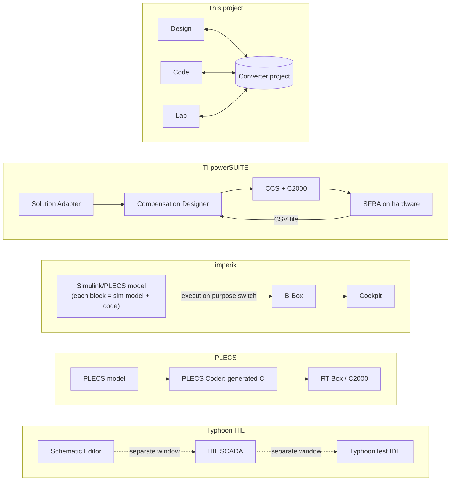
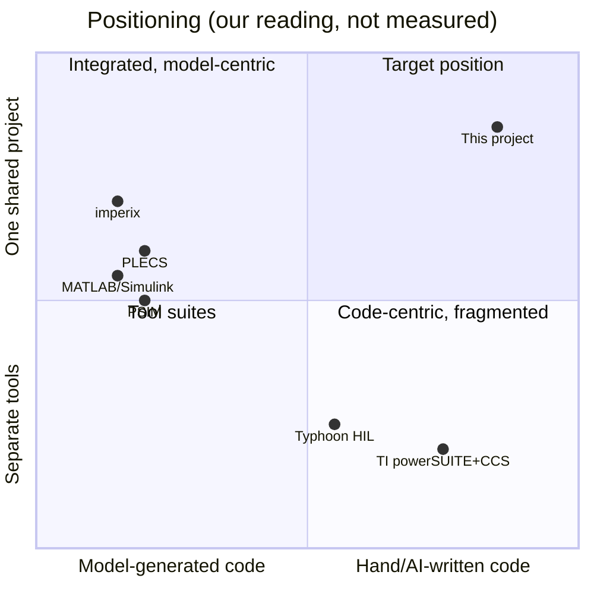

# Benchmark: our decisions against existing tools

For each decision, how the established power-electronics toolchains handle the same question, and whether our choice follows them, departs from them on purpose, or carries a risk they avoid.

Tools compared:

- **Typhoon HIL**: Typhoon HIL Control Center (Schematic Editor, HIL SCADA, TyphoonTest IDE) and HIL hardware.
- **PLECS**: Plexim PLECS Standalone/Blockset, PLECS Coder, RT Box, TI C2000 target support.
- **imperix**: ACG SDK blocksets for Simulink and PLECS, Cockpit, B-Box/B-Board controllers.
- **TI**: powerSUITE (Solution Adapter, Compensation Designer, SFRA), C2000Ware DigitalPower SDK, Code Composer Studio.
- **MATLAB**: Simulink, Simscape Electrical, Embedded Coder with the C2000 support package, Simulink Test, Speedgoat.
- **PSIM**: Altair PSIM, SmartCtrl (loop design), SimCoder (code generation for TI).

Vendor descriptions come from the vendors' own pages (listed at the end). Statements about ergonomics are our reading of those workflows, not measured user studies.

## How each tool chains the workflow

What to take from it:

- **Typhoon** bundles separate applications under a launcher. The user carries the workflow in their head.
- **PLECS, imperix, PSIM and MATLAB** are model-centric: the control is drawn as blocks and C code is generated from it. Users don't write the firmware.
- **imperix** has the cleanest simulation-to-lab switch: one model, two execution purposes.
- **TI** has the only loop that feeds measurements back into design (SFRA → Compensation Designer), but through CSV files between separate tools.
- **This project** puts one shared object in the middle. The firmware is written by hand (or by AI), not generated from a diagram.

## Decision matrix

Legend: **=** we follow the established practice · **≠** we depart from it on purpose · **⚠** a risk the incumbents avoid.

| Decision | Ours | Typhoon HIL | PLECS | imperix | TI | MATLAB | PSIM | Verdict |
|---|---|---|---|---|---|---|---|---|
| **Audience** (Q1) | Students, teaching and research colleagues, PhD students | Industry, utilities, education programme | Industry, academia | Academia and R&D labs | TI customers (industry) | Everyone, academia heavily | Industry, education | **=** imperix's audience. ⚠ The mixed skill levels need two depths of UI. |
| **Hardware scope** (Q2, [ADR 0001](adr/0001-owntech-only-scope.md)) | OwnTech only, maybe Twist only | Own HIL hardware; any DUT controller | Many MCU targets through target support packages | Own B-Box/B-Board | TI C2000 only | Many targets through support packages | TI and a few others | **=** imperix and TI: one vertical stack first. |
| **Shared project object** (Q3, [ADR 0002](adr/0002-one-shared-converter-project.md)) | One converter project, plain files in git | Separate files per tool | Single model file holds plant and control | Single Simulink/PLECS model | Separate tools, CSV exchange | Simulink Project groups files | Single schematic | **≠** Others share a *model*. We share a *project* that also holds requirements, firmware, procedures and records. |
| **Converter decomposition** (Q3) | Five blocks: power, measurement, control, driver, feeder | Free-form schematic | Free-form schematic | Blocks map to B-Box peripherals | Reference designs per topology | Free-form | Free-form, plus hardware target library | **≠** No incumbent imposes a structure. This is our main teaching device. ⚠ It may feel rigid to researchers. |
| **Simulation placement** (Q4, [ADR 0003](adr/0003-simulation-is-a-target-not-a-workbench.md)) | Firmware runs are a target in Lab; Design uses non-firmware models | Real-time sim is the product | Offline and RT are two run modes of one model | Execution-purpose switch | Separate tools | Normal/SIL/PIL/HIL simulation modes | PIL via SimCoder | **=** imperix and MATLAB SIL/PIL modes. We use *source identity* (`controlStep`) instead of code generation. |
| **How control is authored** (Q5, [ADR 0004](adr/0004-text-plus-ai-no-visual-programming-in-v1.md)) | Hand-written C++, AI-assisted; diagrams generated from code | C/C++ on the DUT, outside the tool | Block diagram + C-Script; code generated | Block diagram; code generated | Hand-written C in CCS from SDK examples | Block diagram; code generated | Block diagram; code generated | **≠** All model-based vendors generate code from diagrams. We bet that text + AI is now cheaper to learn than a block language. ⚠ There's no automatic code-from-model consistency: the `controlStep` seam and L1 tests have to provide it. |
| **Lab authoring** (Q5) | Python procedures, AI-assisted | Python + pytest + Allure (TyphoonTest) | Python/XML-RPC scripting | Cockpit GUI + scripting | SFRA GUI | MATLAB scripts, Simulink Test | Scripts | **=** Typhoon's Python/pytest approach, which is the strongest of the lab stories. |
| **Block boundaries** (Q7) | Fixed five-block contents with explicit borders (sensor hot side in Power, conditioning in Measurement, MCU and trips in Control) | None | None | Peripheral blocks (ADC, PWM) mirror the controller hardware | Reference-design hardware docs | None | Hardware target library mirrors MCU peripherals | **≠** imperix and PSIM structure only the *controller* side. We structure the whole converter, including the analog parts students get wrong. |
| **Environment** (Q9) | Named outside the converter; each target has its own version | Sources, grid and loads modelled in the schematic | Same | Physical lab | Physical lab | Same as PLECS | Same | **=** Everyone models it. **≠** We make the sim/bench swap of the environment explicit. |
| **Hardware sizing in Design** (Q10, [ADR 0006](adr/0006-design-workbench-includes-hardware-sizing.md)) | Yes: board sizing exposed, or a free filter design on the Ownverter | No (assumes a given design) | No dedicated sizing; parameter sweeps | No (B-Box hardware is given) | Solution Adapter adapts reference-design values | Manual, via scripts | SmartCtrl helps with the loop, not the hardware | **≠** No incumbent guides hardware sizing. This is the biggest scope risk and the biggest differentiator. |
| **Delivery** (Q11, [ADR 0007](adr/0007-desktop-only-v1.md)) | Desktop installer only | Desktop | Desktop | Desktop (inside MATLAB/PLECS) | Desktop (CCS also has a cloud version) | Desktop + MATLAB Online | Desktop | **=** everyone. |
| **First screen** (Q12) | Block diagram of the converter; IDE opt-in | Welcome screen with tool launchers | Library browser + empty model | Simulink canvas | Tool launcher / project wizard | MATLAB desktop | Empty schematic | **≠** Nobody opens on the *converter*. Arduino IDE 2 is the precedent for hiding a Theia IDE. |
| **Shell** (Q6, [ADR 0005](adr/0005-custom-theia-application.md)) | Custom Theia app | Own desktop apps (Qt/Python) | Own desktop app | Runs inside Simulink/PLECS | CCS 20 is a Theia app | MATLAB desktop | Own desktop app | **=** TI CCS 20 and Arduino IDE 2 both moved to Theia. ⚠ Theia perspectives are still experimental. |

## Where we are deliberately different, in one picture

## Sources

- Typhoon HIL Control Center: https://typhoon-hil.com/documentation/typhoon-hil-software-manual/concepts/typhoon_hil_control_center.html
- PLECS Coder: https://www.plexim.com/cn/node/737 · C2000 target manual: https://www.plexim.com/sites/default/files/c2000manual-2-2-3.pdf
- imperix ACG SDK: https://imperix.com/software/acg-sdk/simulink/ · https://imperix.com/software/acg-sdk/PLECS/ · https://imperix.com/software/
- TI Compensation Designer: https://www.ti.com/tool/COMPENSATION_DESIGNER · SFRA: https://www.ti.com/tool/SFRA
- TI CCS 20 on Theia: https://software-dl.ti.com/ccs/esd/documents/users_guide_ccs_20.5.0/index_overview.html
- PSIM SimCoder tutorial: https://2023.help.altair.com/psim-tut/tutorials/Tutorial%20-%20Auto%20Code%20Generation%20for%20F2833x%20Target.pdf
- Theia perspectives: https://theia-ide.org/docs/perspectives/
- Pulsim: https://pypi.org/project/pulsim/
