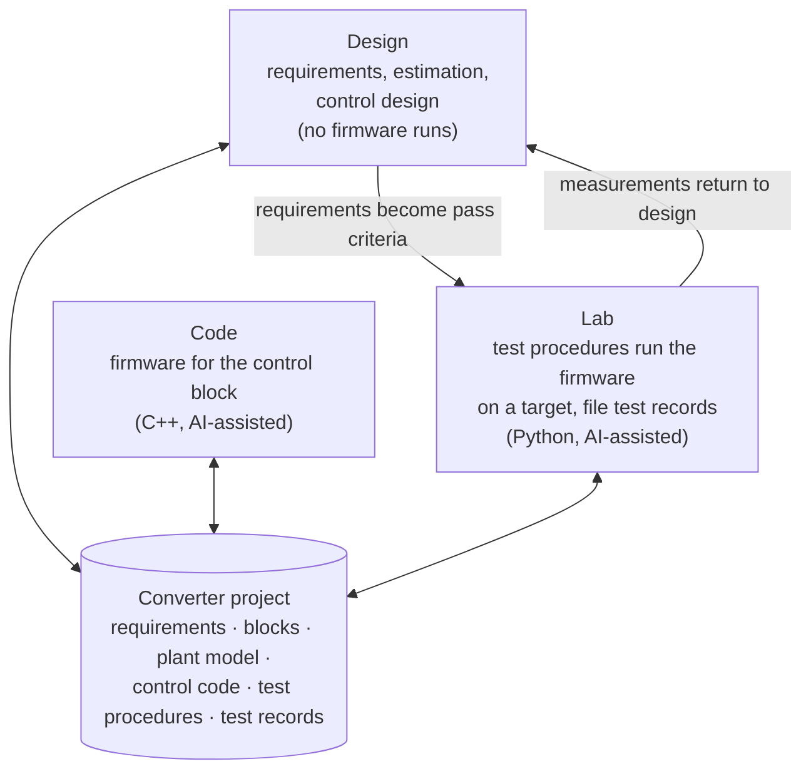
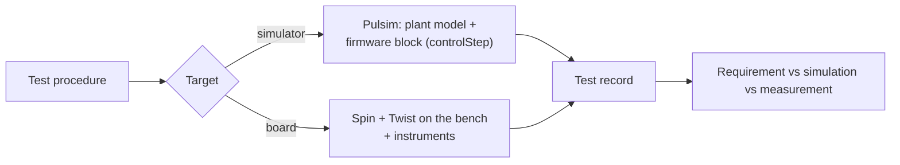
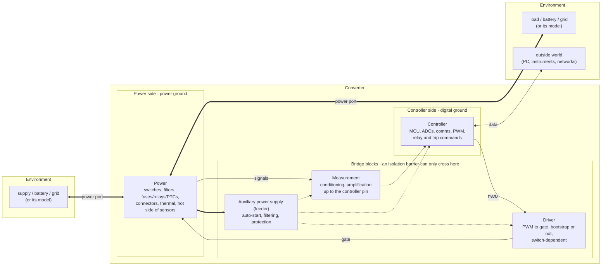

# Overview in pictures

The decided structure so far, drawn. Terms are defined in the [glossary](../GLOSSARY.md); reasons are in the [ADRs](adr/).

## Three workbenches, one converter project

Like the pages of a video editor that all edit one timeline, the three workbenches are views of the same converter project ([ADR 0002](adr/0002-one-shared-converter-project.md)).

## Simulation is a target

The Lab runs the same test procedure against different targets ([ADR 0003](adr/0003-simulation-is-a-target-not-a-workbench.md)).

## The five converter blocks and the environment

Boundaries as decided in round 2 (see the [glossary](../GLOSSARY.md) and Luiz's [reference drawing](images/five-blocks-reference.png)). Thick arrows carry energy, thin arrows carry signals, dotted arrows are auxiliary supply.

The isolation barrier is not drawn as a line: it is recorded as whether each bridge block is isolated, and with which insulation class. Power ports carry energy in either direction; their voltage side (high or low) is a property, not a name. On the Twist the ports are HIGH, LOW1 and LOW2.
