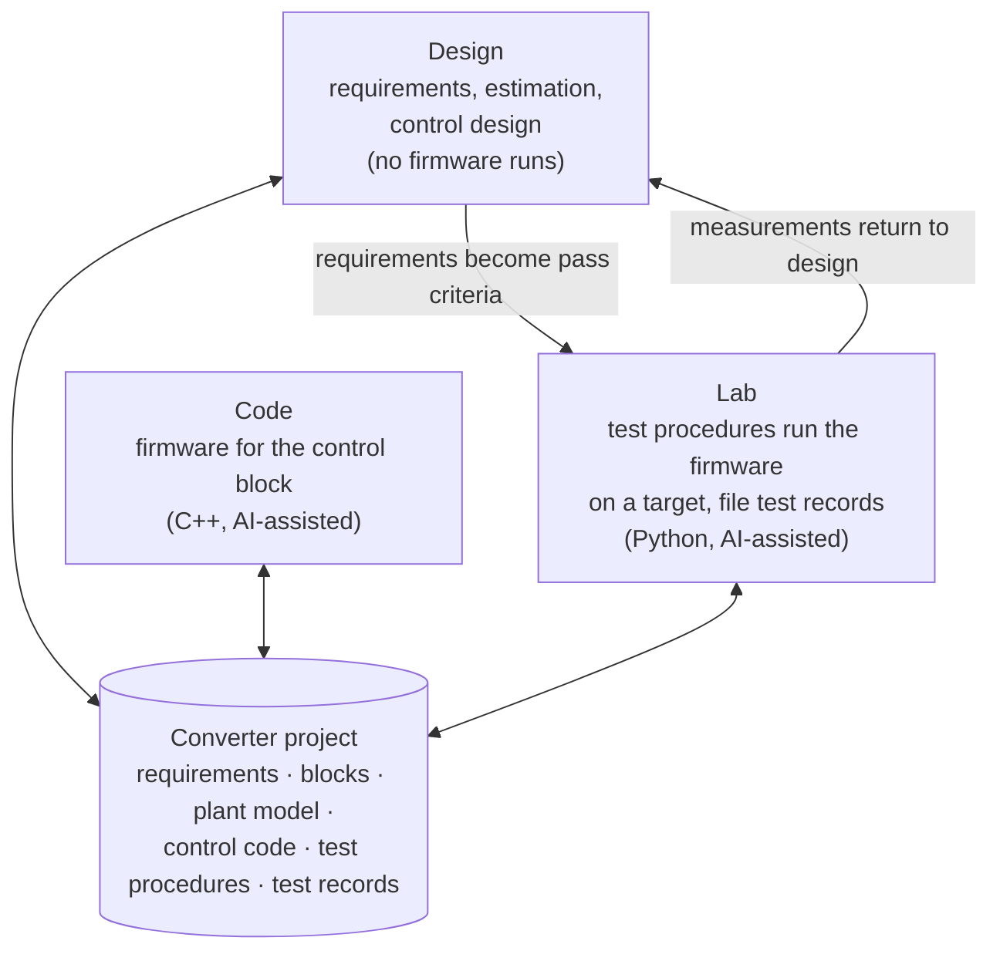
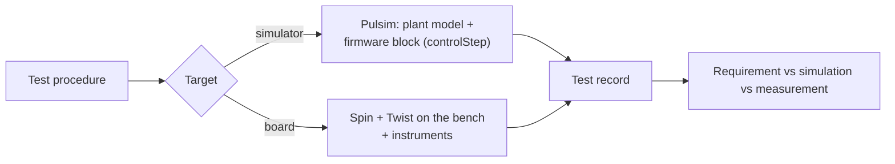
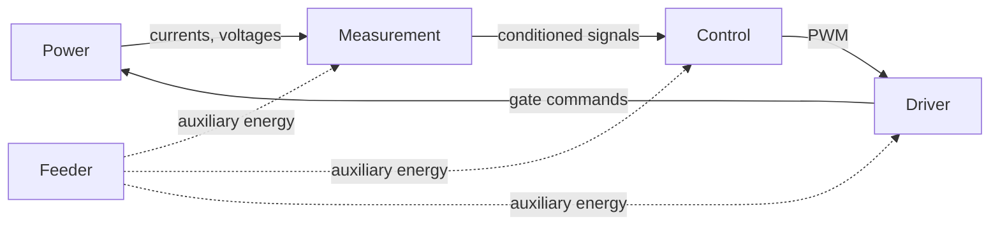

# Overview in pictures

The decided structure so far, drawn. Terms are defined in the [glossary](../GLOSSARY.md); reasons are in the [ADRs](adr/).

## Three workbenches, one converter project

Like the pages of a video editor that all edit one timeline, the three workbenches are views of the same converter project ([ADR 0002](adr/0002-one-shared-converter-project.md)).

## Simulation is a target

The Lab runs the same test procedure against different targets ([ADR 0003](adr/0003-simulation-is-a-target-not-a-workbench.md)).

## The five converter blocks

As stated in round 1. Block boundaries are still being questioned (round 2).

