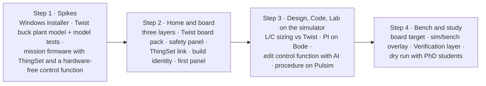

# Plan to the first student study

Four steps, done in order. Dates are a target, not a deadline: if a step takes longer, it takes longer (round 7). Luiz builds; PhD students, colleagues and Jean test.

## Step 1: spikes

**Status (2026-11-07):** done except the Windows installer and the bench comparison. See the [step 1 report](step-1-report.md).

1. **Installer.** A Theia IDE template app at the current Theia release, as a Windows installer bundling Python, Pulsim, a portable host compiler (ADR 0015) and PlatformIO packages for an offline first build (Q45). Done when it installs on a clean Windows machine and compiles a C-Block DLL.
2. **Plant model.** `twist_buck.pulsim` (33 µH, 33 µF, 200 kHz) with its own model test procedure in the style of Core2's model tests, compared once with the bench running the buck voltage-mode example (Q41).
3. **Mission firmware.** The buck voltage-mode example rewritten as the first mission's `main.cpp`: ThingSet instead of the serial menu (ADR 0019), control logic in a hardware-free function (ADR 0018), built in Luiz's fork of the examples (Q47).

## Step 2: Home and board

Home with Specification, Build and Verification layers on the five-block diagram; the Twist board pack (board description from the TWIST repo plus the Core devicetree, ADR 0017); the safety panel (envelope table, isolation switches, protection checklist); the ThingSet connection and data object table; build identity check and pre-built binary; one panel derived from modular.

## Step 3: Design, Code and Lab on the simulator target

Requirements of the mission; L and C sizing compared with the Twist's values; PI tuning on a Bode plot; editing the control function in Code with AI help; the step-test procedure running on the simulator target and filing a test record.

## Step 4: bench and study

The same procedure on the board target; the overlay of requirement, simulation and measurement; the Verification layer colouring; a dry run with PhD students before the student session.

## What the study measures (Q52)

- Completion and duration of each mission step, logged locally by the app with the participant's consent.
- The System Usability Scale questionnaire.
- Three open questions on the breadth and depth of the Design workbench.
- Think-aloud notes from one observer.

## Commit plan for step 1

Three rules apply to every commit:
- Each commit builds and its tests pass.
- Nothing is pushed. You review in the morning and push yourself.
- No commit flashes or powers hardware.

A commit that can't reach a green state isn't made; the problem goes into the morning report instead. Builds run in throwaway copies in the scratchpad, so your Core checkouts are never modified.

### Repository 1: `~/code/examples`, new branch `mission/buck-voltage-mode`

The branch starts from local `main`. It holds the mission in `TWIST/DC_DC/buck_voltage_mode/mission/`. Your fork, `luizvilla/examples`, is the remote to push to later (Q47). Each commit message is shown in bold.

| # | Commit message | What it holds | Done when |
|---|---|---|---|
| E1 | **mission: copy the buck voltage-mode example as the mission firmware** | `firmware/main.cpp`, `app.ini`, unchanged, as the baseline | Builds with PlatformIO against a throwaway Core copy |
| E2 | **mission: move the control law into a hardware-free control.cpp** | `control.cpp/.h` (PI, measurements in, duty out); `main.cpp` calls it; behaviour unchanged | Builds; `control.cpp` compiles on the PC with no OwnTech or Zephyr headers |
| E3 | **mission: L0 tests for the control law** | Tests on the PC: reference tracking, saturation at the bounds, reset | Tests pass with g++ |
| E4 | **mission: declare data objects in YAML and generate the C** | `data_objects.yaml`, the generator script, generated ThingSet declarations, generator tests | Generator tests pass; output matches Core4's `user_data_objects` style |
| E5 | **mission: replace the serial menu with ThingSet** | `app.conf` and `app.overlay` from Core4; the communication task removed | Builds against a throwaway copy of the Core4 ThingSet branch |
| E6 | **mission: Twist buck plant model with model tests** | `plant/twist_buck.pulsim` (33 µH, 33 µF, 200 kHz); `design/sizing.py` as the analytic reference; model tests (DC gain, ripple, LC resonance against the analytic values) | Model tests pass in Pulsim 2.0.0 |
| E7 | **mission: L1 step-response test of control.cpp in Pulsim** | `control.cpp` built as a C-Block, closed loop on the plant model; one test case with numeric criteria (overshoot, settling time); a test record | The L1 test runs and files a record. A failing verdict is fine if the record is correct |
| E8 | **mission: requirements and mission description** | `requirements.yaml` linked to the E7 test case; `mission.yaml` (steps, board pack, envelope with HIGH ≤ 60 V); README | Every requirement links to at least one test case |

### Repository 2: `~/code/Theia`, new branch `step-1/app-skeleton`

The app lives in `app/`. `npm install` and the first build are slow, so they start in the background early, while the mission commits proceed.

| # | Commit message | What it holds | Done when |
|---|---|---|---|
| T1 | **app: scaffold the OwnStudio Theia application** | Theia IDE template at the current release, pinned versions, `app/JOURNAL.md` of build quirks (modular's journal reused) | Builds and starts on Linux (Electron) |
| T2 | **app: OwnStudio branding and a quiet default layout** | OwnTech brand guidelines applied (see below); name, window title, logomark as app and window icon; generic IDE views hidden by default; expert-mode toggle stub | Starts on a window titled OwnStudio in OwnTech colours and fonts, in light and dark themes |
| T3 | **app: workbench bar Home · Design · Code · Lab** | Bottom bar, Ctrl+1…4, one placeholder view per workbench | Switching works; each workbench remembers its layout |
| T4 | **app: Home shows the five converter blocks** | Static five-block diagram read from the mission's `mission.yaml` | Opening the mission folder shows its blocks |
| T5 | **docs: step 1 morning report** | What works, what failed and why, what waits for Luiz; plan updated | Report written |

### T2 branding: what is taken from OwnTech's brand guidelines

Source: `/data/partage/OwnTech Technologies/Charte graphique` (`charte_owntech.pdf`, 19 pages, plus `assets/`). Files are copied into `app/branding/`; the shared folder is never modified.

| Element | Guideline | Use in OwnStudio |
|---|---|---|
| Main colours | Brunswick green `#234D45`, light yellow `#F9F77F`, black `#000000` for text | Green: title bar, workbench bar, primary buttons. Yellow: the active workbench and focus |
| Secondary colours | Azure `#6C8AFF`, light azure `#B6C9F8`, persimmon `#FF6112` | Azure: links and selection. Persimmon: warnings and safety (the red overlay of the Specification layer), so trips stand out |
| Proportions | One main colour, the others in 40/30/20/10 | Green 40, neutral surfaces 30, azure 20, yellow and persimmon 10 together |
| Title font | VG5000 ("modular, playful, technical") | Workbench names and Home titles only |
| Emphasis font | Ronzino | Mission titles and landing-page highlights |
| Body font | Atkinson Hyperlegible (designed for readers with low vision) | All interface text. Code stays in a monospace font |
| Logo | `assets/logos/svg/` (logomark, full logo in black, white, yellow) | Logomark as app icon, window icon and landing-page header |
| Icons | Line icons in `assets/icono/svg/` | Workbench bar icons where a matching one exists; otherwise Theia's codicons |
| Favicons | `assets/favicons/` | Installer and desktop-entry icons at the sizes provided |

Two checks before anything is pushed:
- **Font licences.** The folder holds no licence files. Atkinson Hyperlegible is published under the SIL Open Font License. VG5000 and Ronzino are believed to be OFL too (Velvetyne and Collletttivo), but this must be confirmed and the licence texts added next to the fonts.
- **Logos are trademarks, not LGPL.** They go in `app/branding/` with a note that the LGPL-2.1 licence of the code does not cover them.

### Order through the night

E1 → E2 → E3 run first, because they prove the core idea (the control law runs off-board). T1's install starts in the background during them. Then E4 → E5 → E6 → E7 → E8, then T2 → T3 → T4, and T5 last. If one line of work blocks, the other continues.

### Deferred from step 1

- The Windows installer: there's no Windows machine here.
- Comparing the plant model with the bench: it needs the Twist powered.
- Any push to a remote.

## Commit plan for step 2

**Change since the first plan (2026-11-07):** Luiz connected an unpowered Twist to this computer. Its USB port powers the Spin, but nothing powers the converter's ports. So the board can be flashed and the ThingSet link tested for real. Measurements read zero or noise, which is fine for a link test.

The step 1 rules still apply, plus three for the board:
- Flashing this Twist is allowed. Its current firmware (a test firmware that names itself `DUT_TWT_1_4_1`) is overwritten by the first flash.
- No automated test or tool sets the converter's mode to power. Tests write only the reference and the idle mode.
- Every write goes to the board found by its USB serial number, never to "the first OwnTech port".

### Two choices made for this step

- **One Python package owns the board.** `app/python/ownstudio_lab` holds the ThingSet client, the flasher and a small bridge process. The app's backend talks to the bridge over JSON lines on stdin and stdout. Procedures need Python anyway (ADR 0014), and only one process can hold a serial port. So one implementation in Python beats a second one inside Electron, which would also bring a native serial module to rebuild for every Electron release.
- **Build identity = git commit + dirty flag + source hash.** A binary can't contain its own hash. So the firmware reports a hash of its sources (`firmware/` and `data_objects.yaml`), and the binary's SHA-256 goes in a manifest next to it. The manifest links the two. The spec's "binary hash" stays in the manifest and the test records.

### Branches

- `~/code/examples`: `mission/buck-voltage-mode` continues (E9 onwards).
- `~/code/Theia`: new branch `step-2/home-and-board`, from `step-1/app-skeleton`, in the `/data/ownstudio/Theia` worktree.

### Order

| # | Repo | Commit message | What it holds | Done when |
|---|---|---|---|---|
| P2 | Theia | **docs: commit plan for step 2** | This section | — |
| E9 | examples | **mission: build identity in the firmware** | `tools/build_identity.py` writes `build_identity.h` (commit, dirty, source hash) into the throwaway Core copy; data objects group `Build`; a fallback when built outside the tools | Tests pass; firmware builds; the source hash is the same across two builds |
| E10 | examples | **mission: pre-built firmware binary** | `bin/firmware.mcuboot.bin` and `bin/manifest.json` (SHA-256, commit, source hash, Core commit, board), written by `tools/build_firmware.sh --release` | Manifest test passes |
| T6 | Theia | **lab: Python ThingSet client and flasher** | `app/python/ownstudio_lab`: board discovery by USB serial number and interface, ThingSet text mode over the shell, flashing through MCUboot with `mcumgr` (checks the manifest hash first), tests against a fake serial port | Tests pass; **the Twist is flashed with the E10 binary and reports the matching identity over ThingSet** |
| E11 | examples | **mission: L2 link test on the board** | `tests/l2/test_link.py`: identity matches the manifest, every data object in the YAML is on the board with its type, reference write and readback, mode stays idle. Skipped when no board is connected | Passes on the unpowered Twist |
| T7 | Theia | **app: board link and firmware identity** | Backend starts the bridge; status bar shows "Twist 1.4.x · firmware matches / differs / no ThingSet"; command "Flash the mission firmware" | Screenshot on the real board; flashing from the app works |
| T8 | Theia | **app: Twist board pack** | `boardpacks/twist/board.yaml` (draft of the description meant for the TWIST repo, ADR 0017: port ratings, components, bridge-block isolation, protection chains, each value with its source) and its loader | Loader tests pass |
| T9 | Theia | **app: Home's Specification, Build and Verification layers** | Requirements on ports and blocks; Verification colours from the test records in `records/`; Build shows the board status | Screenshots of the three layers; with the step 1 L1 record, REQ-UNDERSHOOT is red and the others blue |
| T10 | Theia | **app: safety panel** | Envelope table (edits `mission.yaml`), check against board ratings, isolation switch per bridge block, protection checklist showing gaps | Check tests pass; screenshot |
| E12 | examples | **mission: buck panel** | `panels/buck.panel.json` in modular's dashboard format | Opens in T11 |
| T11 | Theia | **app: data object table and the first panel** | Live data object table; panel widgets gauge, number, setpoint, button and plot, reading the matching subset of modular's format (ADR 0024) | On the real board, the table and panel show live values, and the setpoint writes the reference |
| T12 | Theia | **docs: step 2 report** | What works, what failed, what waits for Luiz | Report written |

### Still deferred

- The Windows installer.
- Everything that needs the converter powered: the bench comparison and L2 tests with power.

### Commits as made

Kept up to date as the work advances. Where a commit departs from the plan above, the reason is given.

| Plan | Repo | Commit | Message | Note |
|---|---|---|---|---|
| P2 | Theia | `60e5856` | docs: commit plan for step 2 | |
| E9 | examples | `300f259` | mission: build identity in the firmware | Also untracks two `__pycache__` files committed in step 1, and force-adds the mission's own `.gitignore` (the repository ignores dotfiles) |
| E10a | examples | `95e1629` | mission: release tool for the pre-built firmware | E10 split in two: the binary must name a commit that exists, so the tool is committed first and the binary built from that commit |
| E10b | examples | `7a377ed` | mission: pre-built firmware binary | Built from `95e1629` |
| T6 | Theia | `9993f3e` | lab: Python ThingSet client and flasher | Flashed the Twist with `7a377ed`'s binary; identity read back over ThingSet |
| E10c | examples | `e4cb76a` | mission: rename the Control group to Converter | **Not planned.** Found on the board: the mission's `Control` group shadowed OwnTech Core's own `Control` group (CAN). The generator now refuses Core's and the ThingSet SDK's names and ids |
| E10d | examples | `5175111` | mission: rebuild the pre-built firmware after the group rename | Built from `e4cb76a`, flashed and checked |
| E11 | examples | `1992ba5` | mission: L2 link test on the board | 6 cases, pass on the unpowered Twist |
| T7 | Theia | `06fa95a` | app: board link and firmware identity | Includes the bridge process in `ownstudio_lab` and `MissionService` |
| T8 | Theia | `13ed8a8` | app: Twist board pack | Adds TypeScript unit tests (`npm test`) |
| E11b | examples | `44a4a89` | mission: test records go to records/ | **Not planned.** Needed by T9: Home reads `records/<test>/record.json` |
| — | Theia | `9bad82e` | docs: record the step 2 commits made so far | This table |
| T9 | Theia | `aa114a0` | app: Home's Specification, Build and Verification layers | Screenshots in `docs/images/step-2/` |
