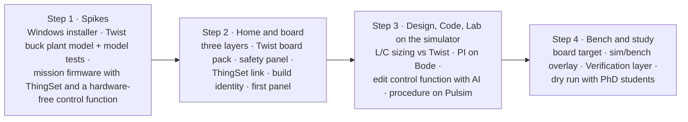
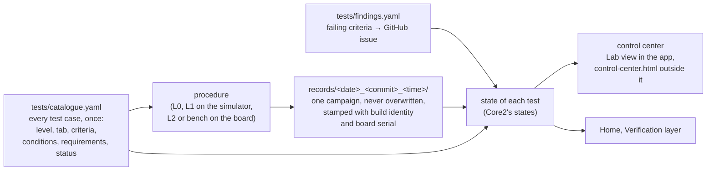

# Plan to the first student study

Four steps, done in order. Dates are a target, not a deadline: if a step takes longer, it takes longer (round 7). Luiz builds; PhD students, colleagues and Jean test.

## Step 1: spikes

**Status (2026-11-07):** done except the Windows installer and the bench comparison. See the [step 1 report](step-1-report.md).

1. **Installer.** A Theia IDE template app at the current Theia release, as a Windows installer bundling Python, Pulsim, a portable host compiler (ADR 0015) and PlatformIO packages for an offline first build (Q45). Done when it installs on a clean Windows machine and compiles a C-Block DLL.
2. **Plant model.** `twist_buck.pulsim` (33 µH, 33 µF, 200 kHz) with its own model test procedure in the style of Core2's model tests, compared once with the bench running the buck voltage-mode example (Q41).
3. **Mission firmware.** The buck voltage-mode example rewritten as the first mission's `main.cpp`: ThingSet instead of the serial menu (ADR 0019), control logic in a hardware-free function (ADR 0018), built in Luiz's fork of the examples (Q47).

## Step 2: Home and board

**Status (2026-11-07):** done, tested on an unpowered Twist. See the [step 2 report](step-2-report.md).

Home with Specification, Build and Verification layers on the five-block diagram; the Twist board pack (board description from the TWIST repo plus the Core devicetree, ADR 0017); the safety panel (envelope table, isolation switches, protection checklist); the ThingSet connection and data object table; build identity check and pre-built binary; one panel derived from modular.

## Step 3: Design, Code and Lab on the simulator target

**Status (2026-11-07):** done on the simulator; the bench runs wait for Luiz, and the buck mission's undershoot requirement waits for his decision (#11). See the [step 3 report](step-3-report.md).

Requirements of the mission; L and C sizing compared with the Twist's values; PI tuning on a Bode plot; editing the control function in Code with AI help; the step-test procedure running on the simulator target and filing a test record.

## Step 4: bench and study

**Status (2026-11-07):** done without Luiz: board waveforms, the twin simulation and its overlay, the Verification layer, the study log and the dry-run kit. The bench runs, the dry run and four decisions wait for him. See the [step 4 report](step-4-report.md).

The same procedure on the board target; the overlay of requirement, simulation and measurement; the Verification layer colouring; a dry run with PhD students before the student session.

## What the study measures (Q52)

- Completion and duration of each mission step, logged locally by the app with the participant's consent.
- The System Usability Scale questionnaire.
- Three open questions on the breadth and depth of the Design workbench.
- Think-aloud notes from one observer.

## Commit plan for step 1

Three rules apply to every commit:
- Each commit builds and its tests pass.
- Nothing is pushed. You review in the morning and push yourself.
- No commit flashes or powers hardware.

A commit that can't reach a green state isn't made; the problem goes into the morning report instead. Builds run in throwaway copies in the scratchpad, so your Core checkouts are never modified.

### Repository 1: `~/code/examples`, new branch `mission/buck-voltage-mode`

The branch starts from local `main`. It holds the mission in `TWIST/DC_DC/buck_voltage_mode/mission/`. Your fork, `luizvilla/examples`, is the remote to push to later (Q47). Each commit message is shown in bold.

| # | Commit message | What it holds | Done when |
|---|---|---|---|
| E1 | **mission: copy the buck voltage-mode example as the mission firmware** | `firmware/main.cpp`, `app.ini`, unchanged, as the baseline | Builds with PlatformIO against a throwaway Core copy |
| E2 | **mission: move the control law into a hardware-free control.cpp** | `control.cpp/.h` (PI, measurements in, duty out); `main.cpp` calls it; behaviour unchanged | Builds; `control.cpp` compiles on the PC with no OwnTech or Zephyr headers |
| E3 | **mission: L0 tests for the control law** | Tests on the PC: reference tracking, saturation at the bounds, reset | Tests pass with g++ |
| E4 | **mission: declare data objects in YAML and generate the C** | `data_objects.yaml`, the generator script, generated ThingSet declarations, generator tests | Generator tests pass; output matches Core4's `user_data_objects` style |
| E5 | **mission: replace the serial menu with ThingSet** | `app.conf` and `app.overlay` from Core4; the communication task removed | Builds against a throwaway copy of the Core4 ThingSet branch |
| E6 | **mission: Twist buck plant model with model tests** | `plant/twist_buck.pulsim` (33 µH, 33 µF, 200 kHz); `design/sizing.py` as the analytic reference; model tests (DC gain, ripple, LC resonance against the analytic values) | Model tests pass in Pulsim 2.0.0 |
| E7 | **mission: L1 step-response test of control.cpp in Pulsim** | `control.cpp` built as a C-Block, closed loop on the plant model; one test case with numeric criteria (overshoot, settling time); a test record | The L1 test runs and files a record. A failing verdict is fine if the record is correct |
| E8 | **mission: requirements and mission description** | `requirements.yaml` linked to the E7 test case; `mission.yaml` (steps, board pack, envelope with HIGH ≤ 60 V); README | Every requirement links to at least one test case |

### Repository 2: `~/code/Theia`, new branch `step-1/app-skeleton`

The app lives in `app/`. `npm install` and the first build are slow, so they start in the background early, while the mission commits proceed.

| # | Commit message | What it holds | Done when |
|---|---|---|---|
| T1 | **app: scaffold the OwnStudio Theia application** | Theia IDE template at the current release, pinned versions, `app/JOURNAL.md` of build quirks (modular's journal reused) | Builds and starts on Linux (Electron) |
| T2 | **app: OwnStudio branding and a quiet default layout** | OwnTech brand guidelines applied (see below); name, window title, logomark as app and window icon; generic IDE views hidden by default; expert-mode toggle stub | Starts on a window titled OwnStudio in OwnTech colours and fonts, in light and dark themes |
| T3 | **app: workbench bar Home · Design · Code · Lab** | Bottom bar, Ctrl+1…4, one placeholder view per workbench | Switching works; each workbench remembers its layout |
| T4 | **app: Home shows the five converter blocks** | Static five-block diagram read from the mission's `mission.yaml` | Opening the mission folder shows its blocks |
| T5 | **docs: step 1 morning report** | What works, what failed and why, what waits for Luiz; plan updated | Report written |

### T2 branding: what is taken from OwnTech's brand guidelines

Source: `/data/partage/OwnTech Technologies/Charte graphique` (`charte_owntech.pdf`, 19 pages, plus `assets/`). Files are copied into `app/branding/`; the shared folder is never modified.

| Element | Guideline | Use in OwnStudio |
|---|---|---|
| Main colours | Brunswick green `#234D45`, light yellow `#F9F77F`, black `#000000` for text | Green: title bar, workbench bar, primary buttons. Yellow: the active workbench and focus |
| Secondary colours | Azure `#6C8AFF`, light azure `#B6C9F8`, persimmon `#FF6112` | Azure: links and selection. Persimmon: warnings and safety (the red overlay of the Specification layer), so trips stand out |
| Proportions | One main colour, the others in 40/30/20/10 | Green 40, neutral surfaces 30, azure 20, yellow and persimmon 10 together |
| Title font | VG5000 ("modular, playful, technical") | Workbench names and Home titles only |
| Emphasis font | Ronzino | Mission titles and landing-page highlights |
| Body font | Atkinson Hyperlegible (designed for readers with low vision) | All interface text. Code stays in a monospace font |
| Logo | `assets/logos/svg/` (logomark, full logo in black, white, yellow) | Logomark as app icon, window icon and landing-page header |
| Icons | Line icons in `assets/icono/svg/` | Workbench bar icons where a matching one exists; otherwise Theia's codicons |
| Favicons | `assets/favicons/` | Installer and desktop-entry icons at the sizes provided |

Two checks before anything is pushed:
- **Font licences.** The folder holds no licence files. Atkinson Hyperlegible is published under the SIL Open Font License. VG5000 and Ronzino are believed to be OFL too (Velvetyne and Collletttivo), but this must be confirmed and the licence texts added next to the fonts.
- **Logos are trademarks, not LGPL.** They go in `app/branding/` with a note that the LGPL-2.1 licence of the code does not cover them.

### Order through the night

E1 → E2 → E3 run first, because they prove the core idea (the control law runs off-board). T1's install starts in the background during them. Then E4 → E5 → E6 → E7 → E8, then T2 → T3 → T4, and T5 last. If one line of work blocks, the other continues.

### Deferred from step 1

- The Windows installer: there's no Windows machine here.
- Comparing the plant model with the bench: it needs the Twist powered.
- Any push to a remote.

## Commit plan for step 2

**Change since the first plan (2026-11-07):** Luiz connected an unpowered Twist to this computer. Its USB port powers the Spin, but nothing powers the converter's ports. So the board can be flashed and the ThingSet link tested for real. Measurements read zero or noise, which is fine for a link test.

The step 1 rules still apply, plus three for the board:
- Flashing this Twist is allowed. Its current firmware (a test firmware that names itself `DUT_TWT_1_4_1`) is overwritten by the first flash.
- No automated test or tool sets the converter's mode to power. Tests write only the reference and the idle mode.
- Every write goes to the board found by its USB serial number, never to "the first OwnTech port".

### Two choices made for this step

- **One Python package owns the board.** `app/python/ownstudio_lab` holds the ThingSet client, the flasher and a small bridge process. The app's backend talks to the bridge over JSON lines on stdin and stdout. Procedures need Python anyway (ADR 0014), and only one process can hold a serial port. So one implementation in Python beats a second one inside Electron, which would also bring a native serial module to rebuild for every Electron release.
- **Build identity = git commit + dirty flag + source hash.** A binary can't contain its own hash. So the firmware reports a hash of its sources (`firmware/` and `data_objects.yaml`), and the binary's SHA-256 goes in a manifest next to it. The manifest links the two. The spec's "binary hash" stays in the manifest and the test records.

### Branches

- `~/code/examples`: `mission/buck-voltage-mode` continues (E9 onwards).
- `~/code/Theia`: new branch `step-2/home-and-board`, from `step-1/app-skeleton`, in the `/data/ownstudio/Theia` worktree.

### Order

| # | Repo | Commit message | What it holds | Done when |
|---|---|---|---|---|
| P2 | Theia | **docs: commit plan for step 2** | This section | — |
| E9 | examples | **mission: build identity in the firmware** | `tools/build_identity.py` writes `build_identity.h` (commit, dirty, source hash) into the throwaway Core copy; data objects group `Build`; a fallback when built outside the tools | Tests pass; firmware builds; the source hash is the same across two builds |
| E10 | examples | **mission: pre-built firmware binary** | `bin/firmware.mcuboot.bin` and `bin/manifest.json` (SHA-256, commit, source hash, Core commit, board), written by `tools/build_firmware.sh --release` | Manifest test passes |
| T6 | Theia | **lab: Python ThingSet client and flasher** | `app/python/ownstudio_lab`: board discovery by USB serial number and interface, ThingSet text mode over the shell, flashing through MCUboot with `mcumgr` (checks the manifest hash first), tests against a fake serial port | Tests pass; **the Twist is flashed with the E10 binary and reports the matching identity over ThingSet** |
| E11 | examples | **mission: L2 link test on the board** | `tests/l2/test_link.py`: identity matches the manifest, every data object in the YAML is on the board with its type, reference write and readback, mode stays idle. Skipped when no board is connected | Passes on the unpowered Twist |
| T7 | Theia | **app: board link and firmware identity** | Backend starts the bridge; status bar shows "Twist 1.4.x · firmware matches / differs / no ThingSet"; command "Flash the mission firmware" | Screenshot on the real board; flashing from the app works |
| T8 | Theia | **app: Twist board pack** | `boardpacks/twist/board.yaml` (draft of the description meant for the TWIST repo, ADR 0017: port ratings, components, bridge-block isolation, protection chains, each value with its source) and its loader | Loader tests pass |
| T9 | Theia | **app: Home's Specification, Build and Verification layers** | Requirements on ports and blocks; Verification colours from the test records in `records/`; Build shows the board status | Screenshots of the three layers; with the step 1 L1 record, REQ-UNDERSHOOT is red and the others blue |
| T10 | Theia | **app: safety panel** | Envelope table (edits `mission.yaml`), check against board ratings, isolation switch per bridge block, protection checklist showing gaps | Check tests pass; screenshot |
| E12 | examples | **mission: buck panel** | `panels/buck.panel.json` in modular's dashboard format | Opens in T11 |
| T11 | Theia | **app: data object table and the first panel** | Live data object table; panel widgets gauge, number, setpoint, button and plot, reading the matching subset of modular's format (ADR 0024) | On the real board, the table and panel show live values, and the setpoint writes the reference |
| T12 | Theia | **docs: step 2 report** | What works, what failed, what waits for Luiz | Report written |

### Still deferred

- The Windows installer.
- Everything that needs the converter powered: the bench comparison and L2 tests with power.

### Commits as made

Kept up to date as the work advances. Where a commit departs from the plan above, the reason is given.

| Plan | Repo | Commit | Message | Note |
|---|---|---|---|---|
| P2 | Theia | `60e5856` | docs: commit plan for step 2 | |
| E9 | examples | `300f259` | mission: build identity in the firmware | Also untracks two `__pycache__` files committed in step 1, and force-adds the mission's own `.gitignore` (the repository ignores dotfiles) |
| E10a | examples | `95e1629` | mission: release tool for the pre-built firmware | E10 split in two: the binary must name a commit that exists, so the tool is committed first and the binary built from that commit |
| E10b | examples | `7a377ed` | mission: pre-built firmware binary | Built from `95e1629` |
| T6 | Theia | `9993f3e` | lab: Python ThingSet client and flasher | Flashed the Twist with `7a377ed`'s binary; identity read back over ThingSet |
| E10c | examples | `e4cb76a` | mission: rename the Control group to Converter | **Not planned.** Found on the board: the mission's `Control` group shadowed OwnTech Core's own `Control` group (CAN). The generator now refuses Core's and the ThingSet SDK's names and ids |
| E10d | examples | `5175111` | mission: rebuild the pre-built firmware after the group rename | Built from `e4cb76a`, flashed and checked |
| E11 | examples | `1992ba5` | mission: L2 link test on the board | 6 cases, pass on the unpowered Twist |
| T7 | Theia | `06fa95a` | app: board link and firmware identity | Includes the bridge process in `ownstudio_lab` and `MissionService` |
| T8 | Theia | `13ed8a8` | app: Twist board pack | Adds TypeScript unit tests (`npm test`) |
| E11b | examples | `44a4a89` | mission: test records go to records/ | **Not planned.** Needed by T9: Home reads `records/<test>/record.json` |
| — | Theia | `9bad82e` | docs: record the step 2 commits made so far | This table |
| T9 | Theia | `aa114a0` | app: Home's Specification, Build and Verification layers | Screenshots in `docs/images/step-2/` |
| — | Theia | `efcaf0f` | docs: step 2 commit table, T9 | |
| T10 | Theia | `3f3f3fb` | app: safety panel | Finds 3 gaps on the buck mission: the voltage limits are watched only by firmware trips the firmware never enables |
| E12 | examples | `0bfb758` | mission: buck panel | With a test that panels use only declared data objects |
| T11 | Theia | `99ba4cd` | app: data object table and the first panel | Also replaces the Lab placeholder. Plots drawn in SVG, not uPlot |
| T12 | Theia | this commit | docs: step 2 report | |

## Commit plan for step 3

**Context (2026-11-07):** steps 1 and 2 are pushed to `luizvilla/Theia` and `luizvilla/examples`, and the open items are issues [#1–#10](https://github.com/luizvilla/Theia/issues). The Twist (a 1.4.3) is now on the bench: 30 V in from a 1 A-limited supply and 33 Ω on each leg. It regulated 5 V and 12 V on the mission firmware. With 33 Ω loads there is no load step on the bench.

Step 3 starts with what Luiz asked for after that first powered run: **register every test the way Core2 does**, with a catalogue, campaigns, a findings register and a control center showing what has passed, failed or found an issue. Design, Code and the simulator target follow.

### Rules

The step 1 and 2 rules still apply (every commit builds and passes its tests; writes go to the board found by its USB serial number), with these changes:
- **Pushing is allowed** to `luizvilla/Theia` and to `luizvilla/examples` (the mission branch).
- **Switching the converter on is allowed only with Luiz at the bench**, one run at a time, with the supply limited (today 30 V, 1 A). Automated tests and the AI agent still never set the power mode.
- Issues found by tests are filed on `luizvilla/Theia` and listed in the findings register.

### How a test is registered

The states are Core2's, worst first: **failing**, **failing (known)** (a failure listed in the findings register, with its issue), **blocked in last run**, **passed**, **run (information only)**, **not run yet**, **blocked**, **not implemented**. A finding whose criteria all pass is shown as ready to close. Colour is never the only cue: each state has an icon and a word.

Two differences from Core2:
- **YAML, not JSON**, like every other mission file.
- **The catalogue defines test cases; `requirements.yaml` keeps linking requirements to them.** A consistency test checks both directions.

### Three choices made for this step

- **The test tooling is shared, in `ownstudio_lab.testing`**, not copied into each mission: the catalogue loader, campaign record writer, findings register, state computation and control center. The app's Home and control center call the same Python through the bridge, so the states are computed in one place (step 2 computed them in TypeScript; that code goes). The cost: a mission's tests need `ownstudio_lab` installed. Until it is on PyPI, `requirements.txt` installs it from `luizvilla/Theia`.
- **Procedures talk to a target, not to a board.** A target has `get`, `update`, `wait(seconds)` and `capture()`. The board target uses ThingSet in real time. The simulator target runs the plant model with `control.cpp` and a small per-mission harness that plays `main.cpp`'s role (mode, reference, measurements), so the same data object names work on both. On the simulator, `wait` advances simulated time and `capture` returns the full waveform. On the board, fast waveforms need the firmware scope, which is step 4.
- **Design runs the mission's own Python files** (`design/sizing.py`, `design/loop.py`) with `--json`, and the app only draws the results. Students can read and change the calculations. The PI gains stay as two constants in `control.cpp`; "Apply" in Design changes those two numbers in the text, the way the safety panel edits the envelope.

### A risk to check first: can the buck mission be solved by control at all?

The output filter's characteristic impedance is √(L/C) = √(33 µH / 33 µF) ≈ 1 Ω. So a 1 A load step makes an LC dip of about 1 V, which is 8 % of 12 V, before any controller can react. The dip reaches its minimum about a quarter of a resonance period after the step: 50 µs at 4.8 kHz. The controller runs every 100 µs, so it acts after that minimum. The step 1 L1 run measured 7.4 %, close to the bare LC dip. **If this holds, no PI tuning at 100 µs meets the 5 % undershoot requirement**, and students would be asked to solve an impossible problem.

The answer depends on two things not yet known:
- **The real output capacitance.** In `PowerLeg.kicad_sch`, the two 33 µF parts are electrolytics (CP_Elec 10×10.5), there are nine 4.7 µF ceramics, and there is the Q5-switched electrolytic (#3). Which of these are on LOW1 changes √(L/C).
- **How fast the control task can run.** At 20 µs or faster, the controller could act within the first quarter period.

E13 checks this in simulation before the Design work, and the answer goes to Luiz. The possible outcomes are:
- the requirement holds (with the real capacitance, or a faster control task, which is then itself a lesson);
- the step changes (0.5 A);
- the requirement changes.

### Branches

- `~/code/examples`: `mission/buck-voltage-mode` continues (E13 onwards).
- `~/code/Theia`: new branch `step-3/design-code-lab`, from `step-2/home-and-board`, in the `/data/ownstudio/Theia` worktree.

### Order

| # | Repo | Commit message | What it holds | Done when |
|---|---|---|---|---|
| P3 | Theia | **docs: commit plan for step 3** | This section | — |
| **A. Registering tests** | | | | |
| T13 | Theia | **lab: test catalogue, campaigns, findings and control center** | `ownstudio_lab.testing`: catalogue schema and loader, campaign record writer (`records/<date>_<commit>_<time>/`, build identity and board serial), findings register, Core2's states, `control_center` writing HTML and `--json` | Tests pass, including a fixture mission with every state |
| E13 | examples | **mission: test catalogue and findings register** | `tests/catalogue.yaml` with every existing case (model tests, L0, L1 BUCK-STEP-01a–d, L2 LINK-01–06) and the bench case as planned; `tests/findings.yaml`; runners write campaigns through `ownstudio_lab.testing`; `run_all.sh` ends with the control center; consistency test against `requirements.yaml`. Also the **feasibility check** above: L1 runs with a stiff PI at 100 µs and at 20 µs, and with the capacitance variants | Every case appears in `control-center.html`; feasibility result written in the step 3 log and sent to Luiz |
| E14 | examples | **mission: bench check of the plant model (BENCH-MOD-01)** | An operator procedure for the bench: 30 V in, 33 Ω on each leg, references 5, 8 and 12 V. Reads the board, asks the operator for the multimeter voltages on LOW1 and LOW2 and the supply current, compares with the plant model at the same conditions (duty, output, input current). Sensor readings against the meter are information only | Run with Luiz at the bench; campaign filed; the sensor offsets become a finding with its issue |
| T14 | Theia | **app: control center in the Lab** | Lab view: one tab per catalogue tab, each test with its state, latest campaign, record and issue links; Home's Verification layer reads the same states through the bridge | Screenshot with the real campaigns: L1 undershoot failing, bench run passed or failing (known) |
| **B. Design** | | | | |
| E15 | examples | **mission: sizing from the requirements** | `design/sizing.py` sizes L from the ripple current and C from the ripple and the undershoot (√(L/C) against the allowed dip), compares with the Twist's values, `--json` | Tests against hand calculations pass |
| E16 | examples | **mission: control design on a Bode plot** | `design/loop.py`: buck small-signal G(s) with the board-pack values, the discrete PI with sampling and one-period delay, loop gain, margins, `--json`; cross-checked against Pulsim's AC sweep of the plant model (`pulsim.run_ac_sweep`) | Analytic and Pulsim gain within a stated tolerance below 10 kHz; margins of the current PI reported |
| T15 | Theia | **app: Design workbench** | Requirements view (edits values in `requirements.yaml`, comments kept); Sizing view (inputs, result, Twist's value next to it); Loop view (Bode plot in SVG, margins, Kp and Ti inputs, "Apply to control.cpp") | Screenshots; applying gains changes only the two constants |
| **C. Simulator target and procedures** | | | | |
| T16 | Theia | **lab: targets for procedures** | `ownstudio_lab.target`: the `Target` interface, the board target over ThingSet, the simulator target loading the mission's plant, `control.cpp` and harness | One script runs unchanged on the fake board and the simulator |
| E17 | examples | **mission: step-response procedure on both targets** | `tests/sim_harness.py`; `tests/procedures/step_response.py` replaces `tests/l1/run_l1.py`: load step (simulator only, as the bench has fixed loads) and reference step 10 → 12 V (both targets); files a campaign | BUCK-STEP-01 on the simulator gives the same verdicts as step 1 |
| T17 | Theia | **app: procedures in the Lab** | Procedures listed from the catalogue; run on Simulator or Board (a procedure that switches power asks for confirmation each time, ADR 0010); live log; waveform plot from the record; control center refreshes | Screenshot of BUCK-STEP-01 run on the simulator from the app |
| **D. Code with AI** | | | | |
| T18 | Theia | **app: the mission agent in Code** | Theia AI with the Anthropic and OpenAI-compatible providers (ADR 0023); an OwnStudio agent given the mission's files, requirements and latest campaign; tools: read files, propose edits to `control.cpp` as a diff the student accepts, run L0 and the simulator procedure. No tool to flash, switch power or edit the envelope (ADR 0010) | Tool tests pass against a scripted model; with a real key, asked to fix BUCK-STEP-01b, the agent proposes a change and runs the procedure |
| **E. End** | | | | |
| T19 | Theia | **docs: step 3 report and a walk-through** | The mission done as a student would: requirements, sizing, Bode, PI applied, procedure on the simulator, record in the control center | Report written, with screenshots |

### Questions for Luiz (work starts without them)

1. **The output capacitance of LOW1:** which capacitors in `PowerLeg.kicad_sch` are on LOW1, and is the Q5 electrolytic switched in for buck mode? This changes the feasibility check and #1, #3.
2. **An API key for T18's live check**, or a local model. Without one, T18 is tested with a scripted model only.
3. **A bench session for E14** (about 15 minutes, with a multimeter), whenever suits you.

### Still deferred

- The firmware scope and the L2 step test on the board (step 4).
- Live panels on the simulator target: the simulator runs slower than real time, so a panel would show simulated time. After the procedures work.
- The Windows installer (#5).

### Commits as made (step 3)

Kept up to date as the work advances. Where a commit departs from the plan above, the reason is given.

| Plan | Repo | Commit | Message | Note |
|---|---|---|---|---|
| P3 | Theia | `168fa41` | docs: commit plan for step 3 | |
| T13 | Theia | `bf49e59` | lab: test catalogue, campaigns, findings and control center | |
| E13 | examples | `6471c19` | mission: test catalogue and findings register | The feasibility check moved to the next commit, once the plant model had the right capacitors |
| E13b | examples | `7b831d2` | mission: the real LOW-side capacitors in the plant model | **Not planned.** Luiz pointed to the switchable electrolytic; the schematic shows the model's 33 µF parts are on the HIGH side. LOW: 3 × 4.7 µF ceramics + 47 µF electrolytic (ESR 0.70 Ω). The firmware now connects the electrolytic. Includes the feasibility study: best undershoot 5.67 % at 100 µs, 4.92 % at 20 µs; issue [#11](https://github.com/luizvilla/Theia/issues/11) |
| E13c | examples | `ff3defb` | mission: rebuild the pre-built firmware with the electrolytic connected | Flashed on the Twist; L2 link 6/6 pass |
| E14 | examples | `d98c8dc` | mission: bench check of the plant model (BENCH-MOD-01) | Tested with a fake board; waits for Luiz at the bench |
| T14 | Theia | `3c0c91b` | app: control center in the Lab | Also fixes a step 2 bug: Home and Lab were empty after switching workbench and back |
| — | Theia | `760e826` | docs: step 3 commits so far | |
| E15 | examples | `29e5072` | mission: sizing from the requirements | Adds the C needed for REQ-UNDERSHOOT and the control period it implies (about 23 µs) |
| E16 | examples | `962627a` | mission: control design on a Bode plot | Plant formula within 0.1 dB and 13° of Pulsim's switched model up to 10 kHz |
| T15 | Theia | `6557fec` | app: Design workbench | Runs the mission's Python through the bridge's new `design` method |
| T16 | Theia | `159db44` | lab: targets for procedures | Includes the procedure runner and its JSON-lines protocol |
| E17 | examples | `c9de0e0` | mission: step-response and reference-step procedures on both targets | `run_l1.py` removed; same verdicts. Adds BUCK-REF-01, which also runs on the board |
| — | Theia | `8e501cc` | lab: a catalogue test may list several levels | **Not planned.** Needed by BUCK-REF-01 (L1 and L2) |
| T17 | Theia | `22b9e91` | app: procedures in the Lab | Checked: BUCK-STEP-01 from the app; the power confirmation on the board, cancelled |
| T18 | Theia | `a115ea3` | app: the mission agent in Code | No key: tested through its tools' unit tests and the chat's agent list only |
| T19 | Theia | `fc42147` | docs: step 3 report | |

## Commit plan for step 4

**Context (2026-11-07):** step 3 is pushed. Luiz is away: step 4 is done without him, and everything that needs him (the bench, the decision on [#11](https://github.com/luizvilla/Theia/issues/11), the dry run with PhD students) is prepared, tested on fakes and on the idle board, and left in the report's "Waiting for you" list.

### Rules

The step 3 rules still apply, and one is stricter: **nothing switches the converter on in step 4.** Flashing the Twist and reading it while idle are allowed. Board procedures that switch power are tested against a fake board only.

### Four choices made for this step

- **The board's waveforms come from a firmware scope read over ThingSet.**
  - It uses OwnTech's ScopeMimicry, as the `scope_simple_example` does, with five channels (LOW1 voltage and current, HIGH voltage, duty, reference) and 1024 samples at the 100 µs control period: a 102 ms window with 20 % before the trigger.
  - A new `Scope` group arms it. It triggers on the next write to `Converter` (a reference step or a start), or at once. The computer reads it 64 values at a time.
  - No second protocol, and the ThingSet port stays the only link. The cost: about 4 s to read a capture.
- **A board run brings its simulation along.** After a procedure runs on the board, the runner runs it again on the simulator at the conditions the board run recorded (HIGH voltage measured, load stated by the operator) and files both in the same campaign. The Lab overlays requirement, simulation and measurement on one plot, case by case.
- **Tests name the blocks they exercise.** The catalogue gains `blocks:` (power, measurement, controller, …). Home's Verification layer colours each block by the worst state of its tests and says whether its evidence comes from the simulator only or from the board.
- **The study log is the app's mission steps.** Home lists `mission.yaml`'s steps; the student opens each one and marks it done. With consent, and only then, the app logs the start and end of each step to a local file outside the mission folder, then asks the System Usability Scale and the three open questions. Nothing leaves the computer.

### Branches

- `~/code/examples`: `mission/buck-voltage-mode` continues (E18 onwards).
- `~/code/Theia`: new branch `step-4/bench-and-study`, from `step-3/design-code-lab`.

### Order

| # | Repo | Commit message | What it holds | Done when |
|---|---|---|---|---|
| P4 | Theia | **docs: commit plan for step 4** | This section | — |
| **A. Waveforms from the board** | | | | |
| E18 | examples | **mission: firmware scope over ThingSet** | The generator learns float arrays and group callbacks; a `Scope` group; ScopeMimicry in `main.cpp`; LINK-07 (scope capture on the idle board) in the L2 link test; pre-built firmware rebuilt | Flashed; LINK-01–07 pass on the idle Twist |
| T20 | Theia | **lab: waveforms from the board** | `target.arm()` and `BoardTarget.capture()` through the scope; the simulator target marks the same trigger; the fake board has a scope | One procedure gets the same waveform keys from the fake board and the simulator |
| E19 | examples | **mission: the reference step measured from the waveform** | BUCK-REF-01 arms the capture before the 10 V → 12 V step; settling time from the waveform on both targets; waveforms filed | BUCK-REF-01c is no longer blocked on the board (tested on the fake board) |
| **B. Simulation next to the measurement** | | | | |
| T21 | Theia | **lab: a board run brings its simulation** | `--twin`: the runner reruns the procedure on the simulator with the board run's conditions and links the two records | Fake board run gives two linked records in one campaign |
| T22 | Theia | **app: requirement, simulation and measurement on one plot** | The Lab's record view overlays the requirement band, the simulation and the measurement, with a table of each case on both targets | Screenshot with a fake board run, labelled as such |
| **C. Verification layer** | | | | |
| E20 | examples | **mission: tests name their blocks** | `blocks:` in the catalogue; consistency test against `mission.yaml` | Tests pass |
| T23 | Theia | **app: the Verification layer colours the blocks** | `ownstudio_lab.testing` gives a state per block and its evidence (simulator, board); Home colours the blocks, with icon and word | Screenshot |
| **D. Study** | | | | |
| T24 | Theia | **app: mission steps and the study log** | Home's mission steps; consent; local log of step times; SUS and the three open questions; export | Unit tests; screenshot of a logged walk-through |
| T25 | Theia | **docs: dry-run kit for the PhD students** | Protocol, facilitator script, observer sheet, consent text, what to change after the dry run | Written |
| **E. End** | | | | |
| T26 | Theia | **docs: step 4 report** | What was done, what waits for Luiz, how to run the bench session | Report written, with screenshots |

### Commits as made (step 4)

| Plan | Repo | Commit | Message | Note |
|---|---|---|---|---|
| P4 | Theia | `b3d0b6e` | docs: commit plan for step 4 | |
| E18 | examples | `254d8aa` | mission: firmware scope over ThingSet | Checked on the idle Twist: LINK-07a/b pass |
| — | examples | `48bdb53` | mission: rebuild the pre-built firmware with the scope | Flashed; LINK-01 to 07b pass |
| T20 | Theia | `809dd26` | lab: waveforms from the board | Adds `ownstudio_lab.fakes`, a fake board with the scope over the simulator |
| T21 | Theia | `ed416b2` | lab: a board run brings its simulation | **Moved before E19**, which needs it |
| E19 | examples | `7f4d142` | mission: the reference step measured from the waveform, on both targets | Also fixes the harness's PWM period index (results depended on segmentation) |
| — | examples | `ba4bf66` | mission: BUCK-REF-01 cases name the part of the waveform they judge | For T22's bands |
| — | examples | `03c68a3` | mission: PWM edges by step index in the simulator harness and the study | **Not planned.** #11 rechecked, unchanged; duty quantization filed as #12 |
| T22 | Theia | `0050cbc` | app: requirement, simulation and measurement on one plot | Screenshot from a fake board, labelled FAKE |
| T23 | Theia | `47594db` | app: the Verification layer colours the blocks | Also: each test keeps one state per target (a twin simulation hid the board's result) |
| E20 | examples | `1091ce1` | mission: tests name the blocks they exercise | `board_blocks` for sensors and drivers |
| T24 | Theia | `6646896` | app: mission steps and the study log | Steps in a side panel opened on demand, because of #13 (switch lag, predates step 4) |
| T25 | Theia | `5e61195` | docs: dry-run kit for the PhD students | |
| T26 | Theia | `4985fdd` | docs: step 4 report | |
| — | examples | `0e1ac86` | mission: BUCK-REF-01 judges settling on a 1 ms average, on both targets | **After the bench session with Luiz.** Board samples scatter by 130 mV |
| — | examples | (findings) | mission: findings from the first bench run (#14 sensors, #15 supply current) | |
| — | examples | `e64f9db` | mission: the load step is 1 A -> 1.5 A (Luiz's decision on #11) | #11 closed; the example PI now passes |
| — | Pulsim | `bac240ee` (local) | feat(solver): exact gate edges on the fixed-step engine (edge_fn) | Luiz's decision on #12; lgili/Pulsim, not pushed |
| — | examples | `c28c89d` | mission: exact PWM edges in the simulator when Pulsim has them (#12) | |
| — | Theia | `1634d34` | app: switch workbenches without Theia perspectives (#13) | #13 closed |
| — | Theia | `f459d4a` | app: the board run in the control center, and the simulation over the measurement | First real overlay screenshot |
| — | Theia | this commit | docs: step 4 report, the bench session | |

---

# Plan to "good enough" (step 5)

Decided in rounds 11–20 ([decision log](decision-log.md)), specified in [SPEC 2.0](../SPEC.md), drawn in the [storyboards](design/storyboards.html). The 1.0 interface gets no more fixes.

**Exit criterion.** Luiz does the nine steps of SPEC §2 on a Twist in one or two hours of testing, and finds OwnStudio good enough: functional, not perfect, with no problem he could have caught himself. Then the PhD trial, and the tutorial rewritten on top.

| Slice | Content | Done when |
|---|---|---|
| 0 | Paper: storyboards, glossary, ADRs 0025–0032, SPEC 2.0, menu map, this commit plan | Luiz has reviewed it |
| 1 | The thread: shell and menus, language support, Start and boards, setups as Core clones, examples as branches, canvas and palette, inside view with a read-only inspector, build and flash with progress, Lab checklist and power token, capture procedure, interactive results, Core2 simulation and PulsimGui, overlay, Design sheets, timeline dots, AI integrations | The exit criterion |
| 2 | Inspector editing, setup round-trip, simulation chips, wiring export, branch lanes | |
| 3 | Blockly test sequences, Monitor mode and widgets, instrument-driver hook, libraries dialog and submodules, remotes and forks | |
| 4 | Skills, AI takeover | |
| Later | Averaged simulator target for fast evaluation ([ADR 0033](adr/0033-averaged-simulator-for-fast-evaluation.md)), following Core2's ADR 0004 | |

## Commit plan for slice 1

### Rules

As in steps 1–4: every commit builds and passes its tests; work on `/data/ownstudio`; writes to the Twist chosen by its USB serial number; the converter is switched on only with Luiz present, one run at a time; automated tests and the AI agent never switch power on.

**Every commit that changes the window is checked against the storyboards.** The table names the frames each commit implements. A script (`tools/storyboard-shots`, added in U2) drives the app, with a fake board, into the state of each frame and takes a screenshot into `docs/images/step-5/`. The commit is done when its screenshots match their frames, or the difference is written down with its reason. The slice report (U19) puts every frame beside its screenshot.

**The navigation test** (written in U2, rerun by every later commit, Luiz's request). An automated test drives the real app through every combination of: the three workbenches; the three right-bar tabs (Parts, Inspector, AI); both canvas levels (the setup and the inside of the Twist); the three bottom tabs (Canvas, Terminal, Build output); dragging a part from Parts in each workbench; selecting a block, then switching. It runs each combination forward and back, then 500 random clicks. After every click it checks that:
- the centre still shows the same document at the same place;
- the canvas kept its level, its selection and its parts (a dropped part is there, once);
- the inspector shows what is selected;
- the highlighted icons match what is shown;
- the switch landed in time (the lesson of #13, where perspectives landed one switch late): 95 % of the switches within 200 ms, none above 300 ms, from the press to the first frame showing the expected state. (Changed in U2 from "every switch within 200 ms": Theia's own work when the main area changes, tab bars, window title, editor and tree layout, puts about 1 switch in 300 above 200 ms; see the U2 note.)

### Choices I would make in this slice (for Luiz's review)

| # | Choice | Why |
|---|---|---|
| S1 | The canvas is drawn with **React Flow** (`@xyflow/react`, MIT) | The library behind most node editors; typed handles and connection rules built in |
| S2 | Plots with **uPlot**, as the panels already use (ADR 0024), with zoom, pan and cursors | One plotting library; fast on 10⁵ points |
| S3 | Python language server: **basedpyright** (MIT) from Open VSX | Microsoft's Pylance may not be redistributed |
| S4 | New setups are cloned from a **local mirror of OwnTech Core** kept in `~/OwnStudio/.cache` | Creating a setup works offline and in seconds |
| S5 | Timeline events are **commit trailers** (`OwnStudio-Event: build`) | Plain git; another tool sees ordinary commits |
| S6 | Canvas edits are committed **after 10 s without change** or when leaving the canvas | One dot per change, not per pixel |
| S7 | **Restore never destroys:** restoring an old dot shows it; a branch is created only at the first edit made from there, and branches left without any edit are pruned | Nothing is ever lost; many back-and-forths make no clutter. Performance is tested (U5, U18): 200 restores on a setup of 1 000 commits with 3 libraries, each under 2 s |
| S8 | Libraries stay fetched by PlatformIO in slice 1; submodules come with the libraries dialog in slice 3 | The thread does not need library edits |
| S9 | The **power token** (ADR 0031) comes in slice 1, not slice 4 | It is the safety half of the Lab checklist; only the takeover button waits |
| S10 | The old Home, Mission steps panel and study log are **removed** in slice 1; the control center stays as a Lab view for setups with requirements | They are superseded; the test-state machinery still serves the buck example |

### Branches

| Repo | Branch | From |
|---|---|---|
| `luizvilla/Theia` | `step-5/slice-1-thread` | `step-5/slice-0-paper` once reviewed |
| `luizvilla/examples` | `ownstudio/buck-extras` | `mission/buck-voltage-mode` |

### Order

| Plan | Repo | Commit message | What | Test | Storyboard |
|---|---|---|---|---|---|
| **A. The shell** | | | | | |
| U1 | Theia | app: the plugin system, with C++, Python and git extensions | `@theia/plugin-ext(-vscode)`; bundled from Open VSX: C/C++ grammar, clangd, Python grammar, basedpyright, git, GitHub pull requests | A `.cpp` opens as C++ with colouring and Ctrl+click; extension list check | 6 |
| U2 | Theia | app: the new window: workbenches on the left, Parts, Inspector and AI on the right, canvas, terminal and timeline at the bottom | Removes Home, the bottom workbench bar and the Mission steps panel; icons on both icon bars; bottom tabs Canvas, Terminal, Build output; green title bar; status bar with Build, Upload and Serial; `tools/storyboard-shots` | Layout tests; the navigation test (first version: workbenches × right-bar tabs × bottom tabs) | 0 |
| U3 | Theia | app: the eight menus of SPEC §5 | One owner module for the menu map; Theia's Selection, Go and Terminal removed; items not built yet say which slice brings them | Menu tree compared with the SPEC table | 15 |
| **B. Boards, setups, examples** | | | | | |
| U4 | Theia | lab: board definitions from Core's devicetree and a board description | `ownstudio_lab.boards` with Zephyr's devicetree library; `boards/twist/board.yaml` (ports, ratings, drawing, plant, templates); Spin pin map | Reads Core4's Twist 1.4.2 overlay: legs, pins, defaults, sensors | 4 (its data) |
| U5 | Theia | lab: setups are Core clones with an OwnStudio folder, committed at events | Create from the Core mirror (S4); `ownstudio/setup.yaml`; event commits (S5); list the timeline; restore as a branch (S7) | Temp-repo tests: create, commit, list, restore never loses a commit; no edit after a restore, no branch; performance (S7) | 14 (its data) |
| U6 | Theia | app: the Start page | Board grid with the connected board detected by serial number; recent setups; the board's examples from the examples index (board inferred) | Examples of the Twist listed from the real index | 1 |
| U7 | Theia | app: an example loads on its own branch | Copy into `src/`, `origin.yaml`, branch named after the example, commit | The buck example loads; previous work still on its branch | 5 |
| **C. The canvas** | | | | | |
| U8 | Theia | app: the setup canvas with its palette and topology rules | React Flow (S1); DC source, Twist, resistor; typed ports; the first rules; values on nodes; tint per workbench; saved in `setup.yaml`, committed (S6) | Rule tests: source–Twist–source and load–Twist–load refused with a reason; navigation test extended to dragging a part from each workbench | 2, 3, 6b |
| U9 | Theia | app: the inside of the Twist and a read-only inspector | Five blocks on Luiz's reference layout (power side, control side, feeder in the centre, clockwise signals, isolation diagonal), names only on the blocks; the details from the board definition in the inspector; Design, Code, Tests buttons | Selecting the driver shows 200 kHz and 100 ns from the overlay; navigation test extended to both canvas levels and selection | 4 |
| **D. The bench** | | | | | |
| U10 | Theia | lab: build and flash a setup, with progress | Code toolbar (Build, Upload, Build and upload, Clean, Serial); `pio run` in the setup with its log in Build output (compile progress), mcumgr upload (bytes); build identity; timeline events | Fake build and flash report progress; real build of the buck example | 6, 7 |
| U11 | Theia | lab: the Lab checklist and the power token | Continuous checks of SPEC §9; Run green only while all hold; the runner refuses power without a one-time token from the dialog (S9) | A fake Spin, a dead HIGH and a 20 % mismatch each turn Run red with their sentence; the runner refuses a missing token | 8 |
| U12 | Theia | lab: the capture procedure, records and reports, and interactive results | Default capture from the board (probes from the canvas, reference step, duration); records in `ownstudio/records/`; light HTML report in `reports/`; uPlot viewer zoomed on the event (S2) | Fake board: capture filed, report written, viewer opens on the step | 9, 10 |
| **E. Simulation** | | | | | |
| U13 | Theia | sim: the Twist plant as a .pulsim file, with the control code as a C-Block | `boards/twist/plant/twist_buck.pulsim` from the step-4 plant's values; C-Block wrapper for `control_step`; runner applies named values (Core2's pattern) | Same step response as the step-4 harness within tolerance; exact edges checked on the C-Block path | 12 (its data) |
| U14 | Theia | sim: Open in PulsimGui, sharing the runner | Launcher with an OwnStudio backend (as Core2's `gui.py`); PulsimGui installed with pip; save → watch → named values synced to the canvas | Headless check run as Core2's `--check-run`; a value changed in the file shows on the canvas | 11 |
| U15 | Theia | lab: simulate a run at its conditions and draw it over the measurement | "Simulate" on a result reruns the procedure on the simulator at the canvas's values | Fake board run plus its simulation on one plot | 12 |
| **F. Design and AI** | | | | | |
| U16 | Theia | app: the Design sheets: output filter and control loop | Live forms over the board's `design/*.py --json`; Apply writes the gains; L and C changes update the canvas and the plant values | Moving L updates ripple within 0.5 s; Apply changes `control.cpp` | 13 |
| U17a | Theia | app: Theia 1.77 | `@theia/*` 1.76.0 → 1.77.0 and Electron 44, as its own commit before the agents need it | Every gate on both versions | — |
| U17 | Theia | ai: Claude Code and Codex through the user's account | `@theia/ai-claude-code`, `@theia/ai-codex`; the old key-based agent removed; a first `AGENTS.md` in the board definition pointing at the setup's Core | Both agents listed; the power token refuses an agent-started run | 6, 16 |
| **G. Timeline and end** | | | | | |
| U18 | Theia | app: the timeline strip | Dots with event icons; preview (canvas and diff); Restore here (S7) | Restore after a build returns the code and the canvas; 200 back-and-forths, each under 2 s | 14 |
| E21 | examples | buck example: OwnStudio extras | `ownstudio/` with the buck's procedures and requirements; `control.cpp` and the setup function in `main.cpp` | Loads through U7 with its extras | 5 |
| U19 | Theia | docs: slice 1 report and how to try it | `try-it.md` for the nine steps; screenshots next to the storyboards | Luiz's test session | all, side by side |

### Work log (slice 1)

What each step built and measured: tests, gates, frames, and every difference from the Order table above. The Order table stays the plan; results go here.

| Plan | Commit | Result |
|---|---|---|
| U1 | `7ebdca0` | See "Commits as made": the plugin system with the C/C++, Python and git extensions; the GitHub pull-request extension is left out until slice 3 |
| U2 | `b29264c` | Home, the bottom workbench bar, the Mission steps panel, the study log and expert mode are removed (S10). The window is one table (`common/window-layout.ts`) that the layout tests read. The timeline strip sits under the centre and the bottom panel, inside a subclass of Theia's shell. Theia's Search, Source Control, Debug, Testing, Outline and Problems leave the bars (the View menu still opens them). Design and Lab views are detached, not closed, on a switch. **Navigation test** (`tools/storyboard-shots/navigation-test.mjs`): 576 clicks (27 combinations forward and back, then 500 random), 0 wrong states; median 37 ms, 95th percentile 143 ms, slowest 219 ms (a switch to Code, which lays the editor and file tree out again). The 200 ms rule became "95 % within 200 ms, none above 300 ms", for Luiz to confirm. **Frame 0** (`docs/images/step-5/frame-00-anatomy.png`): the same parts in the same places; differences, each with its commit: empty canvas, inspector and timeline (U5–U9, U18), Theia's menus (U3), the explorer as the Code panel (setups), no board or firmware entries yet (U4, U10) |
| U3 | `994af75` | The menu map is `common/menu-map.ts`, its one owner: a subclass of Theia's menu registry empties the menu bar after every contribution has registered, then builds the eight menus from the map. Theia's Selection, Go, Terminal and Run menus are gone; their commands stay in the command palette. Items not built yet say "(slice N)" and, when clicked, which plan step brings them; AI takeover is hidden until enabled. SPEC's View row now marks Zoom ▸ as a submenu, as frame 15 draws it. Tests: the map against SPEC §5's table (menus, items, submenus); `menus-test.mjs` checks the running menu bar against the map (no difference); navigation test rerun: 576 clicks, 0 wrong, 95th percentile 144 ms. **Frame 15** (`frame-15-menus.png`): the frame is a map of all eight; the app opens one at a time |
| U4 | `d04a520` | `ownstudio_lab.board_definition` (the name `ownstudio_lab.boards` was taken by USB discovery) reads the overlay with Zephyr's `devicetree.dtlib` (PyPI `devicetree==0.0.2`, the version Zephyr's own tree carries). An overlay refers to labels of the Spin's base tree that need Zephyr and the C preprocessor; each such label becomes an empty stub, so dtlib parses the overlay as written. `boards/twist/board.yaml` holds the ports (with the sensors that measure them: ratings come from the devicetree's thresholds, never repeated), the inside view's five blocks and signals, and empty places for the plant (U13) and wiring templates (slice 2). Test: Core's Twist 1.4.2 overlay gives 2 legs (LEG1 on Spin pins 12/14, driver 19, 100/100 ns, UpDwn), 200 kHz default and 50 kHz minimum, 9 sensors with gains and channels, the thresholds, and the 46-pin Spin map (pin 29 = PA0, where V1_LOW is read). Runs on a copy of the two files, and on a live Core with `OWNSTUDIO_CORE` |
| U5 | `9bdfb35` | `ownstudio_lab.setups`, plain git through its command line. A bare mirror of Core (S4) serves new setups, offline too. A setup is a clone on its own branch with `ownstudio/setup.yaml` (board, Core commit, canvas). Events are commits with an `OwnStudio-Event:` trailer (S5); builds and runs are empty commits. Restore (S7) commits unsaved work first, then checks the dot out with no branch; the first edit from there makes `<branch>-from-<dot>` (then `-2`, `-3` from the same dot); a commit made by hand on a restored dot gets a branch before HEAD moves. A JSON CLI serves the app (U6, U18). Tests on temporary repos: create, mirror offline, events and trailers, restore and back, unsaved work kept, branch at the first edit, 50 back-and-forths with no new branch, a hand-made commit kept. **Performance (S7)**: 200 restores on 1 000 commits with 3 libraries of 300 files: slowest 98 ms (limit 2 s). No window change; navigation test not rerun |
| U6 | `e45a5c7` | Shown when the folder open is not a setup (no `ownstudio/setup.yaml`): the panels, canvas and timeline are put away; choosing a workbench brings them back. Board grid from the board descriptions (the Twist) plus Spin and Ownverter ("Later") and Custom board (slice 2); the connected Spin is highlighted with its serial number. Recent setups from `<home>/setups`, newest first. The examples index (`ownstudio_lab.examples`): the examples repository has no index file, so an example is a folder with a `main.cpp`; its board comes from `app.ini` (`board_shield`), else the top folder; its title from its README. "New setup on the Twist" asks for a name, mirrors Core and creates the setup (U5) through a new backend `SetupService`, then reopens the window on it. Tests: index on a fixture and on the real examples clone (22 Twist examples, 38 in all), Start data (boards, recent order); end to end in the app: Start, then New setup, then the window reopens on `my-first-buck` in Code. Navigation test now runs on a real setup: 576 clicks, 0 wrong, p95 130 ms, slowest 191 ms. **Frame 1** (`frame-01-start.png`): as drawn; Spin and Ownverter say "Later" instead of "Install" until they have board descriptions |
| U7 | `ad051fa` | `setups.load_example`: unsaved work is committed on its branch first; a branch named after the example (`buck-voltage-mode`, then `-2`); the example's files replace `src/` (not its README, images, `mission/` or `ownstudio/`); its `ownstudio/` extras join the setup's; `ownstudio/origin.yaml` records the example, its repository and commit, the files and the previous branch; an `example` event commit. File › Examples › "Examples of the board…" opens a picker grouped like frame 5's submenu; the Start page's examples create a setup named after the example and load it. Tests: fixture example and the real buck example (lands on its branch, previous `src/main.cpp` still on `twist-buck`, no `old/`); end to end in the app through the File menu (notification, `main.cpp` reopened, origin recorded). Menus test and navigation test rerun: no difference; 576 clicks, 0 wrong, p95 127 ms. **Frame 5** (`frame-05-example.png`): a picker in place of the submenu; the timeline's branch point waits for U18 |
| U8 | `ec7e92a` | React Flow (S1) draws the canvas kept across all three workbenches, with their tints. Parts supplies a DC source, the Twist and resistors; nodes show their values and typed power ports. The first rules allow one source on HIGH and loads on LOW1/LOW2, and refuse a second source, a second board or the wrong kind of wire with one sentence. The model is written immediately to `ownstudio/setup.yaml`; ordered saves and Git event commits prevent a fast later edit from entering an earlier dot, and the event is committed after 10 s without change or on leaving the canvas (S6). Tests: 67 TypeScript tests pass, including 5 canvas-rule tests; the application builds; the navigation test makes 581 interactions with 0 wrong states (median 38 ms, 95th percentile 131 ms, slowest 186 ms), and its drop in each workbench adds exactly one node without moving the window. A fresh storyboard setup ends clean with one `canvas` event containing both drops and both accepted wires. **Frames 2, 3 and 6b** (`frame-02-parts.png`, `frame-03-rules.png`, `frame-6b-partscode.png`): stable captures after the drag; both accepted wires and the refused load-to-HIGH attempt are visible; switching to Code keeps the canvas. The Lab checklist comes in U11, file mapping and the Code toolbar in U10, and timeline dots in U18 |
| U9 | `0f9e354` | A double-click on the Twist opens the five blocks from `boards/twist/board.yaml` on Luiz's reference layout: power and control sides, Feeder in the centre, clockwise signals, the diagonal isolation barrier and HIGH/LOW1/LOW2 on Power. Blocks keep their names only. The setup Core's devicetree fills the read-only inspector: selecting Driver shows both legs, HRTIM derived from its PWM phandles, 200 kHz, 100/100 ns, up-down modulation, the recognised `setup()` location and the overlay source. Design, Code and Tests switch workbenches without losing the inside level or selection. A board without an inside definition still keeps its outer canvas. Tests: all 70 TypeScript tests and all 16 board-definition tests pass against the live Core clone; the application builds. The navigation test now covers both canvas levels, splitting its 500 seeded random clicks between them: 657 interactions, 0 wrong states, median 35 ms, 95th percentile 134 ms, slowest 209 ms. Open, select, the three Inspector actions, close and the three cross-workbench drops all have empty diffs. **Frame 4** (`frame-04-inside.png`): the five blocks, selected Driver and Inspector match the frame; Design sheets arrive in U16, requirement badges when the setup carries requirements, and timeline dots in U18 |
| U10 | `9d72dd1` | The Code editor toolbar has Build, Upload, Build and upload, Clean and Serial; the status icons and Board menu run the same commands. A backend service runs `pio run` in the setup and streams every compile line into Build output and a progress notification. It hashes the tracked and untracked build inputs, embeds the commit/dirty/source identity in the linked image, copies the signed MCUboot image beside a SHA-256 manifest, and restores Core's mechanical CMake/devicetree pre-build rewrites only when no other edit is present. Upload reuses `ownstudio_lab.flash`; mcumgr carriage-return progress is streamed and normalised to exact bytes. Successful builds and flashes are separate timeline events. The canvas maps the firmware to `src/main.cpp · setup_routine()` and shows its identity or flashing state on the Twist. Tests: all 72 TypeScript tests pass, including a fake PlatformIO build and fake byte-progress flash; all 96 Python tests pass (9 hardware/tool-dependent skips), including carriage-return progress; the Electron application builds. Through the service, the real buck-voltage-mode example produced a signed 227,328-byte image in 57 s from 535 progress events; its manifest hash verifies, identity `c2f17421be7dfa4a` is present in the binary, and the setup stays clean. The navigation gate remains 657 interactions and 0 wrong states (median 34 ms, 95th percentile 135 ms, slowest 190 ms), including the five toolbar labels; all eight menus match their map. **Frames 6b and 7** (`frame-6b-partscode.png`, `frame-07-build.png`): the Code toolbar and file mapping are present; deterministic fake tools capture build output and 65,536 / 163,840 uploaded bytes without touching a board, while the real-build gate above exercises PlatformIO |
| U11 | `5e6d93e` | One pure checklist owns SPEC §9's six ordered decisions; the live browser model joins the canvas, exact USB product, the setup's current build-input identity, ThingSet measurements, devicetree thresholds and the selected procedure. Its panel and status entry update continuously; board Run is enabled and green only at 6/6, otherwise disabled and red with the first failing sentence, and `ProcedureModel` repeats the same guard so a command cannot bypass the button. The confirmation dialog names the live source/output/load conditions. Only after confirmation does the backend issue a 60-second capability; it is consumed once, exchanged for a mode-0600 token file, and the Python runner atomically consumes that file. Missing, invented, expired and reused tokens never add power permission; the target guard still refuses the power-on write. Setup firmware comparison now uses U10's current and last-built identities. Tests: all 79 TypeScript tests pass, including fake Spin, dead HIGH, 20 % mismatch, missing output telemetry, all-green, one-use and expiry cases; all 97 Python tests pass (9 hardware/tool skips), including missing/invented/reused runner tokens; the Electron application builds. `checklist-test.mjs` drives the real window through fake Spin, 0.2 V HIGH, 24 V HIGH and 29.9 V HIGH states: each red sentence reaches Run, and only 29.9 V reaches 6/6 with Run enabled. Navigation remains 657 interactions, 0 wrong states (median 37 ms, 95th percentile 139 ms, slowest 243 ms); all eight menus still match. **Frame 8** (`frame-08-checklist.png`): five green lines, dead HIGH and Run red with the same sentence, using the deterministic storyboard ThingSet bridge |
| U12 | `14299c4` | The Twist description now supplies every setup's default reference-step capture: canvas Capture probes override its V_LOW1/I_LOW1 defaults, while Monitor probes remain separate; examples add nothing. The trusted procedure prepares 10 V, switches on behind U11's capability, arms the firmware scope, steps to 12 V, files all configured channels and three information metrics, and the runner switches off in `finally`. Raw records go to ignored `ownstudio/records/`; portable, dependency-free HTML reports with a waveform preview go to tracked `ownstudio/reports/`. The Lab draws the channels, trigger and 100 ms / 20 ms pre-trigger / 100 µs form. Results use uPlot 1.6.32 with independent V/A axes, cursor legend, drag zoom, wheel zoom, Shift+wheel pan, channel toggles, an initial −5…+40 ms event view and a working Whole run button. A fast-procedure event race found by the gate is fixed by binding the first event to the pending run id. Tests: all 81 TypeScript tests pass; all 100 Python tests pass (9 hardware/tool skips), including a real runner over the simulated ThingSet board, 1,024 filed samples, ignored raw data and report generation; the Electron application builds with 0 errors. `capture-test.mjs` drives the real window from 6/6 through confirmation and capture, checks record/report files, both channels, the event viewport, Whole run and channel-off behavior, with no browser exception. Navigation: 657 interactions, 0 failures, median 35 ms, 95th percentile 133 ms, slowest 181 ms; all eight menus still match. **Frames 9 and 10** (`frame-09-capture.png`, `frame-10-result.png`): the green board-derived form and the measured interactive result |
| U13 | `853910b` | The Twist board now owns one editable PulsimGui project for leg 1: the step-4 40 V / 200 kHz / 100 ns plant, 33 µH inductor, 14.1 µF ceramics, switched 47 µF electrolytic and ESR, body diodes, load and step load. Its board description names the project, the thin `control_step` ABI wrapper and host-only CMSIS/Zephyr shims; setup creation copies those artifacts into `ownstudio/plant/` and records them in the setup's first commit. `ownstudio_lab.simulation` loads the saved project through PulsimGui's Qt-free model, applies the connected canvas's `Vin` and `Rload` plus named `L`/`C` values, translates the physical circuit strictly, discovers the setup's host dependencies, compiles `src/control.cpp` into Pulsim's native C-Block, and wraps its duty with the Twist PWM/dead-time/load-step hardware adapter. The standard simulator target selects this runner for new setups and keeps legacy per-mission harnesses working. The exact-edge build lands a deliberately off-grid C-Block duty edge without 25 ns quantisation. At the accepted 40 V, 12 Ω plus 24 Ω step, the full 100 ms equivalence gate gives step-4/new values of 11.9926/11.9895 V steady, 11.6518/11.6176 V minimum, 0.0643/0.0845 ms settling and 57.98/44.64 mV ripple, within the fixed 50 mV / 100 mV / 0.25 ms / 15 mV tolerances. Tests: all 81 TypeScript tests pass; all 105 Python tests pass with the live Core overlay (5 external/runtime skips); all three Pulsim-specific gates pass in the combined exact-edge/PulsimGui environment; the Electron application builds with 0 errors. **Frame 12 data**: the native simulated waveform is ready for U15's measured/simulated overlay |
| U14 | `66ffb10` | `ownstudio_lab.gui` opens the setup-owned project in the pip-installed PulsimGui 1.1.1 and registers one `OwnStudio runner` transient backend. The backend reconstructs PulsimGui's live circuit, then delegates it to U13's same native `Harness`; there is no second controller or plant execution path, so unsaved GUI parameter edits and the GUI Run button still use the setup's `src/control.cpp`, C-Block, PWM and dead-time adapter. `pyproject.toml` pins Pulsim 2.0.0 and PulsimGui 1.1.1; the launcher checks the selected Python environment before starting its detached native window. Opening applies the canvas's `Vin`, `Rload`, `L` and `C`; saving the project is watched by Theia, copies only those four named values back while preserving every other canvas field, redraws the already-open React Flow canvas, and records a `simulate` event. The C-Block's embedded source stub is empty so PulsimGui never overwrites the setup-owned ABI wrapper during circuit conversion. Tests: all 81 TypeScript tests pass; all 108 Python tests pass against the live Core overlay (3 external scenario/index skips), including the backend contract and a real offscreen `--check-run` through PulsimGui's Run action; the Electron application builds with 0 errors. The real-window save gate starts at 33 Ω, writes 27.5 Ω to `Rload`, then sees 27.5 Ω in both `setup.yaml` and the open canvas, with a clean `simulate` commit. All eight menus match; navigation passes 657 interactions with 0 failures (median 38 ms, p95 138 ms, maximum 247 ms). **Frame 11** (`frame-11-pulsimgui.png`): the real 1700 × 1000 PulsimGui window shows the editable switching plant, `control_step`, the 200 kHz PWM marker, and `Backend OwnStudio runner 1.0` |
| U15 | `71537ea` | A board capture now finishes and opens as a measured-only result; it no longer receives the runner's old implicit `--twin`. Its **Simulate at these conditions** action starts a separate, simulator-only `--from-record` replay. The runner accepts only a board record inside this setup's records folder, reads its filed conditions, maps measured HIGH and the canvas load to the native plant, puts the simulator record in the same campaign and links both `record.json` files. The default capture is now a two-target procedure, names `v_in`/`load_ohm` as its twin inputs, aligns both waveforms at the trigger, and decimates the 25 ns switching trace to the board's 100 µs scope rate before filing it. The Procedure view keeps the board result visible while the replay runs, rereads both records after linking, then draws the solid measurement and dashed simulation on one time axis with all three metrics side by side; failed replays can be tried again. The result also exposes Open in PulsimGui and Report, and Lab → Run on the simulator is live. Tests: all 81 TypeScript tests and all 110 Python tests pass against the live Core overlay (3 external scenario/index skips); the Electron application builds with 0 errors. `simulation-overlay-test.mjs` drives a 6/6 fake Twist result from measured-only through the explicit action, then verifies two reciprocal records in one campaign, HIGH = 29.9 V and the same 27.5 Ω load on both, the dashed trace and every comparison column, with no browser exception. All eight menus match; navigation passes 657 interactions with 0 failures (median 34 ms, p95 131 ms, maximum 200 ms). **Frames 10 and 12** (`frame-10-result.png`, `frame-12-overlay.png`): the measured result now has its three actions; the fake board is labelled FAKE and its real native C-Block/switching-plant replay is drawn over it |
| U16 | `ceeb917` | The Twist board carries three readable Python files in `boards/twist/design/`, copied into every new setup's `ownstudio/design/` (a setup made before U16 gets them once, as a `design` commit, when Design opens). `operating_point.py` reads the canvas (source on HIGH, resistor on LOW1, the Twist's L and C) and the setup's plant (electrolytic, ESR, f_sw, dead time, C-Block period), so a sheet, the canvas and the simulation describe one circuit. `output_filter.py`: duty, load current, current and voltage ripple, the L and C each target needs, resonance, passive dip, and a ripple-vs-L curve; it says when the current reverses (the Twist is a synchronous buck, so this is not DCM). `control_loop.py`: step 4's averaged plant, discrete PI, hold and PWM delay, Bode and margins; `--apply` changes only the Kp/Ti numbers that differ, and refuses a `control.cpp` without exactly one of each. The Design panel lists the sheets; the centre is a form with log sliders and engineering-notation fields. Dragging tries a value (60 ms debounce); releasing writes it on the Twist through the canvas (its one writer) and commits a `design` dot; the plant reads it by name. Apply to the code writes the gains and commits a `design` dot. The Twist node now shows L and C. New event `design` (SPEC §13 updated). Differences from the Order row: the gains are found by their `static const float kp/Ti` lines rather than a marked block (the example already has them); the sheets run as their own process from the setup service, not through the board bridge. Tests: 86 TypeScript (5 new), 124 Python (14 new: formulas, canvas values used, curve, refusals, write only the changed number, install at creation and once for older setups, no `__pycache__` in the setup). `design-test.mjs`: dragging L to 47.5 µH updates the ripple in 249 ms (limit 500 ms); the canvas shows 47.5 µH, `setup.yaml` has it, a `design: L 47.5 µH` dot; Kp 0.0005 moves the crossover 13.7 → 31.8 Hz without writing; Apply changes only the Kp line, a second dot, setup clean. Gates, each on a fresh setup: navigation 657 interactions, 0 wrong, median 36 ms, p95 136 ms, slowest 250 ms; menus no difference; checklist, PulsimGui sync, overlay pass. `capture-test.mjs` had gone stale at U15 (the run button is below the fold, and Open HTML report is now Report); fixed and passes. The overlay gate needs `OWNSTUDIO_CONTROL_LIBRARY` on a setup never built (no `.pio` libraries). **Frame 13** (`frame-13-design.png`) and frames 2, 3, 4, 6b again (the Twist shows L and C). E21 is still needed: the buck example has no `src/control.cpp` yet, so the test setups copy it from the mission firmware |
| U17a | `0d4308f` | **Theia 1.76.0 → 1.77.0** (released 2026-11-05, no patch release yet), as its own step before U17, whose agents exist only from 1.77. What broke and how it was fixed: (1) Theia's packages are now ES modules (`"type": "module"`, an `exports` map, `shared/*` as `.cjs`), so `@ownstudio/core` became one too: `"type": "module"`, `module`/`moduleResolution` `node16`, `.js` on its 200 relative imports, `__dirname` from `import.meta.url` in the setup service and eight tests, `import uPlot from 'uplot'`. Deep imports such as `@theia/core/lib/browser/...` still resolve through the map. (2) Electron 42.8.1 → 44.9.1: the native modules (drivelist, native-keymap; keytar is Node-API) are rebuilt with `theia rebuild:electron`; a stale `applications/electron/.browser_modules` marker silently skips that rebuild and must be deleted after a clean install. (3) The old lockfile left `electron` and `@theia/electron` nested under the application, where `theia build` cannot find them; the lockfile is regenerated by a clean install. Nothing in OwnStudio's subclasses of Theia (shell, menu registry, theme service) needed a change. Checks, the same on both versions, each on a fresh setup: 86 TypeScript tests (now run as ES modules); navigation 657 interactions, 0 wrong, median 50 ms (36 on 1.76), p95 125 ms (136), slowest 234 ms (250); menus no difference; checklist, capture, PulsimGui sync, overlay and design gates pass; new `plugins-test.mjs` (U1's check made runnable): a `.cpp` opens as C++ with 8 token colours, a `.py` as Python, the git extension shows the branch, on 1.76 and 1.77. Frame 13 taken on both differs only in the window title and the branch's dirty mark. App log: no new errors |
| U17 | `53ec30e` | The AI tab offers the user's own **Claude Code** and **Codex** (`@theia/ai-claude-code`, `@theia/ai-codex` 1.77.0); the old key-based OwnStudio agent and its tools are removed, and so are the Anthropic and Ollama providers (Codex brings OpenAI's). OwnStudio's limits (`common/agent-policy.ts`, two small subclasses): Claude Code never gets `bypassPermissions`, so it asks before every shell command in all three modes it offers; Codex loses "Full Access", so it always runs in its sandbox. The Twist board carries `AGENTS.md` (the power rule first, then where things are and how to check work), copied to each new setup's root with a `CLAUDE.md` that imports it; the setup's `.gitignore` keeps Claude Code's hooks, local settings and edit backups out of the timeline. The runner takes `default-capture` as a procedure name, so the simulator command in `AGENTS.md` works as written (1,001 samples filed on a test setup). **Power, measured rather than assumed**: the bundled Codex binary, run on a probe, cannot open a serial device the user can open (`/dev/ttyS0` standing in for the Twist's port) nor write outside the setup, in both offered sandboxes, children included. The token, however, can be forged by any process running as the user, so it is not a boundary against Claude Code's shell; written up as an open point with options in ADR 0031. Differences from the Order row: the plan's test "the power token refuses an agent-started run" is replaced by the sandbox probe and the open point, because the token test alone would pass while the hole stays. Skills come later (ADR 0031); the first `AGENTS.md` is here. Found on Luiz's machine: (1) Claude Code needs `@anthropic-ai/claude-agent-sdk` installed globally (Theia's agent loads its `sdk.mjs`), not installed here; (2) Theia pins `@openai/codex-sdk` ^0.49, whose Codex refuses Luiz's `~/.codex/config.toml` (`model_reasoning_effort = "xhigh"`, unknown to 0.49; his CLI is 0.92). Neither agent was asked a real question: tests never use the user's account. Tests: 88 TypeScript (2 new policy tests; the old agent's went with it), 129 Python (3 setup/AGENTS.md tests, 2 sandbox probes). `agents-test.mjs`: "@" in the AI tab lists ClaudeCode and Codex and no OwnStudio agent; Codex's sandbox menu lists Workspace and Read-Only only; the setup has the power rule. All gates pass: navigation 657 interactions, 0 wrong, median 49 ms, p95 130 ms, slowest 239 ms; menus, checklist, capture, PulsimGui sync, overlay, design, plugins. **Frames 6 and 16** (`frame-06-code.png`, `frame-16-ai.png`): the agent addressed, the question typed and not sent; takeover is slice 4 |
| U18 | `fd15222` | The timeline strip draws one dot per event of the branch being worked on, coloured by kind as in frame 14, the current dot outlined, the latest kept in view; while an old dot is restored it still shows the whole branch, says "restored" and offers **Back to latest**. A click opens a **Timeline preview** in the centre and the dot's details in the Inspector: the canvas it had (parts and values), the files that differ from now and their diff (records and reports excluded), **Restore here**, Back to latest, and **Milestone…** on the current dot. The History menu's Milestone…, Restore… (a picker of dots) and New branch… are live. Python: `setups.strip`, `preview`, `milestone`, `new_branch` beside U5's restore; the strip follows a branch made by an edit after a restore. Keeping the window consistent: a restore first saves the editors and lets the canvas commit its pending edits, then moves the setup; every view that holds setup state reloads through one model event (canvas, procedures; the design sheet follows the canvas, editors reload from disk). HEAD is polled with `git rev-parse` every 1.5 s, so dots made outside the window (a build, a terminal, an agent) reach the strip, and a checkout made outside reloads the views. Two dependency cycles found on the way (the shell owns the strip) are broken by events and a command. Tests: 90 TypeScript (2 new), 135 Python (6 new: the strip during a restore and after a branch, preview against now, records out of the preview, milestones, new branch keeping unsaved work). `timeline-test.mjs`, on a setup with three dots: an L change, a Kp Apply and an outside build make three more; the earlier dot previews both files and the old Kp; Restore here brings back 33 µH on the canvas, `kp = 0.000215` in the file and in the open editor; Back returns; **200 restores and returns all land: median 906 ms, p95 972 ms, slowest 1,044 ms (limit 2 s)**, no new branch, setup clean; an edit from a restored dot makes `…-from-<dot>` and the strip follows it. All gates pass: navigation 657 interactions, 0 wrong, median 50 ms, p95 129 ms, slowest 247 ms; menus (History items now live), checklist, capture, PulsimGui, overlay, design, plugins, agents. Differences from the Order row: the canvas preview is a table of the dot's parts and values, not a drawn canvas; Open its report waits for run dots that name their report. A move takes about 0.9 s, three Python processes (save, move, strip); fine against the limit, worth a resident process later. **Frame 14** (`frame-14-timeline.png`) |
| E21 | examples `4a180f7` (branch `ownstudio/buck-extras`) and Theia `284fcdb` | The buck example carries the firmware the Lab needs, so a setup loaded from it works on a real Twist without copying files by hand (the test setups of U13–U18 copied `control.cpp` from the mission): `main.cpp` with the PI moved to a hardware-free `control_step()` (`control.cpp`), ThingSet data objects on the second USB port (`app.conf`, `app.overlay`), the firmware scope, and the build identity. **Found and fixed on the way**: U10's forced header (`-include`) defined only the image's identity string, so a setup build reported source hash "unknown" over ThingSet and the Lab checklist's Firmware line could never turn green on a real board (U11's tests used a fake board). The header now also defines `BUILD_COMMIT`, `BUILD_DIRTY` and `BUILD_SOURCE_HASH`, and the example's `build_identity.cpp` uses them when defined. Check: a fresh setup loads the example (its 11 files in `src/`), and OwnStudio's own BuildService with real PlatformIO builds it in 61 s: 227,328-byte signed image, 91 ThingSet symbols, `scope_init`, `control_step`, and the setup's source hash `d4c7e553b9c495a1` in `build_source_hash`; the setup is clean after the build. 91 TypeScript tests (the header test is new). Differences from the Order row: no `ownstudio/` requirements or procedures yet, because nothing in a setup reads them in slice 1 (the Lab's capture comes from the board description); they come with the test sequences. The README says what changed from the original example |
| U19 | this commit | [Slice report](step-5-slice-1-report.md): what works per step of SPEC §2, what this session found beyond the plan, what waits for Luiz, and every storyboard frame beside its screenshot with the recorded differences. All app screenshots retaken on the final build in three runs on fresh setups (frame 11 is U14's own capture); the storyboard frames are rendered from `docs/design/storyboards.html` by the new `tools/storyboard-frames/`. [try-it.md](try-it.md) rewritten for the nine steps, with the known limits first; `scripts/try-ownstudio.sh` now starts on the Start page with a fresh home, profile and `notes.md` per trial, one Python for bridge, simulator and PulsimGui, the local Core mirror, the control library, PlatformIO and mcumgr, and refuses to start unless the examples are on `ownstudio/buck-extras`. Correction found while writing it: parts' values cannot be typed on the canvas in slice 1 (the editable inspector is slice 2); try-it says so. Stale differences in `shots.mjs` ("comes in U18") updated. Luiz's test session is the remaining check |

### Still deferred

Slice 2–4 content; the Windows installer (#5); sensor calibration (#14); the Pulsim upstream issue, waiting for Luiz.

### Commits as made (slice 1)

| Plan | Repo | Commit | Message | Note |
|---|---|---|---|---|
| U1 | Theia | `7ebdca0` | app: the plugin system, with C++, Python and git extensions | The GitHub pull-request extension is left out until slice 3: it fails to start without GitHub sign-in. clangd itself is offered for download on first use; the installer (#5) will bundle it. Also fixed: the OwnStudio themes had no token colours, and Theia's theme cache replayed an old copy over them; they are now registered again after the cache is restored |
| U2 | Theia | `b29264c` | app: the new window: workbenches on the left, Parts, Inspector and AI on the right, canvas, terminal and timeline at the bottom | OwnStudio's fixed window and first navigation gate; frame 0 |
| U3 | Theia | `994af75` | app: the eight menus of SPEC §5 | One menu owner and an exact running-menu test; frame 15 |
| U4 | Theia | `d04a520` | lab: board definitions from Core's devicetree and a board description | Twist 1.4.2 data comes from its live Core devicetree and the board description |
| U5 | Theia | `9bdfb35` | lab: setups are Core clones with an OwnStudio folder, committed at events | Offline mirror, event commits and restore-without-loss semantics |
| U6 | Theia | `e45a5c7` | app: the Start page | Board/examples/recent setup data and setup creation; frame 1 |
| U7 | Theia | `ad051fa` | app: an example loads on its own branch | The example replaces only its owned files and preserves the previous branch; frame 5 |
| U8 | Theia | `ec7e92a` | app: the setup canvas with its palette and topology rules | React Flow canvas, persistence and debounced canvas event; frames 2, 3 and 6b |
| U9 | Theia | `0f9e354` | app: the inside of the Twist and a read-only inspector | Devicetree-backed inside view on Luiz's reference layout; frame 4 |
| U10 | Theia | `9d72dd1` | lab: build and flash a setup, with progress | PlatformIO/mcumgr progress, embedded build identity and build/flash events; frames 6b and 7 |
| U11 | Theia | `5e6d93e` | lab: the Lab checklist and the power token | Six continuous checks, guarded Run and a one-use token consumed by the Python runner; frame 8 |
| U12 | Theia | `14299c4` | lab: the capture procedure, records and reports, and interactive results | Board-derived capture, ignored raw records, tracked HTML reports and interactive uPlot results; frames 9 and 10 |
| U13 | Theia | `853910b` | sim: the Twist plant as a .pulsim file, with the control code as a C-Block | Board-copied Pulsim project, named setup values, native control C-Block and exact-edge PWM adapter; frame 12 data |
| U14 | Theia | `66ffb10` | sim: Open in PulsimGui, sharing the runner | Pip-installed native editor, shared Harness backend, named-value save watcher and frame 11 |
| U15 | Theia | `71537ea` | lab: simulate a run at its conditions and draw it over the measurement | Explicit result-level replay, trigger-aligned linked records and frames 10/12 |
| U16 | Theia | `ceeb917` | app: the Design sheets: output filter and control loop | Setup-owned sheets, L/C through the canvas, gains written by number, design dots; frame 13 |
| U17a | Theia | `0d4308f` | app: Theia 1.77 | ES-module extension, Electron 44, regenerated lockfile; every gate on both versions |
| U17 | Theia | `53ec30e` | ai: Claude Code and Codex through the user's account | No approval-skipping modes, AGENTS.md in setups, Codex sandbox measured, token limit written up; frames 6, 16 |
| U18 | Theia | `fd15222` | app: the timeline strip | Dots, preview against now, restore and back with every view reloaded, History menu; 200 moves under 2 s; frame 14 |
| E21 | examples | `4a180f7` | buck example: OwnStudio extras | Firmware for the Lab in the example; branch `ownstudio/buck-extras` |
| E21 | Theia | `284fcdb` | lab: a setup build reports its identity to the board | The forced header defines the identity macros the firmware reports |
| U19 | Theia | this commit | docs: slice 1 report and how to try it | Report with frames side by side, try-it for the nine steps, a fresh-trial script |
