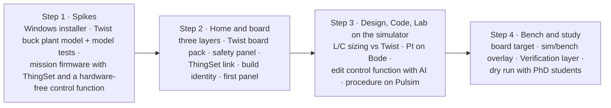

# Plan to the first student study

Four steps, done in order. Dates are a target, not a deadline: if a step takes longer, it takes longer (round 7). Luiz builds; PhD students, colleagues and Jean test.

## Step 1: spikes

1. **Installer.** A Theia IDE template app at the current Theia release, as a Windows installer bundling Python, Pulsim, a portable host compiler (ADR 0015) and PlatformIO packages for an offline first build (Q45). Done when it installs on a clean Windows machine and compiles a C-Block DLL.
2. **Plant model.** `twist_buck.pulsim` (33 µH, 33 µF, 200 kHz) with its own model test procedure in the style of Core2's model tests, compared once with the bench running the buck voltage-mode example (Q41).
3. **Mission firmware.** The buck voltage-mode example rewritten as the first mission's `main.cpp`: ThingSet instead of the serial menu (ADR 0019), control logic in a hardware-free function (ADR 0018), built in Luiz's fork of the examples (Q47).

## Step 2: Home and board

Home with Specification, Build and Verification layers on the five-block diagram; the Twist board pack (board description from the TWIST repo plus the Core devicetree, ADR 0017); the safety panel (envelope table, isolation switches, protection checklist); the ThingSet connection and data object table; build identity check and pre-built binary; one panel derived from modular.

## Step 3: Design, Code and Lab on the simulator target

Requirements of the mission; L and C sizing compared with the Twist's values; PI tuning on a Bode plot; editing the control function in Code with AI help; the step-test procedure running on the simulator target and filing a test record.

## Step 4: bench and study

The same procedure on the board target; the overlay of requirement, simulation and measurement; the Verification layer colouring; a dry run with PhD students before the student session.

## What the study measures (Q52)

- Completion and duration of each mission step, logged locally by the app with the participant's consent.
- The System Usability Scale questionnaire.
- Three open questions on the breadth and depth of the Design workbench.
- Think-aloud notes from one observer.
