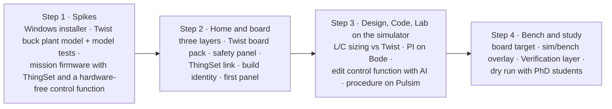

# Plan to the first student study

Four steps, done in order. Dates are a target, not a deadline: if a step takes longer, it takes longer (round 7). Luiz builds; PhD students, colleagues and Jean test.

## Step 1: spikes

1. **Installer.** A Theia IDE template app at the current Theia release, as a Windows installer bundling Python, Pulsim, a portable host compiler (ADR 0015) and PlatformIO packages for an offline first build (Q45). Done when it installs on a clean Windows machine and compiles a C-Block DLL.
2. **Plant model.** `twist_buck.pulsim` (33 µH, 33 µF, 200 kHz) with its own model test procedure in the style of Core2's model tests, compared once with the bench running the buck voltage-mode example (Q41).
3. **Mission firmware.** The buck voltage-mode example rewritten as the first mission's `main.cpp`: ThingSet instead of the serial menu (ADR 0019), control logic in a hardware-free function (ADR 0018), built in Luiz's fork of the examples (Q47).

## Step 2: Home and board

Home with Specification, Build and Verification layers on the five-block diagram; the Twist board pack (board description from the TWIST repo plus the Core devicetree, ADR 0017); the safety panel (envelope table, isolation switches, protection checklist); the ThingSet connection and data object table; build identity check and pre-built binary; one panel derived from modular.

## Step 3: Design, Code and Lab on the simulator target

Requirements of the mission; L and C sizing compared with the Twist's values; PI tuning on a Bode plot; editing the control function in Code with AI help; the step-test procedure running on the simulator target and filing a test record.

## Step 4: bench and study

The same procedure on the board target; the overlay of requirement, simulation and measurement; the Verification layer colouring; a dry run with PhD students before the student session.

## What the study measures (Q52)

- Completion and duration of each mission step, logged locally by the app with the participant's consent.
- The System Usability Scale questionnaire.
- Three open questions on the breadth and depth of the Design workbench.
- Think-aloud notes from one observer.

## Commit plan for step 1

Three rules apply to every commit:
- Each commit builds and its tests pass.
- Nothing is pushed. You review in the morning and push yourself.
- No commit flashes or powers hardware.

A commit that can't reach a green state isn't made; the problem goes into the morning report instead. Builds run in throwaway copies in the scratchpad, so your Core checkouts are never modified.

### Repository 1: `~/code/examples`, new branch `mission/buck-voltage-mode`

The branch starts from local `main`. It holds the mission in `TWIST/DC_DC/buck_voltage_mode/mission/`. Your fork, `luizvilla/examples`, is the remote to push to later (Q47). Each commit message is shown in bold.

| # | Commit message | What it holds | Done when |
|---|---|---|---|
| E1 | **mission: copy the buck voltage-mode example as the mission firmware** | `firmware/main.cpp`, `app.ini`, unchanged, as the baseline | Builds with PlatformIO against a throwaway Core copy |
| E2 | **mission: move the control law into a hardware-free control.cpp** | `control.cpp/.h` (PI, measurements in, duty out); `main.cpp` calls it; behaviour unchanged | Builds; `control.cpp` compiles on the PC with no OwnTech or Zephyr headers |
| E3 | **mission: L0 tests for the control law** | Tests on the PC: reference tracking, saturation at the bounds, reset | Tests pass with g++ |
| E4 | **mission: declare data objects in YAML and generate the C** | `data_objects.yaml`, the generator script, generated ThingSet declarations, generator tests | Generator tests pass; output matches Core4's `user_data_objects` style |
| E5 | **mission: replace the serial menu with ThingSet** | `app.conf` and `app.overlay` from Core4; the communication task removed | Builds against a throwaway copy of the Core4 ThingSet branch |
| E6 | **mission: Twist buck plant model with model tests** | `plant/twist_buck.pulsim` (33 µH, 33 µF, 200 kHz); `design/sizing.py` as the analytic reference; model tests (DC gain, ripple, LC resonance against the analytic values) | Model tests pass in Pulsim 2.0.0 |
| E7 | **mission: L1 step-response test of control.cpp in Pulsim** | `control.cpp` built as a C-Block, closed loop on the plant model; one test case with numeric criteria (overshoot, settling time); a test record | The L1 test runs and files a record. A failing verdict is fine if the record is correct |
| E8 | **mission: requirements and mission description** | `requirements.yaml` linked to the E7 test case; `mission.yaml` (steps, board pack, envelope with HIGH ≤ 60 V); README | Every requirement links to at least one test case |

### Repository 2: `~/code/Theia`, new branch `step-1/app-skeleton`

The app lives in `app/`. `npm install` and the first build are slow, so they start in the background early, while the mission commits proceed.

| # | Commit message | What it holds | Done when |
|---|---|---|---|
| T1 | **app: scaffold the OwnStudio Theia application** | Theia IDE template at the current release, pinned versions, `app/JOURNAL.md` of build quirks (modular's journal reused) | Builds and starts on Linux (Electron) |
| T2 | **app: OwnStudio branding and a quiet default layout** | Name, window title; generic IDE views hidden by default; expert-mode toggle stub | Starts on a blank window titled OwnStudio |
| T3 | **app: workbench bar Home · Design · Code · Lab** | Bottom bar, Ctrl+1…4, one placeholder view per workbench | Switching works; each workbench remembers its layout |
| T4 | **app: Home shows the five converter blocks** | Static five-block diagram read from the mission's `mission.yaml` | Opening the mission folder shows its blocks |
| T5 | **docs: step 1 morning report** | What works, what failed and why, what waits for Luiz; plan updated | Report written |

### Order through the night

E1 → E2 → E3 run first, because they prove the core idea (the control law runs off-board). T1's install starts in the background during them. Then E4 → E5 → E6 → E7 → E8, then T2 → T3 → T4, and T5 last. If one line of work blocks, the other continues.

### Deferred from step 1

- The Windows installer: there's no Windows machine here.
- Comparing the plant model with the bench: it needs the Twist powered.
- Any push to a remote.
