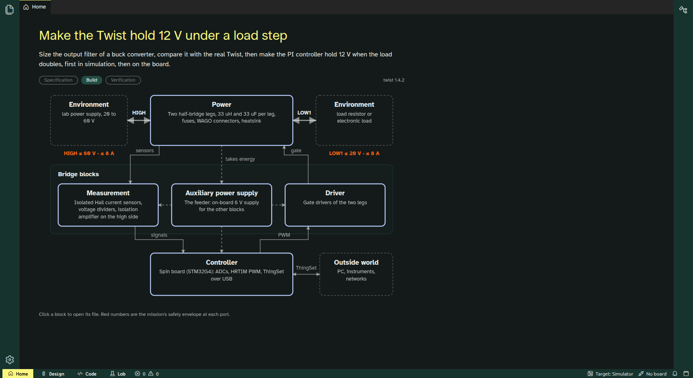
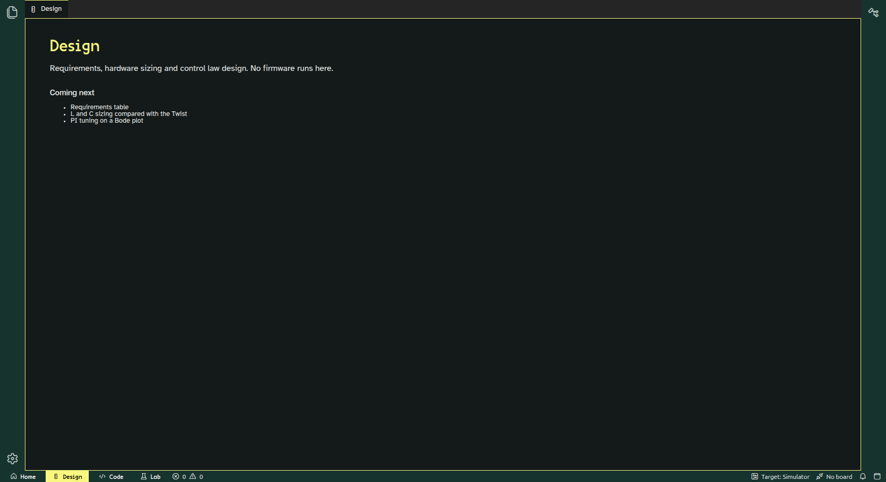
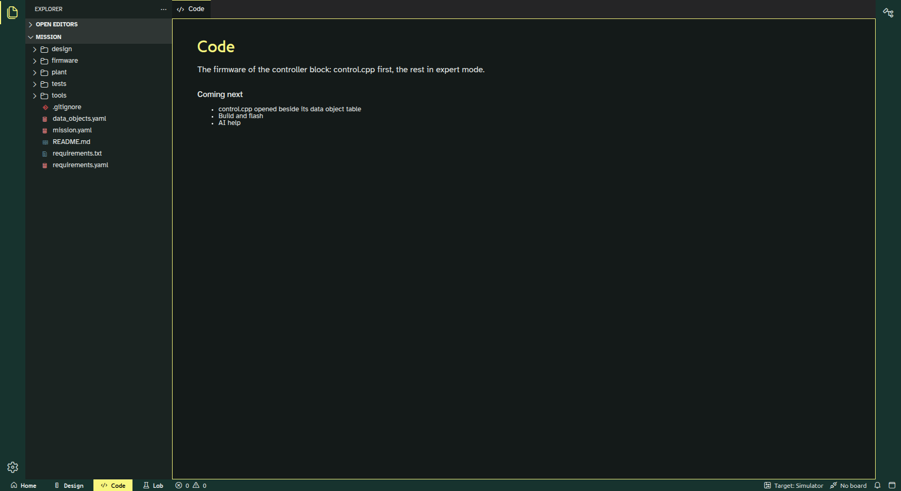

# Step 1 report (night of 2026-11-06 to 07)

All 13 planned commits are made, on two local branches, and nothing is pushed. Every commit builds and its tests pass. One test verdict fails, and it is meant to: it is the buck mission's first problem to solve (see "The L1 finding").



## What was committed

### `~/code/examples`, branch `mission/buck-voltage-mode` (from local `main`, `a64644c`)

| # | Commit | Checked by |
| --- | --- | --- |
| E1 | `fcdc652` Copy the buck voltage-mode example as the mission firmware | Builds against OwnTech Core `8111a0d`: flash 52 %, RAM 26 % |
| E2 | `2352464` Move the control law into a hardware-free `control.cpp` | Firmware builds; `control.cpp` compiles on the PC with the real `control_library` |
| E3 | `8968552` L0 tests for the control law | 6 test cases pass; expected values derived from the PI formula |
| E4 | `1f25022` Declare data objects in YAML and generate the C | 10 generator tests pass; firmware still builds |
| E5 | `5760f6e` Replace the serial menu with ThingSet | Builds against **unmodified** Core main (flash 79 %, RAM 41 %); data object names are in the binary |
| E6 | `56089a6` Twist buck plant model with model tests | 5 checks against the analytic buck pass, in 0.6 s |
| E7 | `85bbe94` L1 step-response test of `control.cpp` in Pulsim | Runs (12 s) and files a test record; verdict below |
| E8 | `ba18812` Requirements and mission description | 16 consistency tests pass; `tests/run_all.sh` runs every board-free check |

### `~/code/Theia`, branch `step-1/app-skeleton` (checked out at `/data/ownstudio/Theia`)

| # | Commit | Checked by |
| --- | --- | --- |
| T1 | `6c6c2dc` and `dfa3aeb` Scaffold the OwnStudio Theia application | Builds with no errors, starts, window titled "OwnStudio" |
| T2 | `c06ea6f` OwnStudio branding and a quiet default layout | Green chrome, Atkinson Hyperlegible as interface font, all three brand fonts loaded, no trust prompt |
| T3 | `86bc58f` Workbench bar Home · Design · Code · Lab | Switching 2, 4, 3, 1, 2 on a fresh profile: right workbench shown and marked every time |
| T4 | `e169de2` Home shows the five converter blocks | Title, five blocks and envelope read from `mission.yaml`; clicking Controller opens `control.cpp` |
| T5 | this report | |

The app was checked by driving it through Electron's remote-debugging port and taking screenshots. Nobody clicked through it by hand.

| Design workbench | Code workbench |
| --- | --- |
|  |  |

## The L1 finding

With the example's PI unchanged, the L1 load step (12 V, 1 A to 2 A, at 40 V input) gives:

| Case | Requirement | Measured | Criterion | Verdict |
| --- | --- | --- | --- | --- |
| BUCK-STEP-01a | REQ-VOUT | 11.99 V | 12 V ± 2 % | PASS |
| BUCK-STEP-01b | REQ-UNDERSHOOT | 11.11 V (−7.4 %) | ≥ 11.4 V (−5 %) | **FAIL** |
| BUCK-STEP-01c | REQ-SETTLING | 0.49 ms | ≤ 10 ms | PASS |
| BUCK-STEP-01d | REQ-RIPPLE | 24 mV | ≤ 100 mV | PASS |

The dip is the output filter's own response. The filter's characteristic impedance √(L/C) = √(33 µH / 33 µF) = 1 Ω, so a 1 A step gives about 1 V. The example's PI behaves like a pure integrator with τ = 1 / (Kp/Ti · V_in) ≈ 8.7 ms, which matches the "8.6 ms step response" comment in the original code. That is far too slow to damp a 4.8 kHz resonance. So with the stated requirements, the mission begins with a real failing test, and the student's task is to make it pass. Whether 5 % is the right requirement is your call.

A full example record is in [images/step-1/l1-record-example.md](images/step-1/l1-record-example.md). It shows "dirty" because it was run before its commit.

## Where I departed from the plan, and why

- **The plant is a Pulsim builder script, not a `.pulsim` file.** Core2's `.pulsim` files are PulsimGUI schematics (JSON with layout), which are fragile to write by hand. `plant/twist_buck.py` plus `plant/params.yaml` (each value with its source and confidence) is the source. A GUI view is listed as still to do.
- **The L1 test calls `control.cpp` through `ctypes` every 100 µs, not through Pulsim's C-Block API.** It is the same source compiled the same way. The plant is sampled at exact control ticks, and the duty is applied at the next PWM period. This avoids Core2's electrical stamping of the block outputs, which this mission doesn't need.
- **No `#include "control.cpp"` hack.** I first assumed Core's CMake compiles only `main.cpp`, as Core4's edit of `zephyr/CMakeLists.txt` suggested. In fact PlatformIO compiles every `.cpp` in `src/`. So Core4's change to Core's CMake list may be unnecessary.
- **The modular journal's ripgrep pin breaks Theia 1.76** and was removed (see `app/JOURNAL.md`).
- **The firmware's default reference is now 12 V** (the mission's REQ-VOUT). The example started at 15 V.
- **Any mode value other than "power" now turns the PWM off.** In the example, an unknown mode left the PWM in its last state. This matters once the mode can be written over ThingSet.

## Answers found along the way

- **Your Q43 point is confirmed.** ThingSet needs only app-level files (`app.conf`, `app.overlay`) plus the application code. The mission builds against unmodified OwnTech Core main.
- **The generated ThingSet code is guarded** by `CONFIG_THINGSET`, so a firmware builds with or without ThingSet enabled.
- **Theia 1.76 perspectives work for the workbenches**, with three traps recorded in `app/JOURNAL.md`:
  - views must take keyboard focus, or a switch lands one switch late;
  - the main area is shared across perspectives;
  - the Electron main process relaunches itself.

## Waiting for you

1. **Flash the mission firmware on a Twist** (`mission/tools/build_firmware.sh` against a throwaway Core copy, then upload). Check that the ThingSet shell answers on the second USB serial port and that `Control/Mode` and `Control/wVoltageRef_V` can be written. Nothing was run on hardware.
2. **Run the buck example on the bench once**, to compare the plant model with the board: output voltage at duty 0.3 and 0.5, ripple, load step. Until then the model only agrees with first principles.
3. **Confirm three plant parameters**, all marked low confidence in `params.yaml`:
   - which 33 µF capacitor in `PowerLeg.kicad_sch` is the LOW-side output capacitor;
   - the dead time configured by Core's HRTIM;
   - whether any ESR or inductor DCR should be modelled.
4. **Font licence texts** for Atkinson Hyperlegible, VG5000 and Ronzino go next to the fonts in `app/packages/ownstudio-core/branding/fonts/` before anything is public.
5. **The light theme** is registered but was never seen rendered, because the OS was in dark mode all night.
6. **Push when you're happy**:
   - `mission/buck-voltage-mode` to your fork `luizvilla/examples`;
   - `step-1/app-skeleton` to wherever the OwnStudio repository will live.
   Both are local only.
7. **Two upstream fixes** remain open from the specification:
   - the bootloader-script pull request from Core4;
   - Pulsim's GCC-only inline-compile flags.

## Still not done in step 1

- **The Windows installer.** No Windows machine was available. Python, Pulsim and the compiler are not yet bundled.
- **A PulsimGUI view of the plant.**
- **The `examples` repository ignores every dotfile** (`.*` in its root `.gitignore`), so the mission's own `.gitignore` can't be committed. Test outputs default to `mission/out/`, which therefore shows as untracked if the tests are run in place.

## How to run things

```sh
# Mission checks that need no board (C++20 compiler, Python with requirements.txt)
cd ~/code/examples/TWIST/DC_DC/buck_voltage_mode/mission
PYTHON=/data/ownstudio/build/venv-mission/bin/python tests/run_all.sh /tmp/mission-out

# The app (built on /data, where there is room)
cd /data/ownstudio/Theia/app/applications/electron
env -u ELECTRON_RUN_AS_NODE ../../node_modules/electron/dist/electron . ~/code/examples/TWIST/DC_DC/buck_voltage_mode/mission
```

Disk: everything for step 1 lives in `/data/ownstudio` (about 2.1 GB: app checkout with `node_modules`, npm and Electron caches, build copies, the mission's Python environment). In `/home`, besides the source changes, the runs left a 0.8 MB `control_library` clone in `~/.cache/ownstudio` and the app's 2.3 MB profile in `~/.config/ownstudio-electron` (from the runs made without a throwaway profile). Both can be deleted. The runs also rewrote `~/.theia/recentworkspace.json`, Theia's list of recent folders, which the May spike in the modular repository used too.
