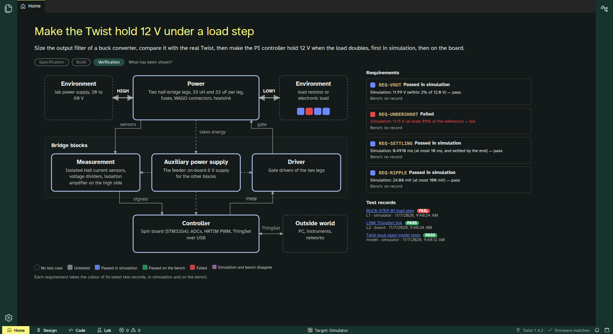
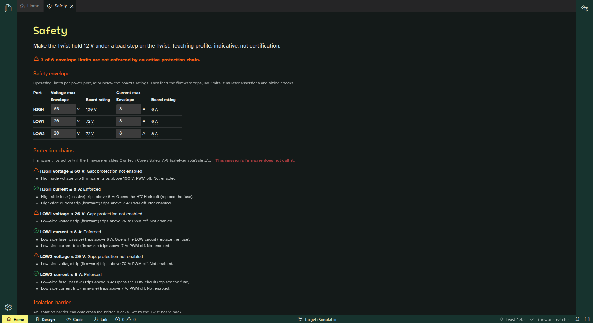
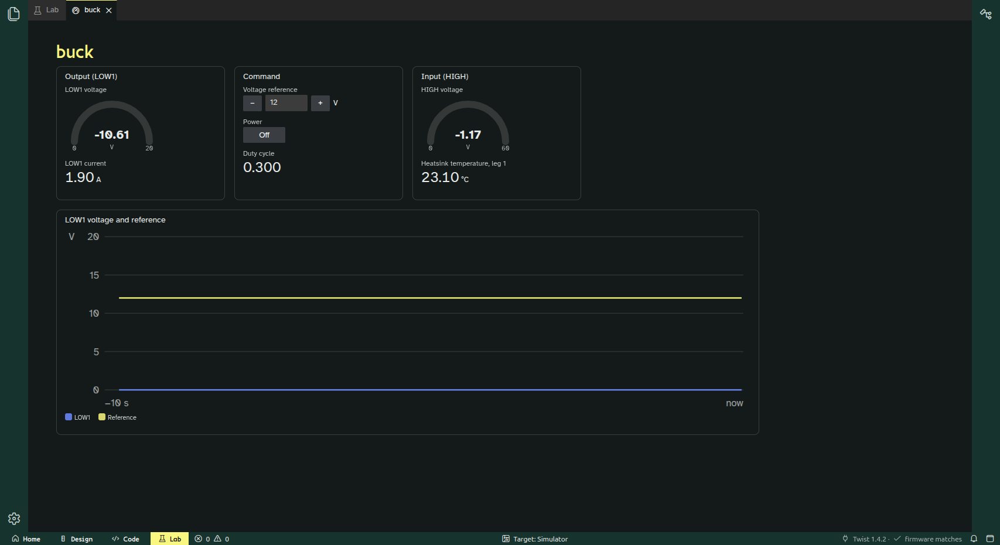
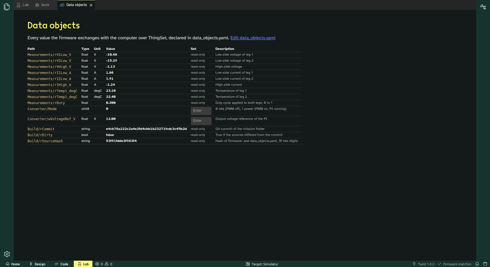

# Step 2 report (2026-11-07)

Step 2 is done on the same two local branches as before, plus a new app branch. Nothing is pushed. Every commit builds and its tests pass. Because you connected an unpowered Twist, the board link was tested on real hardware, not on a fake.

The commit-by-commit list, with the reason for each departure from the plan, is in [plan.md, "Commits as made"](plan.md#commits-as-made).

| Home, Verification layer | Safety panel |
| --- | --- |
|  |  |

| Buck panel, live from the Twist | Data object table |
| --- | --- |
|  |  |

## What works

- **Flashing.** `ownstudio_lab.flash` checks the image against its manifest, restarts the board in MCUboot, uploads with `mcumgr` and waits for the firmware. It worked from the bootloader, from the running firmware and from the app (status bar → confirm → flash).
- **Build identity.** The firmware reports its git commit, dirty flag and source hash in the ThingSet group `Build`. The status bar says "firmware matches" when the board runs the open mission's sources, and "firmware differs" otherwise. Clicking it then offers to flash the pre-built firmware.
- **L2 link test** (`tests/l2/run_l2_link.py`). 6 cases pass on the Twist, and the record is stamped with the board's serial number and identity.
- **Home's three layers.**
  - Specification: requirements per port, envelope in red.
  - Build: bridge-block isolation from the board pack, the linked board, ratings with their sources.
  - Verification: each requirement coloured from the latest records. With the step 1 L1 record, REQ-UNDERSHOOT is red and the others are blue.
- **Safety panel.** You edit the envelope there and it is written to `mission.yaml` with its comments kept. Values above the board rating are refused. The panel also shows the protection checklist and the isolation of each bridge block.
- **Panels and data objects.** A panel in modular's format is live from the board: gauges, numbers, setpoint, plot. The power toggle asks for confirmation. The data object table shows every object with its live value and writes the writable ones.

## Findings on the board

1. **The mission's `Control` group shadowed OwnTech Core's own `Control` group** (id 0x8000, the CAN reference and start/stop). Both appeared at the ThingSet root, and only the first could be reached by name. I renamed the mission's group to `Converter`, and the generator now refuses the names and ids that Core and the ThingSet SDK use. The L2 link test checks for duplicate root names.
2. **The mission firmware never enables Core's Safety API**, so no firmware trip is active. The safety panel shows 3 gaps: the voltage limits at HIGH (60 V), LOW1 and LOW2 (20 V) are watched only by firmware trips that are off. Even if they were on, Core's default thresholds (100 V and 70 V) are above the envelope. The currents are covered by the 8 A fuses. ADR 0009 says the envelope feeds the firmware trips, so the next step would be to generate the Safety API thresholds from the envelope. **That is your decision** (see below).
3. **`select thingset` is needed after every boot** before the shell takes ThingSet requests. The client sends it on every connect.
4. **Unpowered, the sensors read offsets:** V1 ≈ −10.5 V, V2 ≈ −15.3 V, I ≈ 1.9 A. That's expected with the converter unpowered, but it means none of the measured values says anything yet.
5. **The board's own test firmware was overwritten** by the first flash. It named itself `DUT_TWT_1_4_1`, which suggests the board is a 1.4.1. The mission builds for 1.4.2. In Core, the two revisions differ only in the version string and the USB name, so this is harmless. But the firmware reports the version it was built for, not the board's real revision.

## Answers found in the Twist sources (for the plant model and the board pack)

- **Dead time.** The datasheet gives 200 ns, set by 20 kΩ resistors on the gate driver. Core's HRTIM adds 100 ns (devicetree `default-dead-time`). The plant model uses 100 ns, but the effective value is probably the driver's 200 ns.
- **Low-side electrolytic.** The datasheet's mode table says Q5 switches it in for DC-DC modes. The plant model doesn't include it, and I couldn't tell from Core whether it is switched on (perhaps the NGND switch).
- **Fuses.** 8 A in the datasheet, "10A" in the schematic.
- **High-side rating.** 100 V in the datasheet's table and the README, 110 V in the datasheet's front-page text, 120 V absolute maximum.

All of these are recorded in `boardpacks/twist/board.yaml` with their sources, marked "check".

## Where I departed from the plan, and why

- **The identity reports a source hash, not the binary hash.** A binary can't contain its own hash. The binary's SHA-256 is in `bin/manifest.json` next to the source hash, which links the two.
- **One Python process owns the board.** Both the app and the procedures use `ownstudio_lab`, instead of a second serial implementation inside Electron. The app needs a Python with that package installed: set `OWNSTUDIO_PYTHON` or the `ownstudio.python` preference.
- **Plots are drawn in SVG,** not with uPlot. That avoids a dependency until a plot needs more than a rolling time series.
- **Envelope edits change one number in `mission.yaml`'s text,** so its comments survive. It only works with the flow style the missions use (`HIGH: {v_max_V: 60.0, i_max_A: 8.0}`). Any other layout is refused with a message.
- **Test records moved from `out/` to `records/<test>/`.** That is where Home reads them.
- **The isolation switches are read-only for the Twist,** because the board pack sets them. Editable switches matter only for boards you design yourself.

## Waiting for you

1. **Safety API in the mission firmware (decision).** Should the mission firmware enable Core's Safety API, with thresholds generated from the envelope (60 V HIGH, 20 V LOW, 8 A)? I recommend yes: that is ADR 0009. Then the safety panel shows no gaps, and an over-voltage turns the PWM off.
2. **Confirm the board-pack values marked "check":** the high-side rating, the fuses, the 33 µF capacitor, the dead time and the electrolytic. Then move `board.yaml` to the TWIST repository (ADR 0017).
3. **The board's revision.** Is your Twist a 1.4.1 or a 1.4.2?
4. **Power on the Twist** for the bench comparison and the L2 load-step test. These are still the only step 1–2 items that need power.
5. Everything in the step 1 list still stands: font licences, the light theme, pushing, the upstream fixes.
6. **Push when you're happy:**
   - `mission/buck-voltage-mode` (examples);
   - `step-1/app-skeleton` and `step-2/home-and-board` (Theia). Step 2 is built on step 1.

## Still not done

- **The Windows installer.**
- **Adding a data object from the table** (the spec's "adding a row adds a data object"). The table reads, shows and writes, but rows are still added in `data_objects.yaml`.
- **Procedures in the Lab** (step 3).

## How to run things

```sh
# Python for the board link and the tests (once)
/data/ownstudio/build/venv-mission/bin/pip install -e /data/ownstudio/Theia/app/python

# The app, with a board
export OWNSTUDIO_PYTHON=/data/ownstudio/build/venv-mission/bin/python
export OWNSTUDIO_MCUMGR=/path/to/Core/owntech/third_party/mcumgr   # downloaded by Core's first USB upload
cd /data/ownstudio/Theia/app/applications/electron
env -u ELECTRON_RUN_AS_NODE ../../node_modules/electron/dist/electron . ~/code/examples/TWIST/DC_DC/buck_voltage_mode/mission

# Tests
cd /data/ownstudio/Theia/app/packages/ownstudio-core && npm test                           # 23 TypeScript tests
cd /data/ownstudio/Theia/app/python/tests && $OWNSTUDIO_PYTHON -m unittest discover -s .  # 26 Python tests
cd ~/code/examples/TWIST/DC_DC/buck_voltage_mode/mission && tests/l2/run_l2_link.py       # on the board
```

Most test runs used a throwaway profile and `THEIA_CONFIG_DIR=/data/ownstudio/build/theia-config`. Three early runs didn't, so they used the app profile in `~/.config/ownstudio-electron` again and rewrote `~/.theia/recentworkspace.json` (both already listed in the step 1 report as safe to delete).
