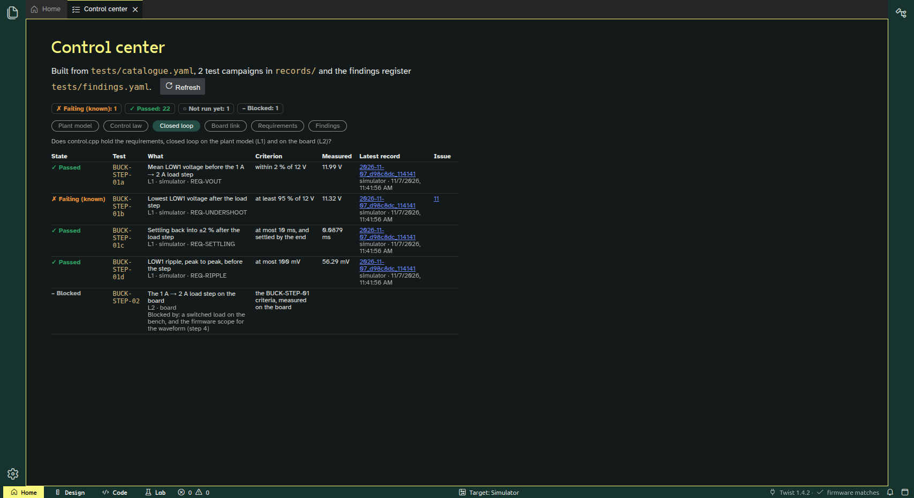
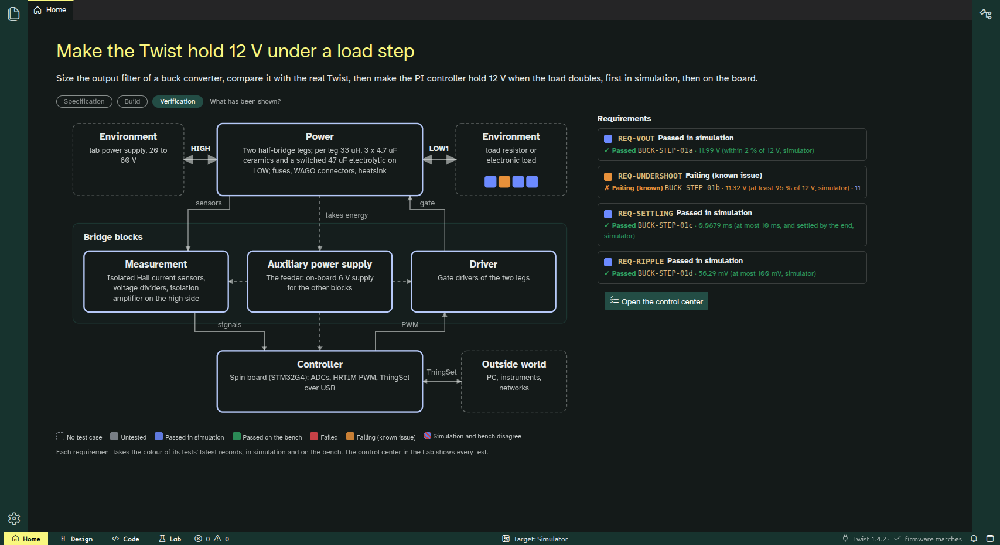
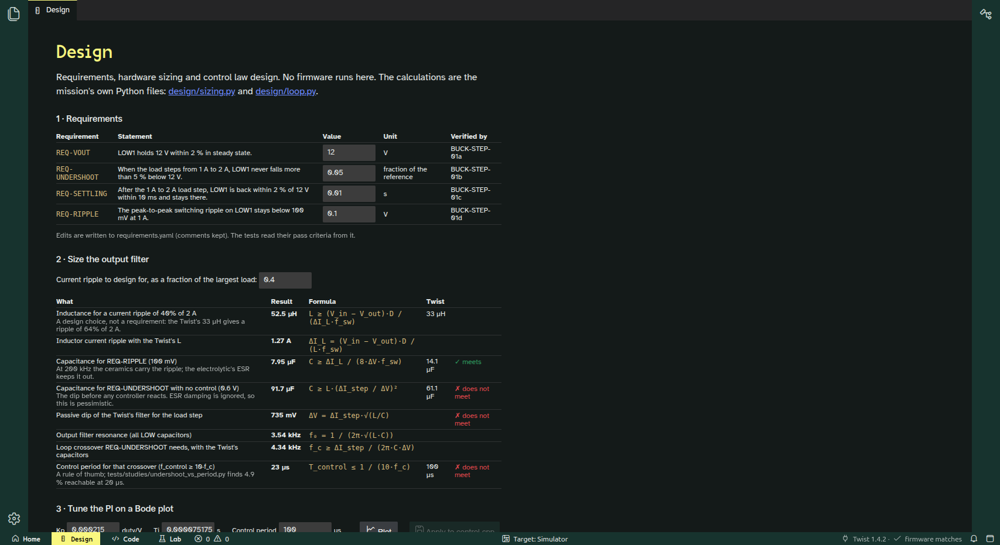
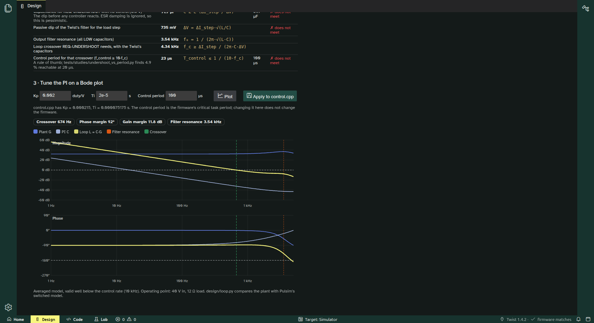
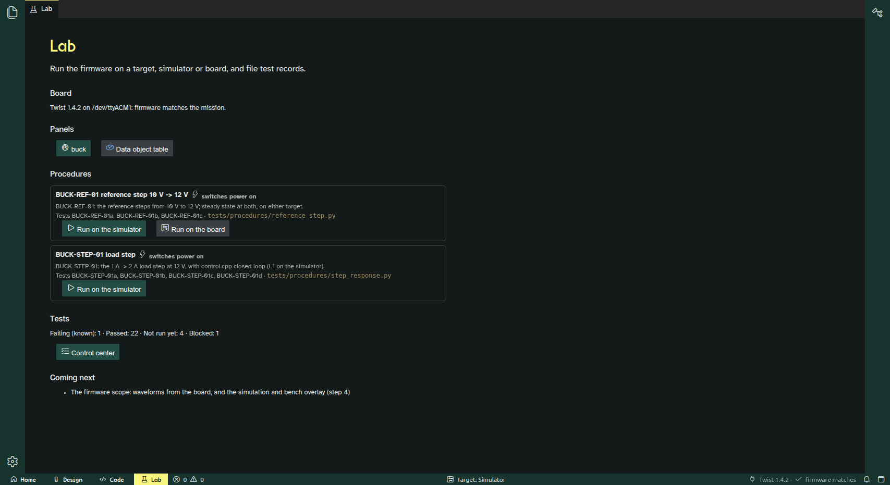
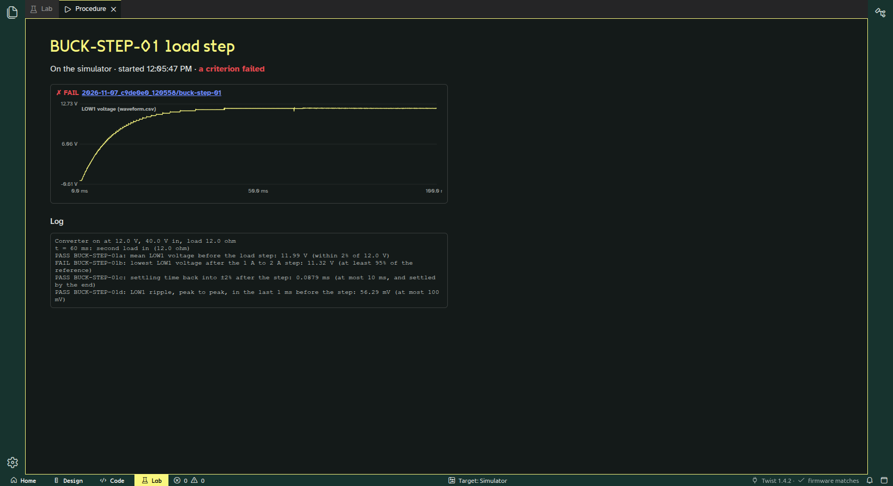

# Step 3 report (2026-11-07)

Step 3 is done on the simulator target, and pushed: `step-3/design-code-lab` on `luizvilla/Theia`, `mission/buck-voltage-mode` on `luizvilla/examples`. Every commit builds and its tests pass. The commit-by-commit list is in [plan.md, "Commits as made (step 3)"](plan.md#commits-as-made-step-3).

Two things wait for you. The bench session (BENCH-MOD-01, BUCK-REF-01 on the board) needs you at the bench. And **the buck mission's undershoot requirement cannot be met by a PI at the firmware's control rate** ([#11](https://github.com/luizvilla/Theia/issues/11)): you must decide what the mission asks of students.

| Control center | Home, Verification layer |
| --- | --- |
|  |  |

| Design: sizing | Design: the PI on a Bode plot |
| --- | --- |
|  |  |

| Lab: procedures | A procedure run on the simulator |
| --- | --- |
|  |  |

## What works

- **Tests are registered as in Core2.**
  - The mission's `tests/catalogue.yaml` declares every test once. There are 28 now: model, L0, L1, L2 link, bench and the blocked board load step.
  - Each run files its records in a new campaign folder (`records/<date>_<commit>_<time>/`).
  - `tests/findings.yaml` links failures to GitHub issues.
  - The control center shows Core2's eight states, with an icon and a word as well as a colour:
    - in the Lab;
    - in Home's Verification layer;
    - as `records/control-center.html` for people without the app.
  - Today: 24 passed, 1 failing (known, #11), 1 information only, 1 not run (the bench check), 1 blocked.
- **Design.** Three sections, all computed by the mission's own Python, which students can read:
  - **Requirements:** each value is editable, and comments survive in `requirements.yaml`.
  - **Sizing:** `design/sizing.py` gives L and C from the requirements, each with its formula, the Twist's value and whether it meets the requirement.
  - **PI on a Bode plot:** plant, PI and loop gain, with crossover, margins and the filter resonance.
    - "Apply to control.cpp" changes only the two gain constants.
    - The plant formula agrees with Pulsim's switched model within 0.1 dB and 13° up to 10 kHz.
    - Its stability prediction matched the simulator for every gain set I tried.
- **Procedures on both targets.** A procedure is a Python file that talks to a *target*: the same data object names on the board (ThingSet) and in the simulator.
  - The simulator target is `tests/sim_harness.py`: `main.cpp`'s part around the unchanged `control.cpp`, with simulated time.
  - BUCK-STEP-01 (the load step) moved there and gives the same verdicts as step 1's runner.
  - BUCK-REF-01 (a 10 V → 12 V reference step) runs unchanged on the simulator and on the board.
  - The Lab lists the procedures, runs them, and shows:
    - the log;
    - the operator's questions;
    - each record with its waveform.
- **Safety on the board.**
  - A procedure that switches the converter on asks each time (ADR 0010).
  - The runner refuses without `--allow-power`, and the target refuses the power-on write.
  - It always switches off at the end.
  - The app hands the board's port to the procedure while it runs.
  - I opened that dialog and cancelled it. Nothing was switched on by any automated step.
- **The AI agent.** Theia AI is in, with Anthropic, OpenAI-compatible and Ollama providers (ADR 0023), off until enabled in the settings.
  - **Tools:** the OwnStudio agent can read the mission, read the test states, compute loop margins, run a procedure on the simulator, and propose a new `control.cpp` as a change set the student reviews.
  - **No board tools:** nothing that flashes, powers, or edits the envelope, the requirements or the tests.
  - **Not tested with a real model.** It appears in the chat, and its tools have unit tests, but without a key no conversation was run.

## Findings

1. **The model's output capacitor was on the wrong side.** The 33 µF electrolytics are on the Twist's HIGH side.
   - LOW has 3 × 4.7 µF ceramics plus the 47 µF electrolytic you mentioned: EEE-FN2A470UL, ESR 0.70 Ω, switched by Q203.
   - The plant model now has both. The firmware calls `connectCapacitor(ALL)`, as the datasheet's mode table asks for buck mode. The firmware is rebuilt and flashed, and the L2 link passes.
   - The ceramics' DC-bias derating is not modelled.
2. **REQ-UNDERSHOOT (5 %) is out of reach of a PI at 100 µs** ([#11](https://github.com/luizvilla/Theia/issues/11)).
   - **Why:** the filter's own dip is ΔI·√(L/C) ≈ 0.73 V (6.1 %). It bottoms out about 70 µs after the step, before the controller's next sample.
   - **What I measured:** every stable PI gives 11.32–11.33 V (−5.6 %), and faster ones go unstable, as the Bode plot predicts.
   - **What would work:** at a 20 µs control period, 4.9 % is reachable. Design's sizing reaches the same conclusion: the requirement needs a crossover of about 4.3 kHz, so a control period near 23 µs.
3. **Leg 2's voltage sensor reads about 3.6 V low,** and the current sensors read about 0.3 A at zero (seen on the 30 V run). The mission's loop uses only V1. BENCH-MOD-01 will measure this properly against your meter, and it should become an issue then.
4. **A step 2 bug, fixed:** Home and Lab were empty after switching to another workbench and back. They were singletons, and the switch disposes them.

## Decisions for you

1. **#11, the undershoot requirement.** Options:
   - keep 5 % and make the faster control task part of the mission (sampling against filter dynamics is a good lesson; the critical task and ADC at 20 µs need checking on the Twist);
   - relax to 6 %;
   - halve the load step.

   **I'd keep 5 % and add the control period as the lever,** because it turns the failure into the mission's lesson, but it needs a check on the board first.
2. **The test tooling lives in `ownstudio_lab`** (OwnStudio's repository), and the mission installs it from GitHub (`requirements.txt`). The alternative is a copy in every mission, or a separate `owntest` package on PyPI later.
3. **AI is off by default.** A student enables it in the settings and gives a key or a local model, as ADR 0023 says.

## Waiting for you

1. **A bench session, about 20 minutes, with a multimeter.** Same setup as today: 30 V limited to 1 A, 33 Ω on each leg.
   - BENCH-MOD-01: the operator procedure in `tests/bench/`.
   - BUCK-REF-01 on the board, from the Lab.
2. **An AI key or a local model,** to try the agent for real.
3. **Everything still open from steps 1 and 2:** issues #1–#10.

## Where I departed from the plan, and why

- **E13 became three commits.** Your capacitor remark led to the schematic, which changed the plant model, which had to come before the feasibility check. So the order was: catalogue, then capacitors with the study, then the firmware rebuild.
- **`run_l1.py` is gone.** The procedure replaces it, so there is one way to run a test from the command line and from the app.
- **A catalogue test may list several levels** (`[L1, L2]`), because one procedure runs on both targets (ADR 0003's target switch).
- **The Bode plot uses an averaged model with the hold and the delay,** not an exact discrete-time one. It is valid well below the 10 kHz control rate, and the Pulsim check covers up to 10 kHz.

## How to run things

```sh
# Mission: every board-free check, a new campaign, then records/control-center.html
cd ~/code/examples/TWIST/DC_DC/buck_voltage_mode/mission
PYTHON=/data/ownstudio/build/venv-mission/bin/python tests/run_all.sh

# One procedure on a target (the board needs you there)
python -m ownstudio_lab.procedure . tests/procedures/step_response.py --target simulator
python -m ownstudio_lab.procedure . tests/procedures/reference_step.py --target board --allow-power
python tests/bench/bench_mod_01.py --board 58435001004B001E

# Design from the command line
python design/sizing.py
python design/loop.py --kp 0.002 --ti 2e-5

# App tests
cd /data/ownstudio/Theia/app/python/tests && $PYTHON -m unittest discover -s .          # 50 tests
cd /data/ownstudio/Theia/app/packages/ownstudio-core && npm test                        # 35 tests
```

Every app run in this step used a throwaway profile and `THEIA_CONFIG_DIR` under `/data`; nothing was written to your home folder's app profile.
