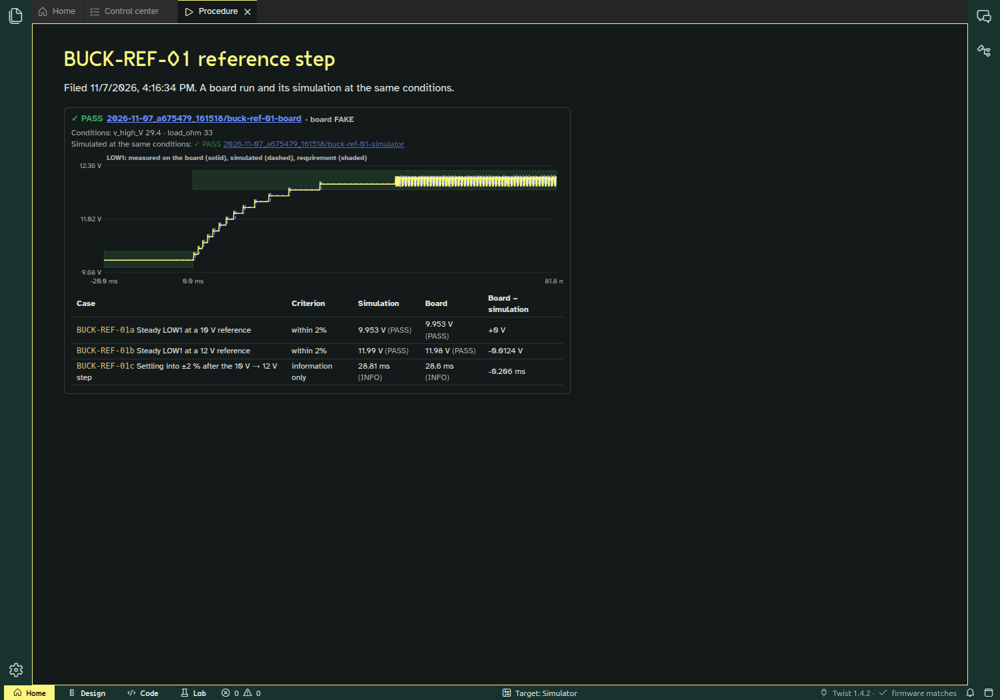
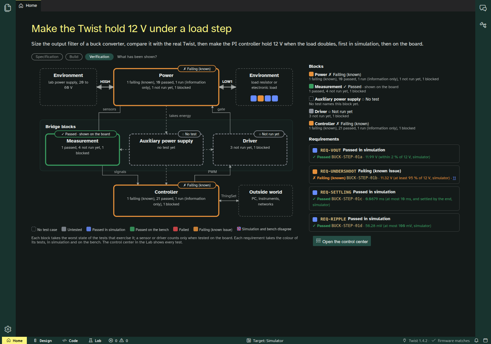
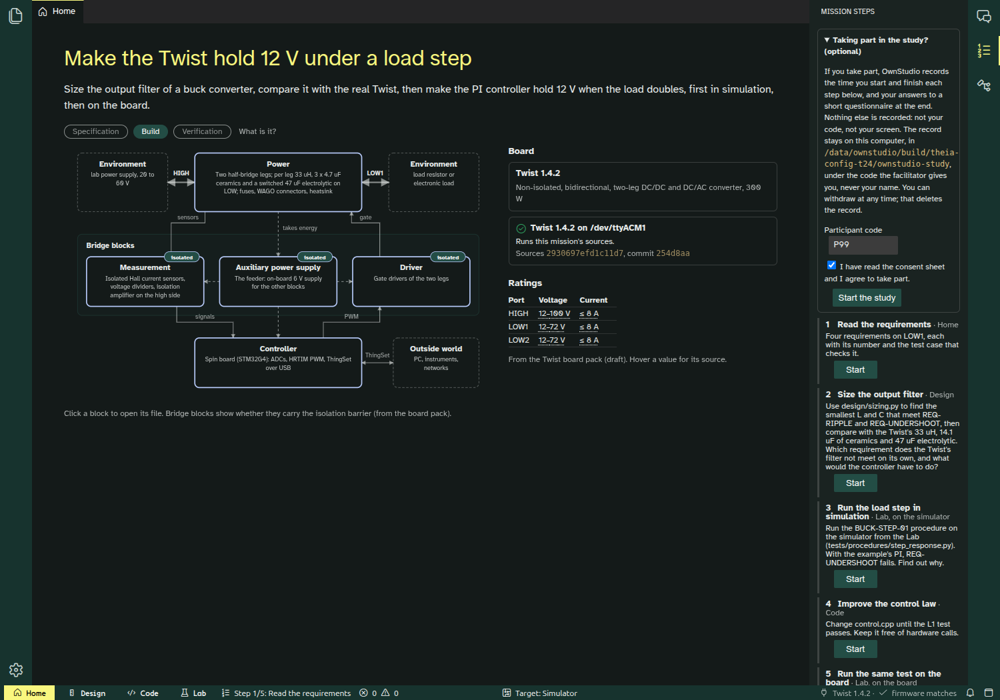
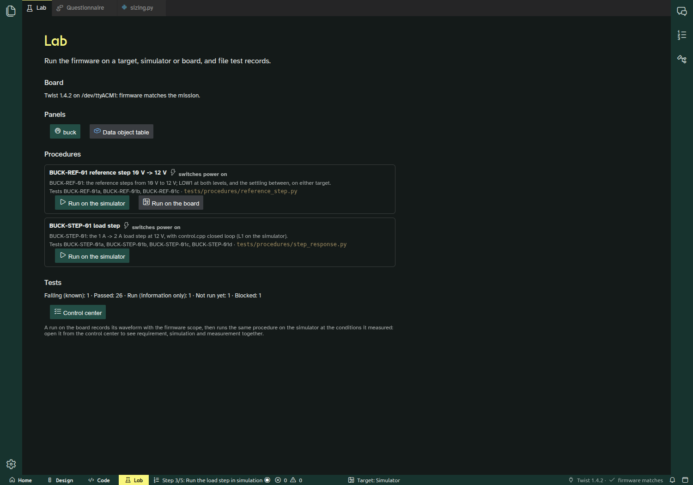

# Step 4 report (2026-11-07)

Step 4 is done as far as it can be without you, and pushed: `step-4/bench-and-study` on `luizvilla/Theia`, `mission/buck-voltage-mode` on `luizvilla/examples`. Every commit builds and its tests pass. The commit-by-commit list is in [plan.md, "Commits as made (step 4)"](plan.md#commits-as-made-step-4).

**Nothing switched the converter on in step 4.** The Twist was flashed twice and read while idle (Mode 0 throughout). Every board procedure that switches power was tested against a fake board.

Four things wait for you, in the "Waiting for you" list below. The most useful is **one bench session of about 30 minutes**: it would turn the board half of step 4 from "tested on a fake" into real evidence.

| A board run next to its simulation (fake board, labelled FAKE) | Home, Verification layer: the blocks |
| --- | --- |
|  |  |

| Mission steps and the study's consent | The questionnaire |
| --- | --- |
|  |  |

## What works

- **Waveforms from the board.**
  - **Firmware:** the mission firmware has a scope, OwnTech's ScopeMimicry, with five channels: LOW1 voltage and current, HIGH voltage, duty and reference. It records 1024 samples at the 100 µs control period, a 102 ms window with 20 ms before the trigger.
  - **Trigger:** it is armed through a new `Scope` data object group, and triggers on the next write to `Converter`.
  - **Reading:** the computer reads it over ThingSet, 64 values at a time, in about 3.5 s.
  - **On the real Twist,** idle, triggered by a reference write: LINK-07a/b pass. The trigger lands exactly at the stated sample, and the capture agrees with the live HIGH voltage (29.4 V).
- **The same procedure on both targets, now with waveforms.**
  - `target.arm()` then `target.capture()` work the same on the board and in the simulator.
  - BUCK-REF-01c (the settling after the 10 V → 12 V step) is no longer blocked on the board.
- **A board run brings its simulation.**
  - After any board run, the runner reruns the procedure on the simulator at the conditions the board run recorded: HIGH voltage as measured, load as stated by the operator. Both records go into the same campaign, linked.
  - The Lab draws them together: measurement (solid), simulation (dashed), and each requirement's band over the part of the waveform it judges, with a table of each case on both targets.
  - The control center opens any recorded run this way ("board and simulation").
- **The Verification layer colours the blocks.**
  - Each block of the converter takes the worst state of the tests that exercise it, says where its passes come from, and counts its tests by state.
  - A test can exercise a block only on the board (`board_blocks`): the simulator's sensors and gate drivers are ideal, so a simulation pass says nothing about them.
  - **Today:**
    - Power and Controller: failing (known, #11).
    - Measurement: passed, shown on the board (LINK-07b).
    - Driver: not run yet.
    - Auxiliary supply: no test.
- **Mission steps and the study log.**
  - A Mission steps panel lists `mission.yaml`'s steps. Start opens the step's workbench and file, and Done marks it. The status bar always names the current step.
  - **The study:** after consent under a participant code, and only then, each step's start and end go to a local file outside the mission folder. At the end come the System Usability Scale and three open questions on Design. Export writes the step times as CSV, and Withdraw deletes the log.
  - Walked through in the app as participant P99.
- **A dry-run kit** in [docs/study/](study/dry-run-kit.md):
  - protocol;
  - a facilitator script to read as written;
  - bench safety for step 5;
  - observer sheet and debrief;
  - what the dry run decides;
  - a consent sheet (draft).
- **Test totals:**
  - the mission's catalogue has 30 tests: 26 pass, 1 known (#11), 1 information only, 1 not run (the bench check), 1 blocked (the board load step);
  - unit tests: Python 60, TypeScript 48, mission 58.

## Findings

1. **A board run's simulation hid the board's result.**
   - **The bug:** a test's state came from its newest record, and the twin simulation is always filed seconds after the board run. A board failure would have shown as a pass, and a requirement could never reach "passed on the bench".
   - **The fix:** each test now keeps one state per target and shows the worst. Found by reasoning about T22, before any board run.
2. **The simulator's result depended on how often a procedure read it.**
   - **The bug:** the harness found the PWM period with `t // period`, and a resumed segment's times can land a hair below a period start. The same run ended 0.23 V apart at 100 ms depending on segmentation.
   - **The fix:** edges are now placed by step index, and every segmentation gives the identical result.
   - **Rechecked:** BUCK-STEP-01 (11.32 V) and the #11 study (5.67 % at 100 µs, 4.92 % at 20 µs) are unchanged. [#11](https://github.com/luizvilla/Theia/issues/11#issuecomment-6708805099) has a note.
3. **The plant model's duty moves in 0.5 % steps** ([#12](https://github.com/luizvilla/Theia/issues/12)).
   - **The cause:** at a 25 ns simulation step, a PWM edge can only land on a step, so the duty moves in 0.5 % quanta.
   - **What it does:** in closed loop, LOW1 climbs in steps of one quantum (0.15 V at 30 V) about 1 ms apart, and the steady state limit-cycles. It's visible in the overlay screenshot, in both traces.
   - **Tried and rejected:** carrying the rounding forward (sigma-delta) makes the mean exact, but adds about 30 mV of ripple, close to REQ-RIPPLE.
   - **The real fix belongs to Pulsim:** a switch function that declares its next edge.
4. **Workbench switches can land one switch late** ([#13](https://github.com/luizvilla/Theia/issues/13)).
   - **When:** with a fresh profile, from the second switch on, the main area and the bar are one click behind.
   - **Since when:** it is already at 47594db (before step 4's UI), so it predates the steps panel. It comes from Theia 1.76's perspective switch awaiting side panel animations.
   - **What it cost:** it is why the Mission steps panel opens on demand instead of staying open.
   - **For the study:** it needs fixing before the dry run.

## Decisions for you

1. **#11, still open.** Nothing in step 4 changes the options. The dry-run kit assumes the mission is solvable as written; if you keep 5 %, the control period must become part of step 4 of the mission.
2. **#12, the duty quantization:** fix in Pulsim (exact edges), halve the step (2× slower), or keep it and show it to students as a model limitation.
3. **The three open questions** in the questionnaire are my drafts (`common/study.ts`).
4. **The consent sheet** probably needs the DPO for the student session, and a French version.

## Waiting for you

1. **A bench session, about 30 minutes.** Same setup as step 3: 30 V limited to 1 A, 33 Ω on each leg, a multimeter. In order:
   1. `python tests/l2/run_l2_link.py --board 58435001004B001E`: the board runs the scope firmware (LINK-01 to LINK-07b), converter idle.
   2. BENCH-MOD-01: `python tests/bench/bench_mod_01.py --board 58435001004B001E` (asks for the meter readings).
   3. BUCK-REF-01 on the board, **from the Lab** ("Run on the board"). It asks for confirmation and the load (33), records the scope waveform, then runs its simulation. Open it from the control center ("board and simulation") to see the first real overlay.
   4. Supply off.

   Expected surprises, worth seeing on the real board first:
   - LOW2 reads about 3.6 V low;
   - the current sensors read about 0.3 A at zero.
2. **Decisions** 1 to 4 above, and #13 fixed, before the dry run.
3. **The dry run** itself: 3 to 5 PhD students, [the kit](study/dry-run-kit.md).
4. **An AI key or a local model** (from step 3): the agent is still untested with a real model.

## Where I departed from the plan, and why

- **T21 came before E19.** The procedure needed the record's conditions and the twin run to exist first.
- **E19 became three mission commits:** the procedure (E19), the cases' windows for the bands (E19b), and the harness's PWM edges (E19c). E19c fixes finding 2, which the fake board revealed.
- **Not planned:** the per-target test states (in T23, finding 1); `board_blocks`; the status bar step.
- **The Mission steps panel opens on demand.** The plan said Home would list the steps. A side panel follows the student through every workbench, but it cannot stay open (finding 4), so the status bar names the step instead.
- **The overlay screenshot uses a fake board,** labelled FAKE, in a copy of the mission. No fake record is in the real mission's campaigns.

## How to run things

```sh
# Mission: board-free checks (about 4 min with the fake-board test), then the control center
cd ~/code/examples/TWIST/DC_DC/buck_voltage_mode/mission
PYTHON=/data/ownstudio/build/venv-mission/bin/python tests/run_all.sh

# A board run with its simulation (the bench needs you)
python -m ownstudio_lab.procedure . tests/procedures/reference_step.py --target board --allow-power --twin

# App tests
cd /data/ownstudio/Theia/app/python/tests && $PYTHON -m unittest discover -s .         # 60 tests
cd /data/ownstudio/Theia/app/packages/ownstudio-core && npm test                       # 48 tests
```

Every app run used a throwaway profile and `THEIA_CONFIG_DIR` under `/data`; the study logs of the walk-through are in `/data/ownstudio/build/theia-config-t24/`, nothing in your home folder.
